# Human Gradient Descent (HGD) Master Roadmap

> **Status**: Active Architecture & Implementation  
> **Standard**: October 2026 Coding Agent Skill Specification  
> **Scale Target**: Encyclopedic & Dictionary Scale (10,000 to 500,000+ Nodes)

This roadmap outlines the phased execution lifecycle for the **Human Gradient Descent** agent skill, engine, and schema compiler. Each phase has a dedicated numbered specification document located in [`phases/`](./phases/).

---

## 🗺️ Master Phase Architecture (Clusters 001 - 100+)

```mermaid
flowchart LR
    C1["Cluster 1: 001-010\nCore Foundations & Sharding"] --> C2["Cluster 2: 011-020\nCorpus Ingestion & Deconstruction"]
    C2 --> C3["Cluster 3: 021-030\nForward Pass Synthesis"]
    C3 --> C4["Cluster 4: 031-040\n5-Axis Diagnostic Loss"]
    C4 --> C5["Cluster 5: 041-050\nBackward Pass Scaffolding"]
    C5 --> C6["Cluster 6: 051-060\nCognitive State & Decay"]
    C6 --> C7["Cluster 7: 061-070\nAgent Skill Packaging"]
    C7 --> C8["Cluster 8: 071-080\nInteractive CLI & TUI"]
    C8 --> C9["Cluster 9: 081-090\nAdversarial Benchmarks"]
    C9 --> C10["Cluster 10: 091-100+\nMulti-Agent Ecosystem"]
```

---

## 📌 Phase Directory & Execution Status

### Cluster 1: Foundations, Partitioning & Core Schemas (001–010)
| Phase ID | Specification File | Title & Core Focus | Status |
|:---|:---|:---|:---|
| **001** | [`phases/001_core_mathematical_pedagogy.md`](./phases/001_core_mathematical_pedagogy.md) | Core Mathematical Pedagogy & Cognitive Invariants | ✅ Completed |
| **002** | [`phases/002_encyclopedic_scale_sharding.md`](./phases/002_encyclopedic_scale_sharding.md) | Encyclopedic-Scale Sharding Architecture | ✅ Completed |
| **003** | [`phases/003_json_schema_formalization.md`](./phases/003_json_schema_formalization.md) | JSON Schema Formalization & AJV Validator | ✅ Completed |
| **004** | [`phases/004_forward_pass_probe_synthesis.md`](./phases/004_forward_pass_probe_synthesis.md) | Forward-Pass Probe Synthesizer | ✅ Completed |
| **005** | [`phases/005_diagnostic_loss_function.md`](./phases/005_diagnostic_loss_function.md) | 5-Axis Diagnostic Loss Function Engine | ✅ Completed |
| **006** | [`phases/006_backward_pass_hint_ladder.md`](./phases/006_backward_pass_hint_ladder.md) | Backward-Pass Progressive Hint Ladder & Remediation | ✅ Completed |
| **007** | [`phases/007_state_and_weight_convergence.md`](./phases/007_state_and_weight_convergence.md) | State Vector & Weight Convergence Optimizer | ✅ Completed |
| **008** | [`phases/008_markdown_corpus_compiler.md`](./phases/008_markdown_corpus_compiler.md) | Markdown Corpus Deconstruction & Shard Compiler | ✅ Completed |
| **009** | [`phases/009_agent_cli_and_interactive_runner.md`](./phases/009_agent_cli_and_interactive_runner.md) | Agent CLI & Interactive Learning Runner | ✅ Completed |
| **010** | [`phases/010_eval_benchmarks_and_adversarial.md`](./phases/010_eval_benchmarks_and_adversarial.md) | Evaluation Benchmarks & Adversarial Stress Testing | ✅ Completed |

---

### Cluster 2: Encyclopedic Ingestion, Pacing & UI Contracts (011–020)
| Phase ID | Specification File | Title & Core Focus | Status |
|:---|:---|:---|:---|
| **011** | [`phases/011_time_bounded_pacing_and_checkpoints.md`](./phases/011_time_bounded_pacing_and_checkpoints.md) | Time-Bounded Pacing, Epoch Acceleration & Checkpoints | ✅ Completed |
| **012** | [`phases/012_ui_json_contract_and_event_stream.md`](./phases/012_ui_json_contract_and_event_stream.md) | Headless UI JSON Contract & Pacing Telemetry | ✅ Completed |
| **013** | [`phases/013_domain_agnostic_compositional_invariants.md`](./phases/013_domain_agnostic_compositional_invariants.md) | Domain-Agnostic Compositional Invariants | ✅ Completed |
| **014** | [`phases/014_bianshi_variation_and_adversarial_probes.md`](./phases/014_bianshi_variation_and_adversarial_probes.md) | Bianshi Variation Engine & Adversarial Probes | ✅ Completed |
| **015** | [`phases/015_anti_fatigue_governor_and_gradient_analytics.md`](./phases/015_anti_fatigue_governor_and_gradient_analytics.md) | Anti-Fatigue Safety Governor & Gradient Analytics | ✅ Completed |
| **016** | [`phases/016_agent_skill_packaging_and_ui_showcase.md`](./phases/016_agent_skill_packaging_and_ui_showcase.md) | Universal Agent Skill Packaging & Headless UI Showcase | ✅ Completed |
| **017** | [`phases/017_deep_causal_synthesis_and_ast_chunker.md`](./phases/017_deep_causal_synthesis_and_ast_chunker.md) | Deep Causal Synthesis & AST Chunker | ✅ Completed |
| **018** | [`phases/018_branching_dag_dependency_resolver.md`](./phases/018_branching_dag_dependency_resolver.md) | Branching DAG Dependency Resolver | ✅ Completed |
| **019** | [`phases/019_agent_synthesis_prompt_protocol.md`](./phases/019_agent_synthesis_prompt_protocol.md) | Agent Synthesis Prompt Protocol | ✅ Completed |
| **020** | [`phases/020_automated_tarjan_scc_cycle_resolver.md`](./phases/020_automated_tarjan_scc_cycle_resolver.md) | Automated Tarjan SCC Cycle Resolver & DAG Integrity | ✅ Completed |

---

### Cluster 3: Forward Pass Probe Generation & Prompt Engineering (021–030)
| Phase ID | Specification File | Title & Core Focus | Status |
|:---|:---|:---|:---|
| **021** | [`phases/021_mental_tracing_execution_probes.md`](./phases/021_mental_tracing_execution_probes.md) | Codebase AST Execution Prediction Probes (Mental Tracing) | ✅ Completed |
| **022** | [`phases/022_anti_owl_grounding_and_scratch_synthesizer.md`](./phases/022_anti_owl_grounding_and_scratch_synthesizer.md) | Cold-Start Anti-Owl Grounding & Scratch Topic Synthesizer | ✅ Completed |
| **023** | [`phases/023_diagnostic_multiple_choice_hypotheses.md`](./phases/023_diagnostic_multiple_choice_hypotheses.md) | Diagnostic Multiple-Choice Hypotheses with Causal Rationales | ✅ Completed |
| **024** | [`phases/024_uila_5_block_learning_architecture.md`](./phases/024_uila_5_block_learning_architecture.md) | Universal Invariant Learning Architecture (UILA 5-Block Framework) | ✅ Completed |
| **025** | [`phases/025_github_style_mastery_heatmap.md`](./phases/025_github_style_mastery_heatmap.md) | Learner Effort & Cognitive Convergence Heatmap (GitHub-Style Grid) | ✅ Completed |
| **026** | [`phases/026_curriculum_expansion_subway_and_spiral.md`](./phases/026_curriculum_expansion_subway_and_spiral.md) | Multi-Dimensional Curriculum Expansion (Depth Spiral & Subway Map) | ✅ Completed |
| **027** | [`phases/027_progressive_uila_stepper_and_focus_mode.md`](./phases/027_progressive_uila_stepper_and_focus_mode.md) | Progressive UILA Stepper & Mobile Viewport Focus Mode | ✅ Completed |
| **028** | [`phases/028_dual_phase_cognitive_pacing.md`](./phases/028_dual_phase_cognitive_pacing.md) | Dual-Phase Cognitive Pacing (Untimed Grounding vs Timed Testing) | ✅ Completed |
| **029** | [`phases/029_interactive_subway_map_navigation.md`](./phases/029_interactive_subway_map_navigation.md) | Interactive Knowledge Subway Map & Cross-Domain Modals | ✅ Completed |
| **030** | [`phases/030_causal_closure_and_zero_orphan_probes.md`](./phases/030_causal_closure_and_zero_orphan_probes.md) | Causal Closure & Zero Orphan Entities in Probes | ✅ Completed |

---

### Cluster 4: Multi-Tier Curriculum Evaluation & Autonomous Auditing (031–040)
| Phase ID | Specification File | Title & Core Focus | Status |
|:---|:---|:---|:---|
| **031** | [`phases/031_deterministic_ast_curriculum_linter.md`](./phases/031_deterministic_ast_curriculum_linter.md) | Tier 1 Deterministic AST, Causal Closure & Orphan Entity Linter | ✅ Completed |
| **032** | [`phases/032_semantic_causal_oracle_evaluator.md`](./phases/032_semantic_causal_oracle_evaluator.md) | Tier 2 Semantic Causal Oracle & Misconception Authenticity | ✅ Completed |
| **033** | [`phases/033_adversarial_virtual_novice_simulator.md`](./phases/033_adversarial_virtual_novice_simulator.md) | Tier 3 Adversarial Virtual Novice Simulation & Skill Packaging | ✅ Completed |
| **034** | [`phases/034_automated_causal_remediation_engine.md`](./phases/034_automated_causal_remediation_engine.md) | Automated Causal Remediation Engine & Auto-Patcher | ✅ Completed |
| **035** | [`phases/035_visual_topology_mermaid_dag_exporter.md`](./phases/035_visual_topology_mermaid_dag_exporter.md) | Visual Topology & Mermaid DAG Exporter | ✅ Completed |
| **036** | [`phases/036_high_school_baseline_and_interactive_glossary.md`](./phases/036_high_school_baseline_and_interactive_glossary.md) | High-School Baseline Epistemic Calibration & Interactive Glossary | ✅ Completed |
| **037–040** | Planned Phases | Few-Shot Diagnostic Rubric Tuners & Multi-Modal Evaluation | Backlog |

---

### Cluster 5: Backward Pass Scaffolding & Dynamic Hint Generation (041–050)
* **Phase 041**: Context-Aware Metacognitive Reflector (Tier 0).
* **Phase 042**: Directional Attention Steering Clues (Tier 1).
* **Phase 043**: Dynamic Distractor Elimination & Constraint Narrows (Tier 2).
* **Phase 044**: Isomorphic Worked Example Synthesizer (Tier 3).
* **Phases 045–050**: Automated Micro-Remediation Formatter & Visual Diagrams.

---

### Cluster 6: Long-Term Memory, Forgetting Curves & Frontier (051–060)
* **Phase 051**: Ebbinghaus Exponential Memory Decay Simulator.
* **Phase 052**: Spaced Repetition Scheduling (SM-2 / FSRS Algorithmic Alignment).
* **Phase 053**: Frontier Queue Re-balancing on Partial Memory Decay.
* **Phase 054**: Transitive Prerequisite Invalidation on Deep Misconception.
* **Phases 055–060**: Cross-Session Sync & Multi-Device State Serialization.

---

### Cluster 7: Coding Agent Skill Packaging & Discovery (061–070)
* **Phase 061**: Universal `SKILL.md` Progressive Disclosure Optimization.
* **Phase 062**: Integration with Claude Code, Hermes Agent, and Codex CLI.
* **Phase 063**: Context Budget Monitor: Keep Per-Turn Footprint $< 4\text{K}$ Tokens.
* **Phase 064**: Skill Manifest Auto-updater from Git Tags.
* **Phases 065–070**: Standalone MCP Server Packaging (`mcp-server-hgd`).

---

### Cluster 8: Terminal UI & Developer Ergonomics (071–080)
* **Phase 071**: Rich Terminal Progress Visualization (`cli-table` / ANSI bars).
* **Phase 072**: Interactive REPL with Autocomplete for Node IDs.
* **Phase 073**: Markdown Rendering & Syntax Highlighting in Terminal.
* **Phase 074**: Headless `--json` Mode for Agent Tool Calling.
* **Phases 075–080**: Web-Based Real-time Frontier Graph Visualizer.

---

### Cluster 9: Adversarial Robustness, Fraud Prevention & Auditing (081–090)
* **Phase 081**: Sycophancy & Prompt-Injection Resistance in Forward Pass.
* **Phase 082**: Anti-Guessing Invariant: Require Rationale with Answers.
* **Phase 083**: LLM Drift & Non-Deterministic Loss Scoring Mitigation.
* **Phase 084**: Zero-Mock Pathway Enforcement with Deterministic Static Analyzers.
* **Phases 085–090**: Automated CI Verification Gauntlet & Stress Tests.

---

### Cluster 10: Multi-Agent Collaboration & Skill Hub (091–100+)
* **Phase 091**: Peer-to-Peer Agent Skill Sharing across Mesh Networks.
* **Phase 092**: Automated Curriculum Reviewers & Peer Quality Audits.
* **Phase 093**: Federated Learner State Aggregation for Course Designers.
* **Phase 094+**: Open-Source Community Curricula Hub & Registry.

---

## 🛠️ Phase Authoring Protocol

To add a new phase beyond Phase 010:
1. Duplicate [`phases/PHASE_TEMPLATE.md`](./phases/PHASE_TEMPLATE.md) to `phases/XXX_title.md`.
2. Follow the 4-phase loop: Spec & Invariants $\to$ Minimal Implementation $\to$ Verification $\to$ Terminal Evidence.
3. Ensure file length is strictly $< 350$ lines.
4. Update this `ROADMAP.md` table.
