# Human Gradient Descent (HGD) Master Roadmap

> **Status**: Active Architecture & Implementation  
> **Standard**: October 2026 Coding Agent Skill Specification  
> **Scale Target**: Encyclopedic & Dictionary Scale (10,000 to 500,000+ Nodes)

This roadmap outlines the phased execution lifecycle for the **Human Gradient Descent** agent skill, engine, and schema compiler. Each phase has a dedicated numbered specification document located in [`phases/`](./phases/).

---

## 🗺️ Master Phase Architecture (Clusters 001 - 100+)

```mermaid
flowchart LR
    C1["Cluster 1: 001-010\nCore Foundations & Sharding"] --> C2["Cluster 2: 011-020\nCorpus Ingestion & Deconstruction"]
    C2 --> C3["Cluster 3: 021-030\nForward Pass Synthesis"]
    C3 --> C4["Cluster 4: 031-040\n5-Axis Diagnostic Loss"]
    C4 --> C5["Cluster 5: 041-050\nBackward Pass Scaffolding"]
    C5 --> C6["Cluster 6: 051-060\nCognitive State & Decay"]
    C6 --> C7["Cluster 7: 061-070\nAgent Skill Packaging"]
    C7 --> C8["Cluster 8: 071-080\nInteractive CLI & TUI"]
    C8 --> C9["Cluster 9: 081-090\nAdversarial Benchmarks"]
    C9 --> C10["Cluster 10: 091-100+\nMulti-Agent Ecosystem"]
```

---

## 📌 Phase Directory & Execution Status

### Cluster 1: Foundations, Partitioning & Core Schemas (001–010)
| Phase ID | Specification File | Title & Core Focus | Status |
|:---|:---|:---|:---|
| **001** | [`phases/001_core_mathematical_pedagogy.md`](./phases/001_core_mathematical_pedagogy.md) | Core Mathematical Pedagogy & Cognitive Invariants | ✅ Completed |
| **002** | [`phases/002_encyclopedic_scale_sharding.md`](./phases/002_encyclopedic_scale_sharding.md) | Encyclopedic-Scale Sharding Architecture | ✅ Completed |
| **003** | [`phases/003_json_schema_formalization.md`](./phases/003_json_schema_formalization.md) | JSON Schema Formalization & AJV Validator | ✅ Completed |
| **004** | [`phases/004_forward_pass_probe_synthesis.md`](./phases/004_forward_pass_probe_synthesis.md) | Forward-Pass Probe Synthesizer | ✅ Completed |
| **005** | [`phases/005_diagnostic_loss_function.md`](./phases/005_diagnostic_loss_function.md) | 5-Axis Diagnostic Loss Function Engine | ✅ Completed |
| **006** | [`phases/006_backward_pass_hint_ladder.md`](./phases/006_backward_pass_hint_ladder.md) | Backward-Pass Progressive Hint Ladder & Remediation | ✅ Completed |
| **007** | [`phases/007_state_and_weight_convergence.md`](./phases/007_state_and_weight_convergence.md) | State Vector & Weight Convergence Optimizer | ✅ Completed |
| **008** | [`phases/008_markdown_corpus_compiler.md`](./phases/008_markdown_corpus_compiler.md) | Markdown Corpus Deconstruction & Shard Compiler | ✅ Completed |
| **009** | [`phases/009_agent_cli_and_interactive_runner.md`](./phases/009_agent_cli_and_interactive_runner.md) | Agent CLI & Interactive Learning Runner | ✅ Completed |
| **010** | [`phases/010_eval_benchmarks_and_adversarial.md`](./phases/010_eval_benchmarks_and_adversarial.md) | Evaluation Benchmarks & Adversarial Stress Testing | ✅ Completed |

---

### Cluster 2: Encyclopedic Ingestion, Pacing & UI Contracts (011–020)
| Phase ID | Specification File | Title & Core Focus | Status |
|:---|:---|:---|:---|
| **011** | [`phases/011_time_bounded_pacing_and_checkpoints.md`](./phases/011_time_bounded_pacing_and_checkpoints.md) | Time-Bounded Pacing, Epoch Acceleration & Checkpoints | ✅ Completed |
| **012** | [`phases/012_ui_json_contract_and_event_stream.md`](./phases/012_ui_json_contract_and_event_stream.md) | Headless UI JSON Contract & Pacing Telemetry | ✅ Completed |
| **013** | [`phases/013_domain_agnostic_compositional_invariants.md`](./phases/013_domain_agnostic_compositional_invariants.md) | Domain-Agnostic Compositional Invariants | ✅ Completed |
| **014** | [`phases/014_bianshi_variation_and_adversarial_probes.md`](./phases/014_bianshi_variation_and_adversarial_probes.md) | Bianshi Variation Engine & Adversarial Probes | ✅ Completed |
| **015** | [`phases/015_anti_fatigue_governor_and_gradient_analytics.md`](./phases/015_anti_fatigue_governor_and_gradient_analytics.md) | Anti-Fatigue Safety Governor & Gradient Analytics | ✅ Completed |
| **016** | [`phases/016_agent_skill_packaging_and_ui_showcase.md`](./phases/016_agent_skill_packaging_and_ui_showcase.md) | Universal Agent Skill Packaging & Headless UI Showcase | ✅ Completed |
| **017–020** | Reserved for advanced domain adapters (Law, Medicine, Codebases). | | 📋 Planned |

---

### Cluster 3: Forward Pass Probe Generation & Prompt Engineering (021–030)
* **Phase 021**: Codebase AST Execution Prediction Probes (Mental Tracing).
* **Phase 022**: Multi-Choice Distractor Generator with Diagnostic Traps.
* **Phase 023**: What-If Parameter Perturbation Engine.
* **Phase 024**: Blind Analogy Pairing & Structural Isomorphism Challenges.
* **Phases 025–030**: Advanced Prompt Templates & Token-Efficient Generators.

---

### Cluster 4: 5-Axis Diagnostic Loss Calibration & ML Classifiers (031–040)
* **Phase 031**: Semantic Embedding Loss Distance with Vector Similarity.
* **Phase 032**: Misconception Pattern Library for Computer Science & Mathematics.
* **Phase 033**: Automated Prerequisite Backtracking on $l_{\text{prereq}}$ Detection.
* **Phase 034**: Syntax Slip vs Conceptual Bug Disambiguation Classifier.
* **Phases 035–040**: Few-Shot Diagnostic Rubric Tuners & Multi-Modal Loss.

---

### Cluster 5: Backward Pass Scaffolding & Dynamic Hint Generation (041–050)
* **Phase 041**: Context-Aware Metacognitive Reflector (Tier 0).
* **Phase 042**: Directional Attention Steering Clues (Tier 1).
* **Phase 043**: Dynamic Distractor Elimination & Constraint Narrows (Tier 2).
* **Phase 044**: Isomorphic Worked Example Synthesizer (Tier 3).
* **Phases 045–050**: Automated Micro-Remediation Formatter & Visual Diagrams.

---

### Cluster 6: Long-Term Memory, Forgetting Curves & Frontier (051–060)
* **Phase 051**: Ebbinghaus Exponential Memory Decay Simulator.
* **Phase 052**: Spaced Repetition Scheduling (SM-2 / FSRS Algorithmic Alignment).
* **Phase 053**: Frontier Queue Re-balancing on Partial Memory Decay.
* **Phase 054**: Transitive Prerequisite Invalidation on Deep Misconception.
* **Phases 055–060**: Cross-Session Sync & Multi-Device State Serialization.

---

### Cluster 7: Coding Agent Skill Packaging & Discovery (061–070)
* **Phase 061**: Universal `SKILL.md` Progressive Disclosure Optimization.
* **Phase 062**: Integration with Claude Code, Hermes Agent, and Codex CLI.
* **Phase 063**: Context Budget Monitor: Keep Per-Turn Footprint $< 4\text{K}$ Tokens.
* **Phase 064**: Skill Manifest Auto-updater from Git Tags.
* **Phases 065–070**: Standalone MCP Server Packaging (`mcp-server-hgd`).

---

### Cluster 8: Terminal UI & Developer Ergonomics (071–080)
* **Phase 071**: Rich Terminal Progress Visualization (`cli-table` / ANSI bars).
* **Phase 072**: Interactive REPL with Autocomplete for Node IDs.
* **Phase 073**: Markdown Rendering & Syntax Highlighting in Terminal.
* **Phase 074**: Headless `--json` Mode for Agent Tool Calling.
* **Phases 075–080**: Web-Based Real-time Frontier Graph Visualizer.

---

### Cluster 9: Adversarial Robustness, Fraud Prevention & Auditing (081–090)
* **Phase 081**: Sycophancy & Prompt-Injection Resistance in Forward Pass.
* **Phase 082**: Anti-Guessing Invariant: Require Rationale with Answers.
* **Phase 083**: LLM Drift & Non-Deterministic Loss Scoring Mitigation.
* **Phase 084**: Zero-Mock Pathway Enforcement with Deterministic Static Analyzers.
* **Phases 085–090**: Automated CI Verification Gauntlet & Stress Tests.

---

### Cluster 10: Multi-Agent Collaboration & Skill Hub (091–100+)
* **Phase 091**: Peer-to-Peer Agent Skill Sharing across Mesh Networks.
* **Phase 092**: Automated Curriculum Reviewers & Peer Quality Audits.
* **Phase 093**: Federated Learner State Aggregation for Course Designers.
* **Phase 094+**: Open-Source Community Curricula Hub & Registry.

---

## 🛠️ Phase Authoring Protocol

To add a new phase beyond Phase 010:
1. Duplicate [`phases/PHASE_TEMPLATE.md`](./phases/PHASE_TEMPLATE.md) to `phases/XXX_title.md`.
2. Follow the 4-phase loop: Spec & Invariants $\to$ Minimal Implementation $\to$ Verification $\to$ Terminal Evidence.
3. Ensure file length is strictly $< 350$ lines.
4. Update this `ROADMAP.md` table.
