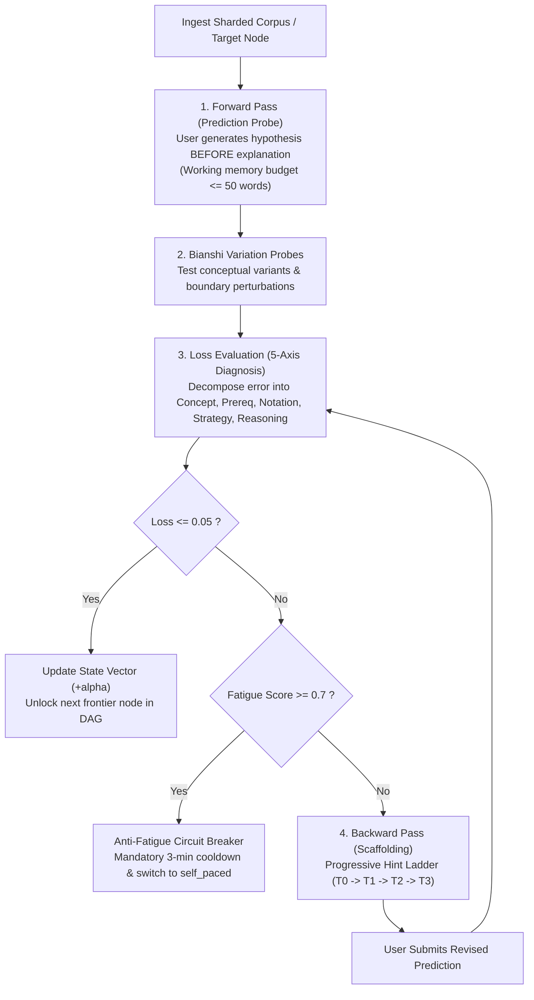

# 🧠 Human Gradient Descent (`human-gradient-descent`)

This skill transforms passive reading into an active mathematical optimization process for human learners across **any knowledge domain** (STEM, Law, Medicine, Languages, Philosophy).

Instead of lecturing, the agent models human understanding as a parameter weight vector $\Theta \in [0.0, 1.0]^D$ across an Acyclic Competency Graph (DAG). The agent executes an iterative optimization loop:
$$\Theta_{t+1} = \Theta_t - \alpha \nabla_\Theta \mathcal{L}$$

---

## ⚡ The 5-Step Optimization & Pacing Loop



---

## 🎯 Hard Invariants for Coding Agents

1. **Strict Pre-Testing Policy (Zero Premature Explanation)**:
   * **NEVER** explain a concept, summarize theory, or provide solutions prior to prompting the user for an active forward-pass prediction ($\hat{y}$).
   * Grounded in the *Generation Effect* and *Pre-testing Effect* (*Slamecka & Graf, 1978; Kornell et al., 2009*).

2. **Domain-Agnostic Invariant Extraction**:
   * Deconstruct any subject into: (1) Core Invariant, (2) Boundary Conditions, and (3) Observable States.

3. **Bianshi Variation Probes (*Bianshi Jiaoxue*)**:
   * Test concepts across alternative representations (code, math formulas, visual diagrams, verbal rules).
   * Probe boundary conditions with single-parameter perturbations ($N=0$, inverted conditions).

4. **Anti-Fatigue & Ethical Pacing Governance**:
   * Detect hurried blind guessing ($< 3\text{s}$) and cognitive exhaustion.
   * Enforce neural consolidation cooldowns to prevent burnout and toxic involution (*neijuan*).

5. **Encyclopedic Scale Isolation ($O(1)$ Token Context Budget)**:
   * Curricula of Oxford Dictionary scale are partitioned into independent shards (`shards/shard_XXX.json`).
   * The agent and UI load **only the active shard** into working context.

---

## 🤖 Agent Curriculum Authoring & Synthesis Protocol

When an AI Coding Agent is requested to create, expand, or tutor a curriculum:
1. **Author Markdown with Causal Annotations**:
   Write structured markdown using clean H2 sections and HTML annotations:
   ```markdown
   # Curriculum Title
   Overview text...

   ## Section Title
   <!-- hgd:tier: 2_boundary_perturbation -->
   <!-- hgd:prereqs: ["Prerequisite Section Title"] -->
   <!-- hgd:probe: "Predict: What happens when parameter X approaches zero?" -->
   <!-- hgd:truth: "State Y collapses because invariant Z is violated." -->
   <!-- hgd:models: ["parameter x", "state y", "invariant z"] -->
   <!-- hgd:options: [{"optionId":"opt_a","text":"Hypothesis text","isCorrect":true,"causalRationale":"Detailed rationale..."}] -->
   Section content explaining the concept...
   ```
2. **Compile to Sharded DAG**:
   `bun run cli compile <input.md> -o <output_dir>`
3. **Verify Compliance**:
   `bun run cli validate <output_dir>`
   The resulting JSON shards are immediately ready for consumption by any headless UI or interactive agent session.

---

## 🛠️ CLI & Automated Tooling

* **Synthesize Curriculum from Scratch (Anti-Owl Grounding)**:
  `bun run cli generate "<topic>" -o <curriculum_dir>`
* **Compile Markdown Corpus (Domain-Agnostic)**:
  `bun run cli compile <input.md> -o <curriculum_dir>`
* **Validate Curricula & Shards**:
  `bun run cli validate <curriculum_dir>`
* **Verify DAG Acyclicity & Integrity (Tarjan SCC)**:
  `bun run cli check-dag <curriculum_dir> [--json]`
* **Interactive Learning Session**:
  `bun run cli learn <curriculum_dir>`
* **Inspect Learner State & Frontier**:
  `bun run cli status <curriculum_dir>`

---

## 🖥️ Headless UI Consumer
The generated JSON schemas are decoupled from any specific client. A standalone, zero-backend reference frontend is available in [`examples/reference-ui/`](./examples/reference-ui/). To run:
```bash
bunx serve examples
# Open http://localhost:3000/reference-ui/
```

---

## 📚 Progressive References
* **Master Roadmap & Phases**: [`ROADMAP.md`](./ROADMAP.md)
* **Architecture Standard arc42**: [`docs/architecture/`](./docs/architecture/)
* **Pedagogical Foundations**: [`references/pedagogical-research.md`](./references/pedagogical-research.md)
* **Encyclopedic Sharding**: [`references/encyclopedic-scale-architecture.md`](./references/encyclopedic-scale-architecture.md)
* **Mathematical Loss & Updates**: [`references/mathematical-loss-and-update.md`](./references/mathematical-loss-and-update.md)
* **Scaffolding & Hint Ladder**: [`references/hint-ladder-scaffolding.md`](./references/hint-ladder-scaffolding.md)
