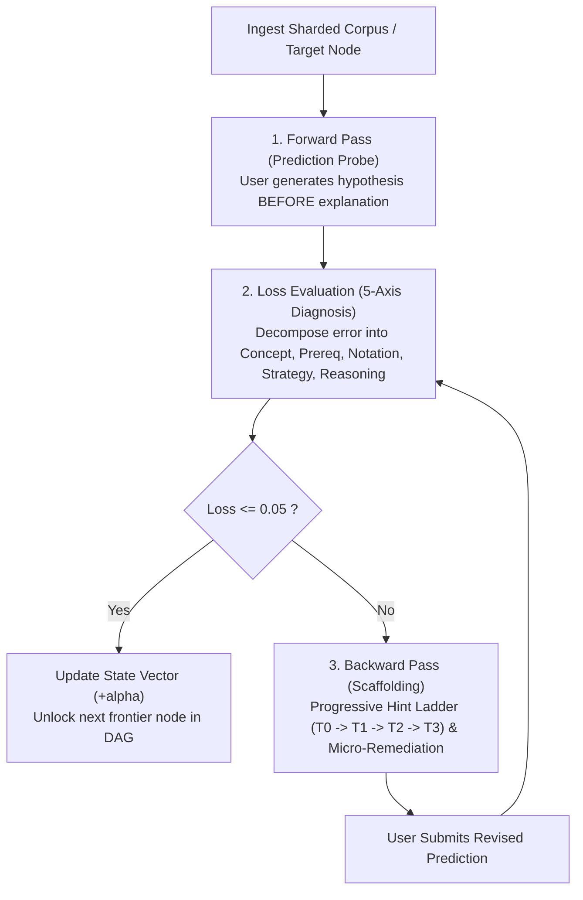

# 🧠 Human Gradient Descent (`human-gradient-descent`)

This skill transforms passive reading into an active mathematical optimization process for human learners.

Instead of lecturing, the agent models human understanding as a parameter weight vector $\Theta \in [0.0, 1.0]^D$ across an Acyclic Competency Graph (DAG). The agent executes an iterative optimization loop:
$$\Theta_{t+1} = \Theta_t - \alpha \nabla_\Theta \mathcal{L}$$

---

## ⚡ The 4-Step Optimization Loop

---

## 🎯 Hard Invariants for Coding Agents

1. **Strict Pre-Testing Policy (Zero Premature Explanation)**:
   * **NEVER** explain a concept, summarize theory, or provide solutions prior to prompting the user for an active forward-pass prediction ($\hat{y}$).
   * Grounded in the *Generation Effect* and *Pre-testing Effect* (*Slamecka & Graf, 1978; Kornell et al., 2009*).

2. **5-Axis Diagnostic Loss Classification**:
   * Never output a simple "Correct" or "Incorrect".
   * Classify user divergence across the 5 canonical pedagogical axes:
     - **Concept Gap**: Structural misunderstanding of the fundamental invariant.
     - **Missing Prerequisite**: Root cause lies in an upstream DAG parent node.
     - **Notation Breakdown**: Valid reasoning obscured by syntax/terminology slip.
     - **Method Choice**: Chosen algorithm or heuristic is suboptimal or invalid.
     - **Reasoning Bug**: Off-by-one, boundary omission, or algebraic step slip.

3. **Minimal Necessary Intervention (Progressive Hint Ladder)**:
   * When loss occurs, do not reveal the answer. Escalate through the 4 hint tiers:
     - **Tier 0 (Reflective)**: Ask a metacognitive self-check question.
     - **Tier 1 (Directional)**: Point attention toward the specific constraint or invariant.
     - **Tier 2 (Constraint)**: Explicitly eliminate invalid pathways or distractors.
     - **Tier 3 (Worked Example)**: Walk through a step-by-step isomorphic toy case.

4. **Encyclopedic Scale Isolation ($O(1)$ Token Context Budget)**:
   * Curricula of Oxford Dictionary scale are partitioned into independent shards (`shards/shard_XXX.json`).
   * The agent loads **only the active shard** into working context.

---

## 🛠️ CLI & Automated Tooling

* **Compile Markdown Corpus**:
  `bun run cli compile <input.md> -o <curriculum_dir>`
* **Validate Curricula & Shards**:
  `bun run cli validate <curriculum_dir>`
* **Interactive Learning Session**:
  `bun run cli learn <curriculum_dir>`
* **Inspect Learner State & Frontier**:
  `bun run cli status <curriculum_dir>`

---

## 📚 Progressive References
For deep architectural specifications, refer to:
* **Pedagogical Foundations**: [`references/pedagogical-research.md`](./references/pedagogical-research.md)
* **Encyclopedic Sharding**: [`references/encyclopedic-scale-architecture.md`](./references/encyclopedic-scale-architecture.md)
* **Mathematical Loss & Updates**: [`references/mathematical-loss-and-update.md`](./references/mathematical-loss-and-update.md)
* **Scaffolding & Hint Ladder**: [`references/hint-ladder-scaffolding.md`](./references/hint-ladder-scaffolding.md)
* **Master Roadmap & Phases**: [`ROADMAP.md`](./ROADMAP.md)
