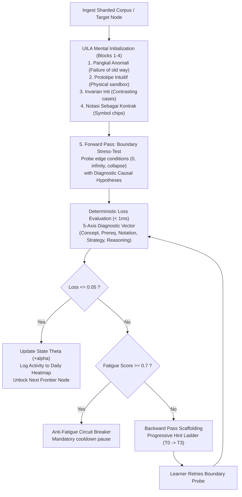
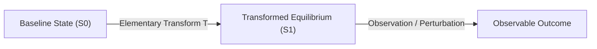

# Human Gradient Descent (`human-gradient-descent`)

This skill transforms passive reading into an active mathematical optimization process for human learners across **any knowledge domain** (STEM, Law, Medicine, Languages, Philosophy).

Instead of lecturing or blind ungrounded guessing, the agent models human understanding as a parameter weight vector $\Theta \in [0.0, 1.0]^D$ across an Acyclic Competency Graph (DAG). The agent executes an iterative optimization loop:
$$\Theta_{t+1} = \Theta_t - \alpha \nabla_\Theta \mathcal{L}$$

---

## The 5-Step Optimization & Grounding Loop



---

## Hard Invariants for Coding Agents

1. **UILA Grounding Doctrine (Zero Demoralizing Blind Prediction)**:
   * **STRICTLY PROHIBITED**: Never force a learner to make an ungrounded zero-shot prediction from a conceptual vacuum. This causes cognitive paralysis.
   * **MANDATORY**: Every competency node must initialize the mental model through Blocks 1 to 4 before executing the Forward Pass.
   * The Forward Pass is strictly executed at **Block 5: Uji Tegangan Batas (Boundary Stress-Test)**, evaluating causal limits ($0, \infty$, inverted conditions).

2. **The 5-Block UILA Sequential Structure**:
   * **Block 1: Pangkal Anomali (The Ground State & Inadequacy)**: Exposes where conventional/legacy approaches fail or complexity explodes without introducing early technical jargon.
   * **Block 2: Prototipe Intuitif (Isomorphic Sandbox)**: Grounds a real-world physical analog preserving identical proportional relationships to resolve the anomaly.
   * **Block 3: Invarian & Operasi Inti (Core Mechanics)**: Isolates conserved properties and features a Side-by-Side Contrasting Cases Table (*Pemula Salah* vs *Model Mental Nyata*).
   * **Block 4: Notasi Sebagai Kontrak (Minimal Formalization)**: Symbolism and formulas introduced as practical shorthand contracts, deconstructing every term into its physical meaning.
   * **Block 5: Uji Tegangan Batas (Boundary Stress-Test)**: Active Forward Pass challenge with Diagnostic Multiple-Choice Hypotheses and explicit causal rationales.

3. **Cognitive-Load Guardrails**:
   * **Monocentric Sub-Units**: Each sub-unit introduces exactly one mechanistic invariant. Dual mechanisms must be split into separate nodes.
   * **Zero Blind Jargon**: Every technical term must have its function experienced in Block 1 or 2 before its formal name is introduced.
   * **2-Second Working Memory Budget**: Challenge prompts must be bounded to $\le 50$ words to prevent phonological loop overload.

4. **Deterministic Diagnostic MCQ Evaluation**:
   * Client-side evaluation must execute in $O(1)$ time ($< 1\text{ms}$) without expensive backend round-trips.
   * Distractors represent specific misconceptions mapped to the 5-axis loss vector ($l_{\text{concept}}, l_{\text{prereq}}, l_{\text{notation}}, l_{\text{strategy}}, l_{\text{reasoning}}$).

5. **Effort Attribution & Heatmap Logging**:
   * Every completed epoch and mastered invariant must be logged to `dailyActivityLog` in `learner-state.json` to feed the GitHub-style 4-tier emerald contribution calendar.

6. **Encyclopedic Sharding ($O(1)$ Token Context Budget)**:
   * Curricula are partitioned into single-node shards (`nodesPerShard: 1`). The agent and UI load **only the active shard** into working context.

7. **Causal Closure & Zero Orphan Probe Entities (Anti-Unfairness Rule)**:
   * **STRICT PROHIBITION**: Never test an entity, operator, parameter, or constant in Block 5 (prompt or options) that has not been explicitly grounded in Blocks 1 to 4.
   * If testing an operator (e.g. "Hadamard gate"), it MUST have its physical analog in Block 2 (e.g. "tuas penyeimbang"), its transformation mechanics in Block 3, and its contract symbol in Block 4 ($H|0\rangle$). Testing unannounced jargon violates learning fairness and triggers cognitive panic.

8. **Visual & Intuitive Diagram Anchoring (Mermaid First Principle)**:
   * **Mandatory Directive for Authoring Agents**: Saat membuat materi kurikulum, agen WAJIB mencantumkan diagram visual **Mermaid** (`flowchart LR`, `flowchart TD`, `stateDiagram-v2`, `sequenceDiagram`) pada **Blok 2 (Prototipe Intuitif)** atau **Blok 3 (Invarian & Operasi Inti)** bilamana konsep melibatkan:
     - Transisi status atau tahapan siklus hidup (misal: *Input Baseline -> Transformasi Operasi -> Pengukuran/Hasil*).
     - Aliran kausal, *pipeline*, percabangan kondisi, atau *feedback loop*.
     - Relasi pertukaran timbal balik antar entitas (*Party A Detriment <-> Bargained-for Exchange <-> Party B Benefit*).
     - Perbedaan jalur antara ekspektasi salah vs mekanisme fisik sebenarnya.
   * Diagram Mermaid menjembatani narasi analogi di Blok 2 dengan abstraksi formal di Blok 4, mengunci intuisi spasial-temporal pembelajar sebelum disajikan simbol matematika/steno.

9. **Deep Explanatory Narrative Invariant (> 3 Paragraphs per Block)**:
   * **Mandatory Narrative Depth**: Setiap blok penjelasan (Blok 1, 2, 3, dan 4) **WAJIB** memuat minimal lebih dari 3 paragraf (artinya **minimal 4 paragraf**) narasi terstruktur yang relevan dan mendalam untuk membangun model mental yang utuh. Dilarang keras menyajikan penjelasan dangkal berupa 1–2 kalimat pendek:
     - **Blok 1 (Pangkal Anomali)**: $\ge 4$ paragraf (Intuisi awal & asumsi awam $\to$ Konteks kecukupan cara lama $\to$ Titik kegagalan/ledakan kompleksitas saat diskalakan $\to$ Akar kausal perlunya primitif baru).
     - **Blok 2 (Prototipe Intuitif)**: $\ge 4$ paragraf (Pengenalan objek fisik sandbox $\to$ Tuas/komponen interaktif model $\to$ Preservasi proporsi isomorfis dengan sistem nyata $\to$ Resolusi anomali secara fisik) didukung diagram Mermaid.
     - **Blok 3 (Invarian & Operasi Inti)**: $\ge 4$ paragraf (Hukum kekekalan/ekuilibrium inti $\to$ Mekanisme transisi keadaan sistem $\to$ Batas kegagalan jika invarian dilanggar $\to$ Dekonstruksi jebakan pemikiran pemula vs realitas fisik) didukung Tabel Kontras.
     - **Blok 4 (Notasi Sebagai Kontrak)**: $\ge 4$ paragraf (Urgensi formalisasi sebagai kontrak operasional $\to$ Korespondensi rumus dengan prototipe fisik $\to$ Makna fisik dan penalti variabel/konstanta $\to$ Jaminan keabsahan status sistem) didukung chip dekonstruksi simbol.

10. **Zero-Failure Math Delimiters & Mermaid Sanitization (ADR-010)**:
   * **Mermaid Node Labels**: Any mathematical formula or LaTeX symbol inside a Mermaid node label `["..."]` **MUST** be explicitly wrapped in `$$...$$` (e.g., `["Kernel Trap ($$\\tau_{\\text{trap}}$$)"]`). **NEVER** write unescaped raw LaTeX backslashes or curly braces like `(\tau_{trap})` inside Mermaid labels.
   * **Notation Deconstruction Chips**: All mathematical symbols in `termsDeconstruction` must be wrapped in `$` delimiters (e.g., `$\tau_{\text{switch}}$`, `$\mathcal{O}(1)$`) so KaTeX auto-renders them with zero failure.
   * **Educational Taxonomy Compliance (ADR-009)**: Use formal Instructional Design / CBE terminology: *Program Pembelajaran* (Learning Program), *Cetak Biru Instruksional* (Instructional Blueprint), *Peta Jalur Prasyarat* (Prerequisite Map), *Unit Kompetensi* (Competency Unit). Avoid campus-specific terms like "kuliah" or vague terms like "bab".

---

## Author's Diagnostic Checklist (Matriks Uji Mandiri Penulis)

Before releasing or synthesizing any curriculum, the agent must self-audit against this checklist:

| Pertanyaan Uji | Jika Jawabannya "Tidak" | Tindakan Koreksi Wajib |
|:---|:---|:---|
| Apakah masalah di Blok 1 terasa nyata tanpa pembaca perlu tahu teorinya terlebih dahulu? | Pembaca akan membaca teks sebagai hafalan akademis, bukan solusi fungsional. | Tulis ulang Blok 1 menggunakan skenario operasional/kegagalan fisik sederhana. |
| Bisakah pembaca memprediksi arah perubahan (naik/turun) tanpa melihat rumus di Blok 4? | Penjelasan mekanik di Blok 2 & 3 gagal total membangun intuisi. | Ganti analogi di Blok 2 dengan model spasial/aliran yang lebih ketat secara relasi (isomorphic). |
| Apakah konsep dinamis/multi-langkah didukung diagram alur Mermaid di Blok 2/3? | Pembaca harus membayangkan aliran spasial di kepala secara abstrak (beban kognitif berlebih). | Sisipkan diagram Mermaid (`flowchart LR` atau `stateDiagram-v2`) untuk memetakan transisi status dan invarian secara visual. |
| Apakah setiap blok penjelasan (Blok 1–4) memiliki minimal > 3 paragraf narasi terstruktur? | Penjelasan terpotong pendek (1–2 kalimat) gagal menanamkan model mental yang kokoh. | Kembangkan narasi menjadi minimal 4 paragraf utuh yang mengupas latar, mekanisme, batas, dan kontrak. |
| Apakah ada simbol/istilah asing yang muncul tiba-tiba tanpa didekonstruksi? | Terjadi *split-attention effect* dan kepanikan kognitif. | Sisipkan jembatan penalaran atau hilangkan jargon yang tidak esensial. |
| Apakah pembaca bisa menjawab pertanyaan di Blok 5 hanya dengan mengingat kata-kata di teks? | Pertanyaan evaluasi terlalu dangkal (hanya menguji memori, bukan model mental). | Ubah soal uji batas ke situasi baru (*transfer test*) yang belum pernah dicontohkan di teks. |
| Apakah seluruh entitas, operator, dan konstanta di Blok 5 sudah memiliki padanan di Blok 2–4? | Terjadi *Orphan Probe Fallacy* dan rasa tidak adil pada pembelajar. | Masukkan analog fisik operator ke Blok 2 dan simbol steno ke Blok 4 sebelum mengujinya. |

---

## Agent Curriculum Authoring & Synthesis Protocol

When an AI Coding Agent is requested to create, expand, or tutor a curriculum:

```markdown
# Curriculum Title
Overview text...

## Section Title (UILA 5-Block Standard)
<!-- hgd:tier: 1_foundational_fluency -->
<!-- hgd:prereqs: [] -->

### 1. Pangkal Anomali
Selama ini kita menyelesaikan [Kondisi X] dengan [Cara Lama Y]. Ini bekerja dengan baik, sampai kita menghadapi [Situasi Z] di mana [Cara Lama Y] tiba-tiba menghasilkan [Kegagalan/Ledakan Kompleksitas].

### 2. Prototipe Intuitif
Bayangkan alih-alih [Sistem Asli], kita punya [Objek Fisik Sederhana]. Jika Anda mengubah tuas A, cairan di wadah B otomatis naik...



### 3. Invarian & Operasi Inti
Hukum kekekalan: [Invarian Sistem].
| Apa yang Dipikirkan Pemula (Salah) | Apa yang Sebenarnya Terjadi dalam Model Mental |
|---|---|
| Mengasumsikan nilai statis bebas | Diatur oleh hukum kekekalan dan interaksi aktif |

### 4. Notasi Sebagai Kontrak
Formula: `X = Y / Z`
* `X`: Ukuran besaran dalam model fisik
* `Y`: Komponen input
* `Z`: Skala normalisasi

### 5. Uji Tegangan Batas
<!-- hgd:probe: "Jika variabel [A] dibuat mendekati nol, bagian mana dari sistem yang akan runtuh duluan? Mengapa?" -->
<!-- hgd:truth: "Sistem runtuh karena invariant B dilanggar." -->
<!-- hgd:options: [
  {"optionId": "opt_a", "text": "Hypothesis A text...", "isCorrect": true, "causalRationale": "Adheres to invariant..."},
  {"optionId": "opt_b", "text": "Hypothesis B text...", "isCorrect": false, "diagnosticAxis": "conceptGap", "causalRationale": "Violates..."}
] -->
```

---

## Multi-Dimensional Curriculum Expansion

When a learner masters a node ($\mathcal{L} \le 0.05$), the agent surfaces 3 expansion pathways:
1. **Vertical Depth Spiral**: Re-visiting the concept with higher mathematical/production rigor (`deeperSpiralNodeId`).
2. **Horizontal Branching Tracks**: Elective specializations (`branches: [{ trackName, targetNodeId }]`).
3. **Lateral Isomorphic Bridges**: Connecting the mastered invariant across different disciplines (`isomorphicBridges: [{ domain, targetNodeId, sharedInvariant }]`).

---

## CLI & Automated Tooling

* **Synthesize Curriculum from Scratch (Anti-Owl Grounding)**:
  `bun run cli generate "<topic>" -o <curriculum_dir>`
* **Compile Markdown Corpus (UILA-Native)**:
  `bun run cli compile <input.md> -o <curriculum_dir>`
* **Validate Curricula & Shards**:
  `bun run cli validate <curriculum_dir>`
* **Audit 3-Tier Pedagogical Invariants & Causal Closure**:
  `bun run cli audit <curriculum_dir> [--strict] [--json]`
* **Auto-Remediate Violations (Auto-Patcher)**:
  `bun run cli remediate <curriculum_dir> [--dry-run]`
* **Export Topological DAG (Mermaid / Markdown Report)**:
  `bun run cli export-dag <curriculum_dir> [--format mermaid|markdown]`
* **Verify DAG Acyclicity & Integrity (Tarjan SCC)**:
  `bun run cli check-dag <curriculum_dir> [--json]`
* **Interactive Learning Session**:
  `bun run cli learn <curriculum_dir>`
* **Inspect Learner State & Frontier**:
  `bun run cli status <curriculum_dir>`

---

## Headless UI Consumer
The generated JSON schemas are decoupled from any specific client. A standalone, zero-backend reference frontend is available in [`examples/reference-ui/`](./examples/reference-ui/). To run:
```bash
bunx serve examples
# Open http://localhost:3000/reference-ui/
```

---

## Progressive References
* **Master Roadmap & Phases**: [`ROADMAP.md`](./ROADMAP.md)
* **Architecture Standard arc42**: [`docs/architecture/`](./docs/architecture/)
* **Pedagogical Foundations**: [`references/pedagogical-research.md`](./references/pedagogical-research.md)
* **Encyclopedic Sharding**: [`references/encyclopedic-scale-architecture.md`](./references/encyclopedic-scale-architecture.md)
* **Mathematical Loss & Updates**: [`references/mathematical-loss-and-update.md`](./references/mathematical-loss-and-update.md)
* **Scaffolding & Hint Ladder**: [`references/hint-ladder-scaffolding.md`](./references/hint-ladder-scaffolding.md)
