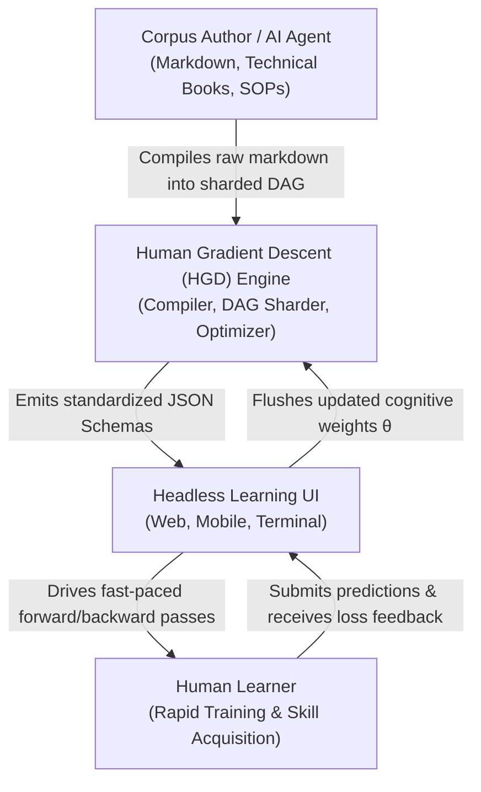

# 3. Context and Scope

> [!INFO] **Architecture Provenance & Freshness**
> - **Verified Commit**: `5795cf3`
> - **Verified Timestamp**: `2026-11-03T07:07:00+07:00`
> - **Tracked Paths**: `src/`, `schemas/`, `phases/`
> - **Drift Status**: `verified`

This section defines the business and technical context of HGD, delineating external boundaries and integration interfaces.

---

## 3.1 Business Context

---

## 3.2 Technical Interfaces (`IF-xx`)

| Interface ID | Interface Name | Protocol | Data Contract | Description |
|:---|:---|:---|:---|:---|
| **IF-01** | **Corpus Ingestion** | CLI / FS | Markdown AST | Compiles raw text, headers, and codeblocks into sharded DAG nodes. |
| **IF-02** | **Manifest & Shard Delivery** | JSON / HTTP / FS | `curriculum-manifest.schema.json` & `node-shard.schema.json` | Headless UI loads the curriculum manifest and active shard. |
| **IF-03** | **Learner State Telemetry** | JSON / LocalStorage | `learner-state.schema.json` | Persists cognitive parameter vector $\Theta$, active frontier, checkpoints, and rollback traces. |
| **IF-04** | **Diagnostic Evaluation Stream** | JSON-RPC / CLI | `session-interaction.schema.json` | Evaluates forward pass attempts, calculates 5-axis loss, and delivers hint ladder interventions. |

---

## 3.3 Scope Boundaries

* **In Scope**:
  * Sharded DAG compilation for massive encyclopedic curricula.
  * Time-bounded (sprint) and self-paced (mastery) scheduling.
  * Checkpoint persistence and divergence rollback execution.
  * 5-axis diagnostic error classification and 4-tier hint ladder.
* **Out of Scope**:
  * Proprietary UI rendering frameworks (UI is fully decoupled and consumes the JSON standard).
  * Persistent user account management or cloud authentication.
