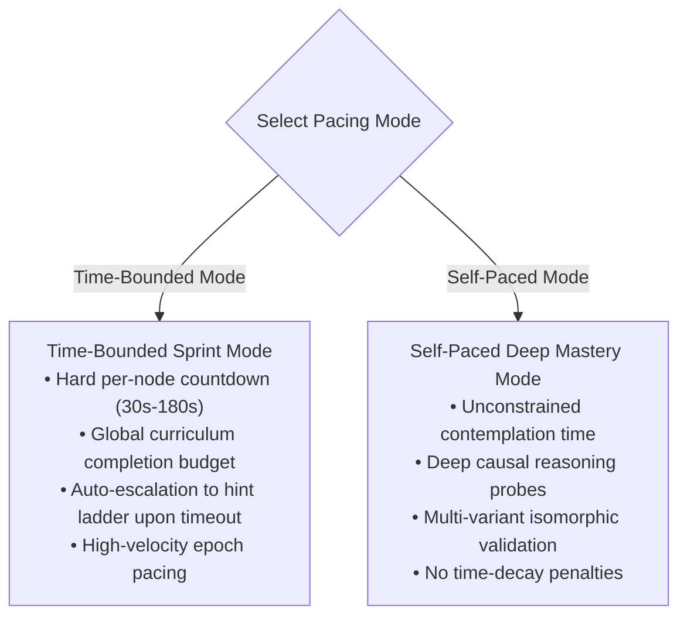

# 4. Solution Strategy

> [!INFO] **Architecture Provenance & Freshness**
> - **Verified Commit**: `d1fa162` (branch: `main`)
> - **Verified Timestamp**: `2026-10-30T20:12:51+07:00`
> - **Tracked Paths**: `src/`, `schemas/`, `phases/`
> - **Drift Status**: `verified`

The core strategy synthesizes findings from cognitive science, agent skill benchmarks, and neural network optimization.

---

## 4.1 Curriculum Creation: Dual Pacing Modes

The curriculum compiler and JSON schema explicitly encode two primary learning modes:



1. **Time-Bounded (Fast-Paced Training Mode)**:
   * **Analogy**: High-throughput GPU batch processing in LLM pretraining.
   * **Mechanism**: Each forward-pass prediction has a strict countdown timer (`timeLimitSeconds`). If the learner hesitates beyond the threshold, the system auto-escalates to Tier 1 Directional Hint to maintain neuroplastic momentum.
   * **Goal**: Rapidly break passive hesitation, force quick intuitive hypotheses, and maximize the number of training epochs per hour.
2. **Self-Paced (Mastery Mode)**:
   * **Analogy**: Reinforcement Learning from Human Feedback (RLHF) fine-tuning.
   * **Mechanism**: No timer constraints; requires rigorous proof and comprehensive mental model validation before advancing.

---

## 4.2 Synthesis of Benchmark Skills

| Benchmark Skill | Pedagogical Insight Borrowed | HGD Integration Strategy |
|:---|:---|:---|
| **`human-skill-tree`** | "Test before explaining" | Forward Pass Engine blocks theory until prediction $\hat{y}$ is generated. |
| **`magnus919/teach-me`** | Teach $\to$ Attempt $\to$ Check loop | Fast iteration cycles with clear distinction between minor slip and deep error. |
| **`helderberto/teach`** | Minimal Necessary Knowledge (MNK) | Micro-lessons capped at $< 150$ words to avoid working memory overload. |
| **`gareth-manning`** | Progressive Hint Ladder | 4-tier graduated intervention ($T_0 \to T_1 \to T_2 \to T_3$) with credit penalties. |
| **`universal-diagnostic-tutor`** | 5-component error classification | Formative loss vector isolating Concept, Prereq, Notation, Strategy, and Reasoning. |

---

## 4.3 The LLM Training Analogy: Fast-Paced Epochs & Checkpoints

```
[Epoch Step t] ──► Forward Pass (ŷ) ──► Compute 5-Axis Loss (L)
                          │
                   (L > Threshold?)
                    ├── No  ──► Update θ (+α) ──► Advance Frontier
                    └── Yes ──► Scaffolding (Hint Tier) ──► Re-Attempt
                                  │
                       (Severe Loss Spike / Divergence?)
                                  │
                                  ▼
                   [Rollback to Stable Checkpoint Node]
                   (Re-align upstream prerequisites before continuing)
```

In neural network training, unmitigated gradient explosion causes NaN weights. Similarly, when a human learner experiences a deep misconception, continuing forward causes cognitive collapse.
HGD integrates **Milestone Checkpoints**:
* Checkpoints are designated in `curriculum-manifest.json`.
* When loss spikes on a complex node or prerequisite failure is detected ($l_{\text{prereq}} > 0.5$), the engine **rolls back** the active frontier to the nearest verified checkpoint milestone, re-stabilizing foundational weights before re-attempting the advanced node.

---

## 4.4 Decoupled JSON UI Architecture

The curriculum and telemetry are 100% represented in standard JSON:
* The UI receives `curriculum-manifest.json` and loads active `shards/shard_XXX.json`.
* The UI displays timers, progress bars, interactive forward-pass inputs, radar loss breakdowns, and hint accordions.
* State is persisted in `learner-state.json`. Any modern web, mobile, or terminal app can render the experience with zero proprietary server logic.
