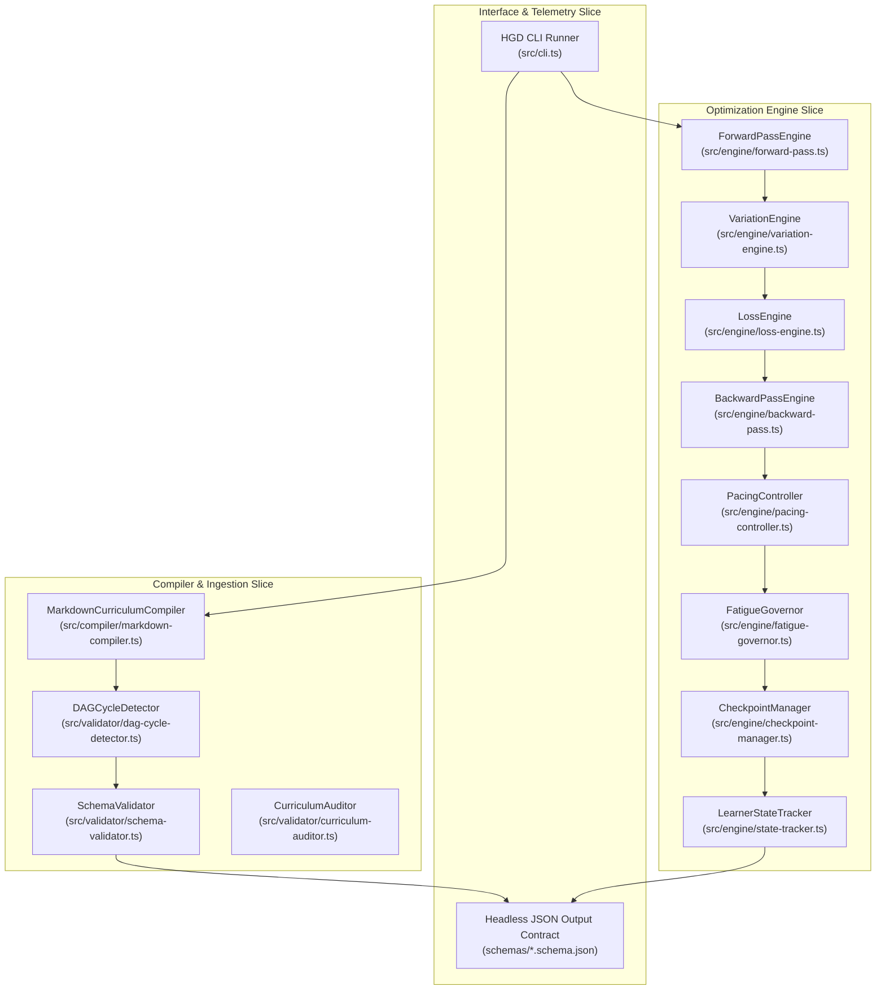

# 5. Building Block View

> [!INFO] **Architecture Provenance & Freshness**
> - **Verified Commit**: `ff92c54`
> - **Verified Timestamp**: `2026-11-01T08:59:00+07:00`
> - **Tracked Paths**: `src/`, `schemas/`, `phases/`
> - **Drift Status**: `verified`

The system is decomposed into decoupled modules following Vertical Slice Architecture and SOLID principles.

---

## 5.1 Whitebox Overall System (Level 1)

---

## 5.2 Building Block Specifications (Level 2)

### 1. `MarkdownCurriculumCompiler`
* **Responsibility**: Ingests raw markdown, extracts domain-agnostic invariants, assigns 4 difficulty tiers, synthesizes Bianshi variation probes, and partitions nodes into shards.

### 2. `ForwardPassEngine` & `VariationEngine`
* **Responsibility**: Formulates pre-testing challenge prompts, surfaces alternative conceptual representations (code/symbolic/verbal), and injects procedural boundary perturbations.

### 3. `LossEngine`
* **Responsibility**: Deconstructs user attempt $\hat{y}$ against ground truth $y$, calculating the 5-axis loss vector $\mathbf{l} = [l_{\text{concept}}, l_{\text{prereq}}, l_{\text{notation}}, l_{\text{strategy}}, l_{\text{reasoning}}]^T$ and scalar loss $\mathcal{L}$.

### 4. `BackwardPassEngine`
* **Responsibility**: Manages the 4-tier Progressive Hint Ladder ($T_0 \to T_1 \to T_2 \to T_3$), applies credit penalties, selects targeted micro-remediations, and computes weight delta $\Delta \theta$.

### 5. `PacingController` & `FatigueGovernor`
* **Responsibility**: Enforces `time_bounded` countdowns vs `self_paced` timers, monitors user response latencies, detects hurried blind guessing and cognitive exhaustion, and triggers mandatory neural cooldowns.

### 6. `CheckpointManager` & `LearnerStateTracker`
* **Responsibility**: Tracks milestone checkpoints in the DAG, executes state rollbacks upon divergence, maintains sparse cognitive weights $\Theta$, and simulates Ebbinghaus forgetting decay.

### 7. `DAGCycleDetector`
* **Responsibility**: Guarantees acyclicity across encyclopedic-scale multi-parent curriculum DAGs via Tarjan's Strongly Connected Components algorithm ($O(V + E)$) and Kahn's topological sort, preventing deadlock in the learner frontier queue.

### 8. `UILABuilder` & `ExpansionBuilder`
* **Responsibility**: Deconstructs markdown sections into the 5-block Universal Invariant Learning Architecture (Anomaly, Prototype, Invariant, Contract, Boundary Stress-Test) and generates multi-dimensional expansion pathways (Depth Spiral, Branching Tracks, and Isomorphic Cross-Domain Bridges).

### 9. `Headless UI & Heatmap Renderer`
* **Responsibility**: Zero-backend reference web client providing high-contrast diagnostic hypothesis selection, side-by-side contrasting case tables, and a GitHub-style activity contribution calendar for visual mastery tracking.

### 10. `CurriculumAuditor`
* **Responsibility**: Autonomous 3-tier evaluation engine executing sub-20ms deterministic AST static linting (schema validation, Tarjan SCC acyclicity, phonological working memory budgets <= 50 words, Causal Closure / zero orphan entities, 5-axis diagnostic MCQs, and contrasting cases), semantic causal oracle checks (isomorphic physical models, authentic cognitive traps vs strawmen, state prediction transfer tests), and adversarial virtual novice simulation protocols.
