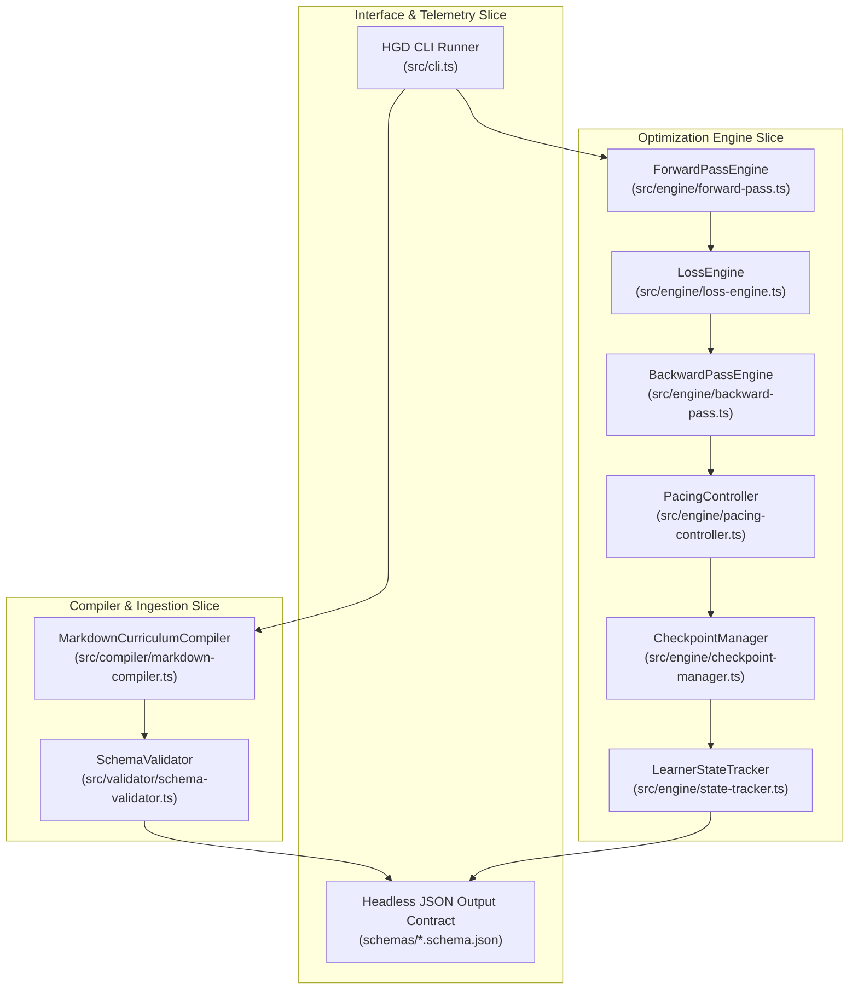

# 5. Building Block View

> [!INFO] **Architecture Provenance & Freshness**
> - **Verified Commit**: `d1fa162` (branch: `main`)
> - **Verified Timestamp**: `2026-10-30T20:12:51+07:00`
> - **Tracked Paths**: `src/`, `schemas/`, `phases/`
> - **Drift Status**: `verified`

The system is decomposed into decoupled modules following Vertical Slice Architecture and SOLID principles.

---

## 5.1 Whitebox Overall System (Level 1)

---

## 5.2 Building Block Specifications (Level 2)

### 1. `MarkdownCurriculumCompiler`
* **Responsibility**: Ingests raw markdown, extracts headers, infers DAG edges, synthesizes forward probes, loss rubrics, hint ladders, and partitions nodes into shards.

### 2. `ForwardPassEngine`
* **Responsibility**: Formulates pre-testing challenge prompts, strips solution leaks, and prepares the active probe for terminal or UI rendering.

### 3. `LossEngine`
* **Responsibility**: Deconstructs user attempt $\hat{y}$ against ground truth $y$, calculating the 5-axis loss vector $\mathbf{l} = [l_{\text{concept}}, l_{\text{prereq}}, l_{\text{notation}}, l_{\text{strategy}}, l_{\text{reasoning}}]^T$ and scalar loss $\mathcal{L}$.

### 4. `BackwardPassEngine`
* **Responsibility**: Manages the 4-tier Progressive Hint Ladder ($T_0 \to T_1 \to T_2 \to T_3$), applies hint credit penalties, selects targeted micro-remediations, and computes weight delta $\Delta \theta$.

### 5. `PacingController`
* **Responsibility**: Enforces `time_bounded` countdowns vs `self_paced` timers, calculates stagnation penalties, and triggers automatic hint ladder escalation upon timeout.

### 6. `CheckpointManager`
* **Responsibility**: Tracks milestone checkpoints in the DAG. When severe loss spikes occur or prerequisite failure is identified, triggers state rollback to the last stable checkpoint.

### 7. `LearnerStateTracker`
* **Responsibility**: Maintains the sparse cognitive state vector $\Theta$, unlocks nodes in the active frontier, and simulates temporal Ebbinghaus forgetting decay.
