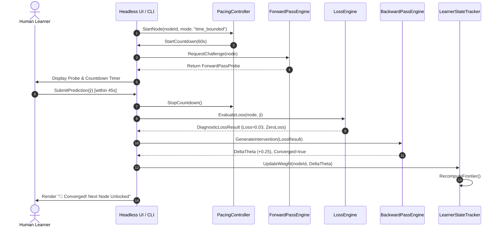
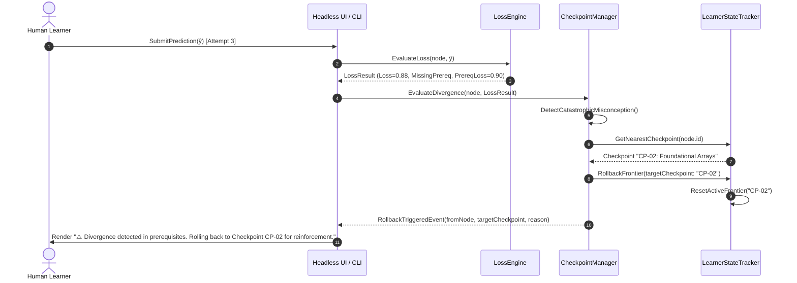

# 6. Runtime View

> [!INFO] **Architecture Provenance & Freshness**
> - **Verified Commit**: `a4b86ba`
> - **Verified Timestamp**: `2026-10-31T20:31:00+07:00`
> - **Tracked Paths**: `src/`, `schemas/`, `phases/`
> - **Drift Status**: `verified`

This section details the dynamic execution flows for fast-paced training epochs, hint ladder escalations, and checkpoint rollbacks.

---

## 6.1 Fast-Paced Timed Epoch & Convergence Sequence

---

## 6.2 Divergence Detection & Checkpoint Rollback Sequence

