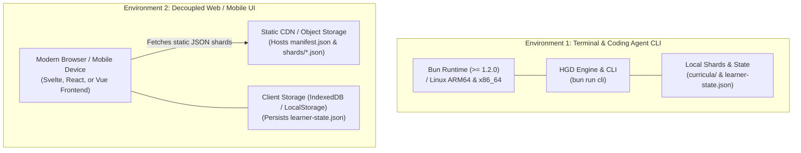

# 7. Deployment View

> [!INFO] **Architecture Provenance & Freshness**
> - **Verified Commit**: `3e2dba6` (branch: `main`)
> - **Verified Timestamp**: `2026-10-30T20:12:51+07:00`
> - **Tracked Paths**: `src/`, `schemas/`, `phases/`
> - **Drift Status**: `verified`

The system supports local development, agent skill invocations, and headless UI deployments.

---

## 7.1 Deployment Topologies

---

## 7.2 Deployment Target Specifications

1. **Coding Agent Environment**:
   * Installed via git clone and executed using `bun run cli` or as an open skill (`SKILL.md`).
   * Operates headless with optional `--json` machine-readable output.
2. **Static Web UI Deployment**:
   * Curricula compiled by HGD can be deployed directly to Cloudflare Pages, Vercel, or AWS S3 as purely static assets.
   * Because all logic, rubrics, timers, and hint ladders are contained inside the JSON schemas, any client-side frontend can run the full learning session without a backend server.
