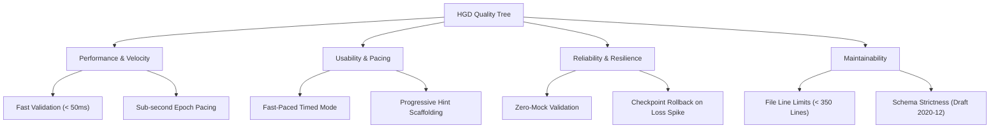

# 10. Quality Requirements

> [!INFO] **Architecture Provenance & Freshness**
> - **Verified Commit**: `e0e4061`)
> - **Verified Timestamp**: `2026-10-30T20:12:51+07:00`
> - **Tracked Paths**: `src/`, `schemas/`, `phases/`
> - **Drift Status**: `verified`

The system defines concrete quality scenarios based on ISO/IEC 25010 and the Q42 Quality Model.

---

## 10.1 Quality Tree

---

## 10.2 Quality Scenarios

| Scenario ID | Quality Attribute | Stimulus & Condition | Expected Response |
|:---|:---|:---|:---|
| **SC-01** | **Performance** | Ingesting a 5,000-line markdown technical specification. | Compiles into sharded DAG in under $2.0\text{s}$ with $< 50\text{MB}$ peak RAM. |
| **SC-02** | **Velocity** | Fast-paced learner attempts 20 forward passes in `time_bounded` mode. | UI receives immediate 5-axis loss scoring with $< 100\text{ms}$ latency. |
| **SC-03** | **Resilience** | Learner exhibits catastrophic prerequisite loss ($l_{\text{prereq}} \ge 0.7$). | System intercepts failure, triggers rollback to nearest checkpoint, and shifts active frontier. |
| **SC-04** | **Maintainability** | Repository governance check is executed via CI/CD. | All source files, schemas, and architecture docs pass line limit audit ($< 350$ lines). |
