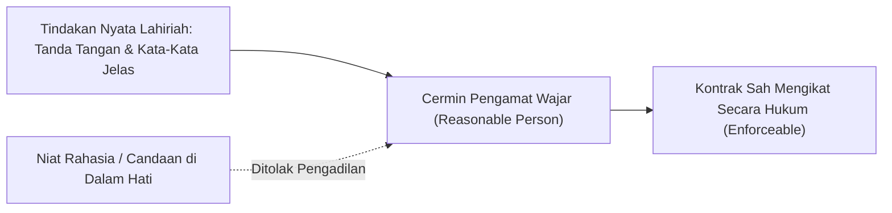
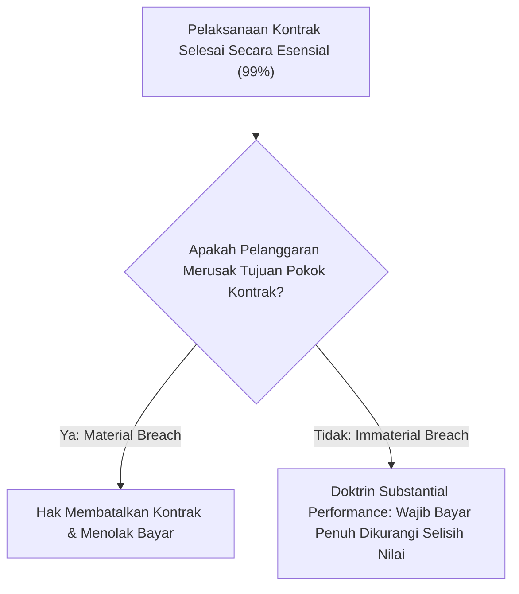
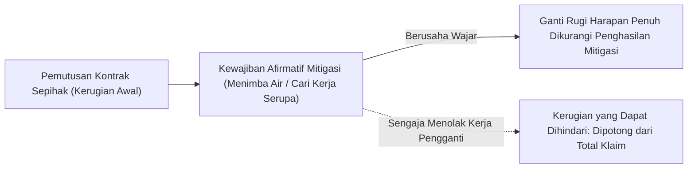

# Contract Law Foundations

A comprehensive curriculum on mutual assent, consideration doctrine, material breach, and expectation damages compiled with the Human Gradient Descent paradigm.

## Objective Mutual Assent
<!-- hgd:tier: 1_foundational_fluency -->
<!-- hgd:primer: "A valid contract requires mutual assent. Under the objective theory of contracts, assent is determined by a reasonable person's outward manifestation, rather than secret subjective intent (Lucy v. Zehmer)." -->
<!-- hgd:probe: "Predict contract enforceability if Party A writes and signs a formal land sale contract but secretly considers it an elaborate practical joke." -->
<!-- hgd:truth: "The contract is binding under the objective theory of contracts: assent is judged by a reasonable person's outward manifestation, not hidden subjective intent (Lucy v. Zehmer)." -->
<!-- hgd:worked: "Worked Solution: In Lucy v. Zehmer, Zehmer claimed his agreement on a restaurant napkin was merely executed in jest. The court held that an outward expression of serious intent creates a binding contract regardless of secret mental reservations." -->
<!-- hgd:models: ["objective theory", "reasonable person", "outward manifestation", "binding"] -->
<!-- hgd:options: [
  {"optionId":"opt_a","text":"The contract is binding under the objective theory of contracts: assent is judged by a reasonable person's outward manifestation, not hidden subjective intent (Lucy v. Zehmer).","isCorrect":true,"causalRationale":"Correct: Outward objective manifestation binds the parties regardless of secret subjective intent."},
  {"optionId":"opt_b","text":"The contract is void because subjective mutual assent (meeting of minds) was absent during signing.","isCorrect":false,"diagnosticAxis":"conceptGap","causalRationale":"Subjective Fallacy: Law discarded subjective intent in favor of outward reasonable manifestation."},
  {"optionId":"opt_c","text":"The contract is unenforceable because contracts signed in social settings are per se invalid.","isCorrect":false,"diagnosticAxis":"reasoningBug","causalRationale":"Setting Irrelevance: Location does not invalidate an otherwise formal written offer and acceptance."},
  {"optionId":"opt_d","text":"The contract requires approval from the governor before any outward manifestation can be evaluated.","isCorrect":false,"diagnosticAxis":"missingPrerequisite","causalRationale":"Fictitious governmental approval requirement unrelated to common law contract formation."}
] -->

### 1. Pangkal Anomali
Dalam kehidupan bermasyarakat, kita sering mengira bahwa kesepakatan hukum yang sah mensyaratkan adanya kesamaan isi pikiran batiniah (*subjective meeting of the minds*). Kita membayangkan bahwa kedua belah pihak harus sama-sama memiliki niat tulus dari lubuk hati terdalam.

Namun anggapan ini runtuh seketika dalam transaksi nyata. Bayangkan jika seseorang menuliskan surat jual beli tanah secara resmi, menyepakati harga, dan menandatanganinya di atas materai, namun beberapa minggu kemudian ia menolak menyerahkan sertifikat tanah dengan dalih: *"Waktu itu saya hanya bercanda di dalam hati; saya tidak benar-benar berniat menjual tanah saya!"* (seperti dalam kasus hukum terkenal *Lucy v. Zehmer*).

Jika pengadilan mengizinkan orang membatalkan perjanjian hanya dengan mengklaim bahwa hatinya sedang bercanda, maka seluruh roda ekonomi perdagangan akan hancur. Pengadilan manusia tidak memiliki teknologi untuk membelah tengkorak kepala seseorang dan membaca apa yang ia pikirkan di dalam hatinya secara rahasia.

### 2. Prototipe Intuitif
Bayangkan sebuah cermin pantulan di atas meja kasir toko swalayan.

Cermin kasir tersebut hanya bisa merekam apa yang tampak secara fisik di depan mata: tangan pembeli yang meletakkan uang tunai di atas meja, bibir yang mengucapkan kata setuju, dan pena yang menandatangani tanda terima. Cermin tidak bisa melihat apakah di dalam hati pembeli tersebut ia sedang menggerutu, bercanda, atau melamun.

Hukum bertindak persis seperti cermin kasir tersebut. Hukum tidak menilai apa yang Anda bisikkan di dalam hati; hukum menilai apa yang dilihat dan didengar oleh seorang "Orang Wajar" (*Reasonable Person*) yang berada di ruangan tersebut.



### 3. Invarian & Operasi Inti
Invarian mutlak sistem ini adalah **Teori Objektif Perjanjian (Objective Theory of Contracts)**: keabsahan suatu kesepakatan hukum diukur semata-mata dari manifestasi lahiriah yang dapat ditangkap oleh akal sehat orang wajar (*reasonable person*), bukan dari niat subjektif atau reservasi mental rahasia yang tidak diucapkan.

Jika kata-kata dan tindakan Anda menunjukkan kesungguhan seorang penjual yang wajar, maka Anda terikat secara hukum, terlepas dari apa pun lelucon batin yang Anda simpan di dalam kepala.

| Apa yang Dipikirkan Pemula (Salah) | Apa yang Sebenarnya Terjadi dalam Model Mental |
|---|---|
| Kontrak otomatis batal jika penandatangan mengaku tidak bersungguh-sungguh di dalam hati. | Manifestasi lahiriah yang wajar mengikat para pihak secara mutlak tanpa memedulikan niat tersembunyi. |
| Menandatangani kesepakatan di restoran atau kafe otomatis tidak sah secara hukum. | Lokasi santai tidak membatalkan kekuatan hukum selama tindakan dan isi dokumen tertulis jelas. |
| Pengadilan wajib memanggil saksi paranormal untuk membaca isi hati terdakwa. | Pengadilan hanya memeriksa bukti fisik rekaman kata-kata, tindakan, dan teks dokumen tertulis. |

### 4. Notasi Sebagai Kontrak
Kesepakatan objektif dirumuskan dalam kontrak steno:
$$K = Offer(O) + Acceptance(A)$$

Persamaan formal di atas merangkum syarat pembentukan kontrak:
* `K`: Kontrak yang mengikat secara sah menurut hukum (*binding legal contract*).
* `Offer(O)`: Penawaran definitif yang dimanifestasikan secara lahiriah dengan syarat-syarat yang jelas.
* `Acceptance(A)`: Penerimaan tegas tanpa syarat (*mirror image*) yang dikomunikasikan ke pihak penawar.
* `Lucy v. Zehmer`: Preseden yurisprudensi penting yang menegakkan prinsip objektivitas lahiriah.

### Glosarium & Jembatan Konsep SMA

| Istilah | Konsep Formal | Jembatan Konsep SMA |
|---|---|---|
| Objective Mutual Assent | Kesepakatan bersama yang dinilai dari kata-kata dan perbuatan lahiriah yang tampak | Mengacungkan tangan dan menyebut "Saya beli" di kantin sekolah; penjual menganggap transaksi sah |
| Reasonable Person | Standar hipotetis orang berakal sehat dengan kehati-hatian dan pertimbangan wajar | Teman sekelas yang berpikiran logis dan tidak mudah tertipu oleh alasan aneh |
| Lucy v. Zehmer | Kasus hukum penting tahun 1954 yang menetapkan objektivitas kontrak di atas candaan rahasia | Peristiwa nyata di mana perjanjian di atas serbet restoran tetap sah karena tampak serius |
| Offer (Penawaran) | Pernyataan kesediaan untuk terikat pada syarat tertentu jika pihak lain menyetujuinya | Murid yang menawarkan pensilnya seharga Rp 5.000 kepada teman sebangkunya |
| Acceptance (Penerimaan) | Pernyataan persetujuan tanpa syarat terhadap seluruh butir penawaran yang diajukan | Teman sebangku yang langsung menyerahkan uang Rp 5.000 dan mengambil pensil tersebut |
| Subjective Intent | Niat, maksud, atau pikiran tersembunyi di dalam batin seseorang yang tidak diungkapkan | Memikirkan lelucon April Mop di dalam hati tanpa memberi tahu siapa pun |

---

## Consideration and Bargained-for Exchange
<!-- hgd:prereqs: ["Objective Mutual Assent"] -->
<!-- hgd:tier: 2_boundary_perturbation -->
<!-- hgd:primer: "Enforceable promises require consideration: a bargained-for exchange of legal value. Past consideration or moral gratitude does not constitute consideration for a new contract." -->
<!-- hgd:probe: "Predict whether an employer's promise to pay a retiring employee an extra bonus 'in gratitude for 30 years of past loyal service' forms an enforceable contract." -->
<!-- hgd:truth: "Unenforceable for lack of consideration: past consideration was not bargained-for in exchange for the new promise, unless promissory estoppel or written statutory reliance applies." -->
<!-- hgd:worked: "Worked Solution: Past consideration is no consideration. Because the 30 years of service were performed before the employer's promise was made, the service was not bargained for in exchange for the bonus." -->
<!-- hgd:models: ["past consideration", "bargained-for exchange", "legal detriment", "unenforceable"] -->
<!-- hgd:options: [
  {"optionId":"opt_a","text":"Unenforceable for lack of consideration: past consideration was not bargained-for in exchange for the new promise, unless promissory estoppel or written statutory reliance applies.","isCorrect":true,"causalRationale":"Correct: Past service cannot serve as fresh bargained-for exchange for a future promise."},
  {"optionId":"opt_b","text":"Enforceable because 30 years of loyal service constitutes sufficient moral obligation.","isCorrect":false,"diagnosticAxis":"conceptGap","causalRationale":"Moral Obligation Fallacy: Moral gratitude is not recognized as legal consideration in contract law."},
  {"optionId":"opt_c","text":"Enforceable under the doctrine of substantial performance.","isCorrect":false,"diagnosticAxis":"methodChoice","causalRationale":"Doctrine Confusion: Substantial performance applies to breach remedies, not formation consideration."},
  {"optionId":"opt_d","text":"Enforceable only if the retiring employee was born on a leap year.","isCorrect":false,"diagnosticAxis":"reasoningBug","causalRationale":"Arbitrary superstitious condition unrelated to common law contract jurisprudence."}
] -->

### 1. Pangkal Anomali
Dalam pergaulan sosial sehari-hari, kita sering membuat janji karena rasa terima kasih atau kesopanan moral. Misalnya seorang paman berkata kepada keponakannya: *"Sebagai hadiah karena kamu sudah menjadi anak baik tahun lalu, paman berjanji akan membelikanmu sepeda motor baru bulan depan."*

Namun dalam hukum kontrak, jika paman tersebut berubah pikiran dan membatalkan janjinya, keponakan tidak bisa menggugat paman ke pengadilan! Mengapa janji hadiah tidak dianggap sebagai kontrak yang mengikat?

Masalahnya terletak pada ketiadaan timbal balik (*Consideration*). Kontrak hukum bukanlah yayasan amal. Pengadilan tidak mau membuang waktu dan biaya negara untuk menegakkan janji hadiah cuma-cuma (*gratuitous promise*). Agar sebuah janji memiliki kekuatan mengikat di mata hukum, janji tersebut harus dibeli melalui pertukaran timbal balik yang dinegosiasikan (*bargained-for exchange*).

### 2. Prototipe Intuitif
Bayangkan sebuah papan jungkat-jungkit dua arah di taman bermain sekolah.

Sebuah kontrak hukum persis seperti jungkat-jungkit yang harus bergerak seimbang:
* Anda tidak bisa menuntut sisi lawan turun jika sisi Anda sendiri tidak diisi beban apapun!
* Sisi A meletakkan beban berupa barang atau jasa (pengorbanan hukum / *legal detriment*).
* Sisi B meletakkan beban berupa uang atau pembayaran (imbalan hukum / *legal benefit*).

Jika Anda meminta janji baru dari seseorang hanya atas dasar jasa Anda yang sudah selesai 10 tahun lalu (*Past Consideration*), jungkat-jungkit tidak akan bergerak. Beban masa lalu sudah mengendap di tanah dan tidak bisa dijadikan alat tukar untuk menggerakkan janji di masa depan.

```mermaid
flowchart LR
    PartyA["Pihak A (Menyerahkan Pengorbanan Hukum)"] <-->|Bargained-For Exchange (Imbalan Langsung)| PartyB["Pihak B (Menyerahkan Imbalan Hukum)"]
```

### 3. Invarian & Operasi Inti
Invarian mutlak sistem ini adalah **Mutualitas Kewajiban Timbal Balik (Consideration Doctrine)**: janji yang dapat dipaksakan di pengadilan wajib lahir dari pertukaran tawar-menawar (*bargained-for exchange*) di mana setiap pihak memberikan sesuatu yang bernilai hukum sebagai imbalan atas janji pihak lain.

*Past Consideration is No Consideration*: perbuatan atau jasa yang telah selesai dilakukan di masa lalu tanpa kaitan dengan janji baru tidak memiliki nilai hukum untuk mengikat janji yang baru diucapkan.

| Apa yang Dipikirkan Pemula (Salah) | Apa yang Sebenarnya Terjadi dalam Model Mental |
|---|---|
| Setiap janji tertulis di atas kertas otomatis mengikat secara hukum. | Janji wajib didukung oleh pertukaran nilai timbal balik (*quid pro quo*). |
| Rasa terima kasih atau kewajiban moral bernilai sama dengan consideration hukum. | Kewajiban moral tidak diakui sebagai consideration yang dapat dipaksakan di pengadilan. |
| Hadiah cuma-cuma dapat dituntut di pengadilan jika pemberi janji mengingkarinya. | Janji hadiah sepihak tidak memiliki kekuatan eksekusi hukum kontrak. |

### 4. Notasi Sebagai Kontrak
Doktrin consideration dirumuskan dalam kontrak tawar-menawar:
$$C = Detriment(A) \leftrightarrow Benefit(B)$$

Formula aljabar kesetaraan pertukaran hukum:
* `C`: *Consideration* (prestasi timbal balik yang sah menurut hukum).
* `Detriment(A)`: Pengorbanan hukum pihak A (melakukan sesuatu yang tidak wajib dilakukan atau menahan diri dari hak legalnya).
* `Benefit(B)`: Manfaat hukum yang diperoleh pihak B sebagai hasil pertukaran langsung.
* `Quid Pro Quo`: Prinsip dasar ada barang ada harga dalam pembentukan perjanjian.

### Glosarium & Jembatan Konsep SMA

| Istilah | Konsep Formal | Jembatan Konsep SMA |
|---|---|---|
| Consideration | Nilai hukum timbal balik yang disepakati untuk ditukarkan sebagai syarat sahnya kontrak | Barter atau jual beli di kantin; kamu dapat roti bakar karena kamu menyerahkan uang jajan |
| Bargained-for Exchange | Proses tawar-menawar di mana janji pihak A memicu prestasi pihak B dan sebaliknya | Negosiasi jual beli: "Aku beri kamu buku ini asalkan kamu bantu aku membetulkan rantai sepeda" |
| Past Consideration | Prestasi atau jasa yang telah selesai dilakukan sebelum janji baru diucapkan | Meminta uang jajan hari ini atas dasar kemarin kamu sudah merapikan tempat tidur |
| Gratuitous Promise | Janji memberi hadiah sepihak tanpa menuntut imbalan apa pun dari penerima | Janji traktiran ulang tahun yang tidak bisa digugat ke pengadilan jika temanmu batal mentraktir |
| Legal Detriment | Menyerahkan hak atau menahan diri dari melakukan tindakan yang sebenarnya sah menurut hukum | Siswa berjanji tidak merokok sampai usia 21 tahun demi mendapatkan hadiah dari orang tua |
| Promissory Estoppel | Doktrin keadilan untuk menegakkan janji tanpa consideration jika korban menderita kerugian reliance nyata | Pengecualian khusus pengadilan untuk mencegah ketidakadilan ekstrem saat seseorang telanjur rugi modal |

---

## Material Breach and Constructive Conditions
<!-- hgd:prereqs: ["Consideration and Bargained-for Exchange"] -->
<!-- hgd:tier: 3_isomorphic_transfer -->
<!-- hgd:primer: "When a party commits an immaterial breach, the contract is not forfeited. Under substantial performance (Jacob & Youngs v. Kent), the owner must pay and can only sue for damages." -->
<!-- hgd:probe: "Predict whether a homeowner can lawfully terminate a building contract and refuse payment if the builder used identical pipe of Brand B instead of Brand A." -->
<!-- hgd:truth: "Cannot terminate: under the doctrine of substantial performance (Jacob & Youngs v. Kent), an immaterial breach only entitles the owner to difference-in-value damages, not contract forfeiture." -->
<!-- hgd:worked: "Worked Solution: In Jacob & Youngs v. Kent, the builder installed Reading pipe instead of Cohoes pipe, which were identical in quality. Justice Cardozo held that trivial variances do not discharge payment when the builder substantially performed." -->
<!-- hgd:models: ["substantial performance", "immaterial breach", "constructive condition", "damages only"] -->
<!-- hgd:options: [
  {"optionId":"opt_a","text":"Cannot terminate: under the doctrine of substantial performance (Jacob & Youngs v. Kent), an immaterial breach only entitles the owner to difference-in-value damages, not contract forfeiture.","isCorrect":true,"causalRationale":"Correct: Substantial performance prevents forfeiture for minor, immaterial variances."},
  {"optionId":"opt_b","text":"Can terminate immediately because any deviation from express contract specifications constitutes a complete material breach.","isCorrect":false,"diagnosticAxis":"conceptGap","causalRationale":"Strict Condition Fallacy: Equity rejects economic forfeiture when performance is substantially complete."},
  {"optionId":"opt_c","text":"Owner must pay full contract price with zero deduction because the builder acted in good faith.","isCorrect":false,"diagnosticAxis":"reasoningBug","causalRationale":"Damage Entitlement Slip: Immaterial breach still entitles the non-breaching party to nominal or difference-in-value damages."},
  {"optionId":"opt_d","text":"The house must be immediately demolished by city police without trial.","isCorrect":false,"diagnosticAxis":"missingPrerequisite","causalRationale":"Extravagant criminal penalty that has zero foundation in civil contract law."}
] -->

### 1. Pangkal Anomali
Bayangkan Anda menyewa seorang kontraktor untuk membangun rumah tinggal senilai Rp 1.000.000.000. Kontraktor menyelesaikan rumah tersebut dengan sangat megah, kokoh, dan siap huni.

Namun saat memeriksa kamar mandi, Anda menemukan bahwa pipa air yang dipasang di dalam dinding bermerek *Reading Pipe*, padahal dalam lampiran perjanjian tertulis merek *Cohoes Pipe*. Kedua pipa ini terbuat dari besi galvanis yang persis sama, memiliki daya tahan yang identik, dan harga di toko bangunan sama persis.

Pemilik rumah kemudian menyatakan: *"Anda telah melanggar klausul kontrak! Karena Anda tidak memasang pipa merek Cohoes, saya membatalkan seluruh kontrak dan menolak membayar sisa tagihan Rp 500.000.000!"*

Jika hukum mengizinkan pembatalan total atas pelanggaran sepele semacam ini, maka para pembeli yang beritikad buruk akan selalu mencari kesalahan kecil untuk menghindari kewajiban pembayaran mereka (*economic forfeiture*).

### 2. Prototipe Intuitif
Bayangkan instalasi pipa air di sebuah bangunan bertingkat.

Terdapat dua jenis kebocoran yang sangat berbeda:
* **Kasus 1: Pipa Utama Pecah (Material Breach)**: Pipa saluran utama pecah sehingga air membanjiri ruang tamu dan membahayakan pondasi bangunan. Tujuan pokok rumah tidak tercapai. Di sini, katup air utama wajib ditutup total dan pembayaran dihentikan sementara.
* **Kasus 2: Warna Cat Pipa Sedikit Pudar (Immaterial Breach)**: Air tetap mengalir jernih dan lancar dengan tekanan sempurna, hanya warna cat pipa di dalam gudang sedikit pudar. Katup air utama tidak boleh ditutup! Pemilik rumah cukup meminta ganti rugi seharga satu kaleng cat untuk mengecat ulang.



### 3. Invarian & Operasi Inti
Invarian mutlak sistem adalah **Doktrin Pelaksanaan Substansial (Substantial Performance - Jacob & Youngs v. Kent)**: jika satu pihak telah melaksanakan kewajiban pokoknya dengan itikad baik dan hanya melakukan penyimpangan minor yang tidak melukai esensi kontrak, pihak lain **dilarang membatalkan kontrak** (*cannot forfeit*).

Kewajiban pembayaran tetap berlaku penuh, dikurangi selisih depresiasi riil (*difference-in-value*) antara apa yang dijanjikan dan apa yang diserahkan.

| Apa yang Dipikirkan Pemula (Salah) | Apa yang Sebenarnya Terjadi dalam Model Mental |
|---|---|
| Setiap kesalahan kecil dalam kontrak otomatis memberi hak pembatalan total. | Hukum membedakan pelanggaran material (hak terminasi) dengan pelanggaran minor (hak ganti rugi selisih nilai). |
| Kontraktor yang salah merek pipa tidak berhak menerima uang sepeser pun. | Kontraktor berhak atas seluruh sisa pembayaran kontrak dikurangi kompensasi kerusakan riil. |
| Pelaksanaan substansial berarti pembuat janji bebas melanggar perjanjian kapan saja. | Pelanggaran yang disengaja dengan niat jahat (*willful breach*) tidak dilindungi oleh doktrin ini. |

### 4. Notasi Sebagai Kontrak
Pembedaan akibat hukum pelanggaran dikontrakkan sebagai berikut:
$$Remedy = DifferenceInValue \neq ContractForfeiture$$

Formula penentu solusi hukum:
* `Substantial Performance`: Pemenuhan tujuan pokok kontrak di atas 95% dengan itikad baik.
* `Jacob & Youngs v. Kent`: Putusan hakim legendaris Benjamin Cardozo yang menolak pembatalan kontrak atas deviasi pipa minor.
* `DifferenceInValue`: Kompensasi selisih nilai pasar antara pipa Reading dan pipa Cohoes (yang dalam kasus ini bernilai Rp 0).
* `Material Breach`: Pelanggaran substansial yang menggagalkan tujuan pokok perjanjian.

### Glosarium & Jembatan Konsep SMA

| Istilah | Konsep Formal | Jembatan Konsep SMA |
|---|---|---|
| Material Breach | Pelanggaran kontrak yang begitu mendasar sehingga menggagalkan tujuan pokok perjanjian | Memesan seragam olahraga ukuran L tetapi yang dikirim seragam ukuran balita |
| Immaterial Breach | Penyimpangan kecil atau cacat minor yang tidak merusak fungsi utama dari apa yang dijanjikan | Memesan buku cetak bersampul biru tua tetapi yang dikirim bersampul biru dongker |
| Substantial Performance | Doktrin hukum yang melindungi pihak yang telah menyelesaikan hampir seluruh kewajibannya dengan itikad baik | Mengerjakan 98 soal ujian dengan benar; guru tidak boleh memberi nilai 0 hanya karena salah di 2 soal |
| Economic Forfeiture | Kerugian finansial yang sangat tidak proporsional yang dialami pelaku janji akibat pembatalan sepihak | Mengambil alih rumah megah secara gratis hanya karena gagang pintu kamar mandi sedikit longgar |
| Jacob & Youngs v. Kent | Putusan pengadilan banding New York tahun 1921 yang menetapkan doktrin pelaksanaan substansial | Kasus hukum nyata tentang perselisihan merek pipa air di sebuah rumah tinggal mewah |
| Difference in Value | Ukuran ganti rugi berupa selisih harga pasar antara barang yang diminta dan barang yang diterima | Harga pipa merek A Rp 50.000 vs merek B Rp 48.000; selisih yang harus diganti adalah Rp 2.000 |

---

## Expectation Damages and Mitigation
<!-- hgd:prereqs: ["Material Breach and Constructive Conditions"] -->
<!-- hgd:tier: 4_adversarial_dilemma -->
<!-- hgd:primer: "Contract remedies place the injured party in the position they would have occupied had the contract been performed. Under the duty to mitigate, avoidable damages cannot be recovered." -->
<!-- hgd:probe: "Predict whether a wrongfully terminated employee who rejects an identical job in the same city can recover their full unpaid contract salary." -->
<!-- hgd:truth: "Recovery is reduced by the avoidable salary under the doctrine of avoidable consequences: an aggrieved party has an affirmative duty to mitigate damages with reasonable effort." -->
<!-- hgd:worked: "Worked Solution: The injured party has a duty to mitigate damages by accepting substantially similar employment. Rejecting an identical replacement job means the resulting wage loss was avoidable and cannot be recovered from the breaching employer." -->
<!-- hgd:models: ["mitigation", "avoidable consequences", "expectation damages", "reduction"] -->
<!-- hgd:options: [
  {"optionId":"opt_a","text":"Recovery is reduced by the avoidable salary under the doctrine of avoidable consequences: an aggrieved party has an affirmative duty to mitigate damages with reasonable effort.","isCorrect":true,"causalRationale":"Correct: The duty to mitigate deducts losses that could have been avoided with reasonable effort."},
  {"optionId":"opt_b","text":"The employee recovers 100% full salary because breach damages are designed to punish wrongful termination.","isCorrect":false,"diagnosticAxis":"conceptGap","causalRationale":"Punitive Fallacy: Contract damages are compensatory, never punitive."},
  {"optionId":"opt_c","text":"The employee forfeits all remedies because rejecting an alternative job constitutes a waiver of breach claims.","isCorrect":false,"diagnosticAxis":"reasoningBug","causalRationale":"Waiver Confusion: Failure to mitigate only reduces damages; it does not extinguish the breach claim itself."},
  {"optionId":"opt_d","text":"The employer is immediately sentenced to 10 years in federal prison for breach of contract.","isCorrect":false,"diagnosticAxis":"missingPrerequisite","causalRationale":"Confuses civil breach of contract remedies with criminal penal sanctions."}
] -->

### 1. Pangkal Anomali
Bayangkan seorang manajer keuangan memiliki kontrak kerja selama 1 tahun dengan gaji Rp 20.000.000 per bulan. Pada bulan kedua, perusahaan secara mendadak memecatnya secara sewenang-wenang tanpa alasan sah (*wrongful termination*).

Satu minggu kemudian, perusahaan saingan yang berada di seberang jalan menawarkan posisi dan gaji yang persis sama. Namun sang manajer menolak tawaran tersebut dan memilih berlibur santai di rumah selama 10 bulan penuh sambil berpikir: *"Biar saja aku menganggur, nanti di pengadilan aku akan menuntut bekas perusahaanku membayar ganti rugi penuh 10 bulan gaji yaitu Rp 200.000.000!"*

Apakah pengadilan akan mengabulkan tuntutan tersebut? Jika hukum mengizinkan korban pemutusan kontrak untuk bermalas-malasan dan membiarkan kerugian membengkak tanpa berusaha mencari pengganti, maka efisiensi perekonomian nasional akan mengalami pemborosan sumber daya yang masif (*economic waste*).

### 2. Prototipe Intuitif
Bayangkan sebuah perahu nelayan yang sedang bersandar di dermaga dan lambungnya tertabrak oleh perahu lain hingga mengalami kebocoran kecil.

Pemilik perahu yang tertabrak tentu berhak meminta ganti rugi biaya penambalan lambung perahu. Namun ia tidak boleh sengaja duduk bersila di pinggir dermaga sambil tersenyum menonton air perlahan menenggelamkan perahunya ke dasar danau tanpa berusaha menimba air keluar (*mitigasi kerugian*), lalu menuntut ganti rugi kapal selam mewah yang baru!

Hukum mengharuskan korban untuk mengambil ember dan berusaha menimba air agar kerusakan tidak meluas. Biaya ember dan tenaga menimba air akan diganti oleh pihak penabrak, tetapi kerusakan tambahan akibat sengaja membiarkan kapal tenggelam adalah tanggung jawab korban sendiri.



### 3. Invarian & Operasi Inti
Invarian mutlak sistem pemulihan kontrak adalah **Kewajiban Mitigasi Kerugian (Doctrine of Avoidable Consequences)**: tujuan ganti rugi kontrak (*Expectation Damages*) adalah menempatkan korban pada posisi finansial yang semestinya ia nikmati seandainya kontrak dilaksanakan secara sempurna.

Namun, kerugian yang secara nyata dapat dihindari melalui upaya wajar (*reasonable effort*) **tidak dapat ditagihkan kepada pelaku wanprestasi**. Ganti rugi kontrak bersifat kompensasi murni (*compensatory*), bukan hukuman (*punitive*).

| Apa yang Dipikirkan Pemula (Salah) | Apa yang Sebenarnya Terjadi dalam Model Mental |
|---|---|
| Ganti rugi kontrak bertujuan untuk menghukum dan memenjarakan pihak yang melanggar janji. | Ganti rugi kontrak adalah kompensasi ekonomi perdata murni untuk menutup kerugian bersih riil. |
| Korban pelanggaran kontrak boleh membiarkan kerugian membesar tanpa batas. | Korban memiliki kewajiban hukum untuk melakukan upaya wajar mencegah pembengkakan kerugian. |
| Menolak pekerjaan pengganti otomatis menghapuskan seluruh hak gugat korban. | Penolakan hanya memotong nilai kerugian yang dapat dihindari, hak gugat atas sisa kerugian tetap ada. |

### 4. Notasi Sebagai Kontrak
Formula pemulihan expectation damages dirumuskan sebagai:
$$Damages = Loss(Expectation) - Avoidable(Mitigation)$$

Persamaan matematika pemulihan ganti rugi:
* `Damages`: Jumlah uang kompensasi bersih yang wajib dibayarkan oleh pihak yang melanggar.
* `Loss(Expectation)`: Posisi keuntungan finansial yang semestinya dinikmati korban jika kontrak berjalan lancar.
* `Avoidable(Mitigation)`: Nilai penghasilan atau penghematan yang semestinya bisa diperoleh korban melalui ikhtiar wajar.
* `Incidental Damages`: Biaya tambahan yang wajar dikeluarkan korban dalam proses mitigasi (misal ongkos transportasi melamar pekerjaan baru).

### Glosarium & Jembatan Konsep SMA

| Istilah | Konsep Formal | Jembatan Konsep SMA |
|---|---|---|
| Expectation Damages | Ganti rugi yang menempatkan korban pada posisi seolah-olah kontrak telah terlaksana sempurna | Mengganti uang tiket konser yang dibatalkan ditambah selisih biaya agar tetap bisa menonton di hari lain |
| Mitigation of Damages | Kewajiban hukum pihak yang dirugikan untuk mengambil langkah wajar guna memperkecil kerugian | Mengambil ember untuk menimba air saat perahu bocor agar barang dagangan di atasnya tidak ikut hanyut |
| Avoidable Consequences | Doktrin bahwa kerugian yang sebenarnya bisa dicegah tidak boleh dibebankan ke pihak lawan | Tidak boleh menuntut ganti rugi seragam basah kuyup jika kamu sengaja berdiri di bawah air hujan setelah payungmu rusak |
| Compensatory Damages | Uang ganti rugi yang dihitung semata-mata untuk mengembalikan kerugian ekonomi aktual | Membayar tepat seharga barang yang rusak, tidak lebih dan tidak kurang |
| Punitive Damages | Ganti rugi berupa denda hukuman tambahan di luar kerugian riil (dilarang dalam hukum kontrak biasa) | Hukuman denda uang sanksi yang biasa diterapkan dalam kasus kejahatan kriminal, bukan kontrak bisnis |
| Reliance Damages | Pengembalian biaya yang telah dikeluarkan korban karena mempercayai janji pihak lawan | Mengganti ongkos cat dan renovasi ruko yang telanjur dikeluarkan sebelum pemilik ruko membatalkan sewa |
