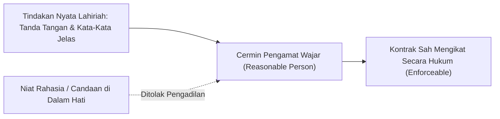
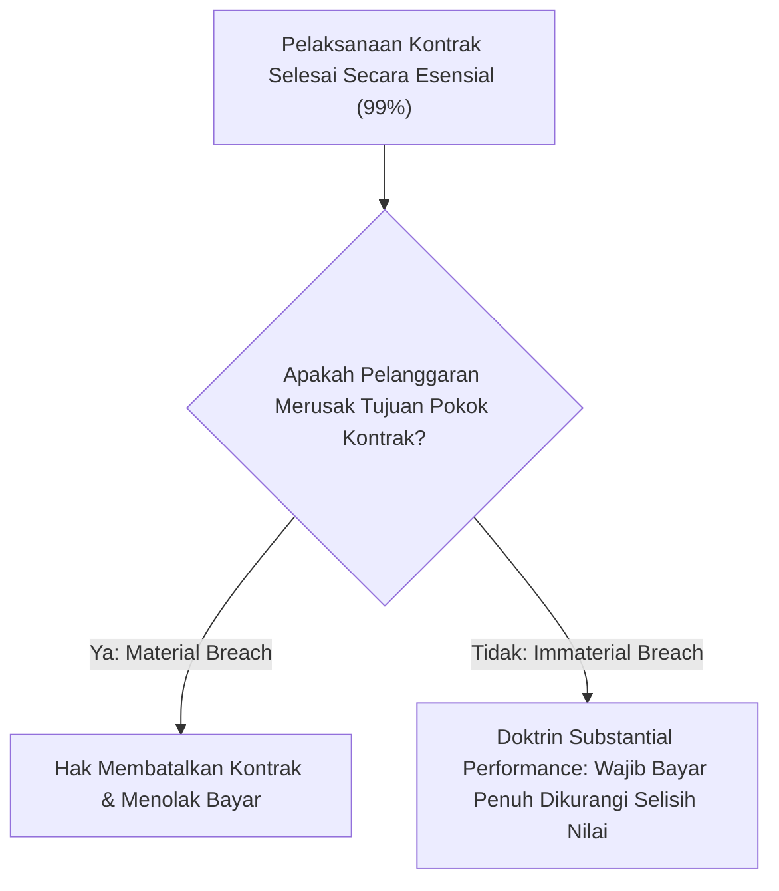
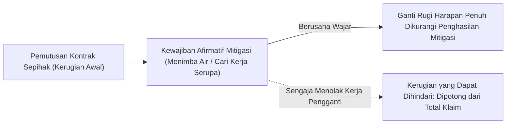

# Contract Law Basics: Formation, Breach, and Remedies

A foundational common-law jurisprudence curriculum compiled with the Human Gradient Descent paradigm. Explores objective mutual assent, consideration mechanics, material breach boundaries, and mitigation invariants in contract formation and dispute resolution.

## Objective Mutual Assent
<!-- hgd:tier: 1_foundational_fluency -->
<!-- hgd:primer: "A valid contract requires mutual assent. Under the objective theory of contracts, assent is determined by a reasonable person's outward manifestation, rather than secret subjective intent (Lucy v. Zehmer)." -->
<!-- hgd:probe: "Predict contract enforceability if Party A writes and signs a formal land sale contract but secretly considers it an elaborate practical joke." -->
<!-- hgd:truth: "The contract is binding under the objective theory of contracts: assent is judged by a reasonable person's outward manifestation, not hidden subjective intent (Lucy v. Zehmer)." -->
<!-- hgd:worked: "Worked Solution: In Lucy v. Zehmer, Zehmer claimed his agreement on a restaurant napkin was merely executed in jest. The court held that an outward expression of serious intent creates a binding contract regardless of secret mental reservations." -->
<!-- hgd:models: ["objective theory", "reasonable person", "outward manifestation", "binding"] -->
<!-- hgd:options: [
  {"optionId":"opt_a","text":"The contract is binding under the objective theory of contracts: assent is judged by a reasonable person's outward manifestation, not hidden subjective intent (Lucy v. Zehmer).","isCorrect":true,"causalRationale":"Correct: Outward objective manifestation binds the parties regardless of secret subjective intent."},
  {"optionId":"opt_b","text":"The contract is void because subjective mutual assent (meeting of minds) was absent during signing.","isCorrect":false,"diagnosticAxis":"conceptGap","causalRationale":"Subjective Fallacy: Law discarded subjective intent in favor of outward reasonable manifestation."},
  {"optionId":"opt_c","text":"The contract is unenforceable because contracts signed in social settings are per se invalid.","isCorrect":false,"diagnosticAxis":"reasoningBug","causalRationale":"Setting Irrelevance: Location does not invalidate an otherwise formal written offer and acceptance."},
  {"optionId":"opt_d","text":"The contract requires approval from the governor before any outward manifestation can be evaluated.","isCorrect":false,"diagnosticAxis":"missingPrerequisite","causalRationale":"Fictitious governmental approval requirement unrelated to common law contract formation."}
] -->

### 1. Pangkal Anomali
Dalam kehidupan bermasyarakat, kita sering mengira bahwa kesepakatan hukum yang sah mensyaratkan adanya kesamaan isi pikiran batiniah (*subjective meeting of the minds*). Kita membayangkan bahwa kedua belah pihak harus sama-sama memiliki niat tulus dari lubuk hati terdalam.

Pemikiran awam ini awalnya tampak memadai dalam relasi pertemanan akrab di mana kepercayaan timbal balik terjaga secara informal. Namun anggapan ini runtuh seketika saat diterapkan pada transaksi perniagaan dan perdagangan nyata.

Bayangkan jika seseorang menuliskan surat jual beli tanah secara resmi, menyepakati harga, dan menandatanganinya di atas materai, namun beberapa minggu kemudian ia menolak menyerahkan sertifikat tanah dengan dalih: *"Waktu itu saya hanya bercanda di dalam hati; saya tidak benar-benar berniat menjual tanah saya!"* (seperti dalam kasus hukum terkenal *Lucy v. Zehmer*).

Jika pengadilan mengizinkan orang membatalkan perjanjian hanya dengan mengklaim bahwa hatinya sedang bercanda, maka seluruh roda ekonomi perdagangan akan hancur. Pengadilan manusia tidak memiliki teknologi untuk membelah tengkorak kepala seseorang dan membaca isi hatinya; oleh karena itu kesepakatan hukum wajib ditambatkan pada manifestasi lahiriah yang tampak nyata.

### 2. Prototipe Intuitif
Bayangkan sebuah cermin pantulan di atas meja kasir toko swalayan.

Cermin kasir tersebut hanya bisa merekam apa yang tampak secara fisik di depan mata: tangan pembeli yang meletakkan uang tunai di atas meja, bibir yang mengucapkan kata setuju, dan pena yang menandatangani tanda terima. Cermin tidak bisa melihat apakah di dalam hati pembeli tersebut ia sedang menggerutu, bercanda, atau melamun.

Hukum bertindak persis seperti cermin kasir tersebut. Hukum tidak menilai apa yang Anda bisikkan di dalam hati; hukum menilai apa yang dilihat dan didengar oleh seorang "Orang Wajar" (*Reasonable Person*) yang berada di ruangan tersebut.

Jika gerak-gerik fisik, kata-kata yang diucapkan, dan tulisan yang ditandatangani mencerminkan transaksi serius di mata pengamat wajar, maka cermin merekam terjadinya kesepakatan sah yang mengikat kedua belah pihak tanpa celah keraguan subjektif.



### 3. Invarian & Operasi Inti
Invarian mutlak sistem ini adalah **Teori Objektif Perjanjian (Objective Theory of Contracts)**: keabsahan suatu kesepakatan hukum diukur semata-mata dari manifestasi lahiriah yang dapat ditangkap oleh akal sehat orang wajar (*reasonable person*).

Keterikatan hukum tidak bertumpu pada niat subjektif atau reservasi mental rahasia yang tidak diucapkan. Jika kata-kata dan tindakan Anda menunjukkan kesungguhan seorang penjual yang wajar, maka Anda terikat secara hukum, terlepas dari apa pun lelucon batin yang Anda simpan di dalam kepala.

Pihak lawan berhak mengandalkan tanda-tanda eksternal tersebut untuk mulai menanamkan modal, mengatur logistik, dan mengalokasikan sumber daya tanpa rasa cemas akan pembatalan sepihak.

Pemula sering mengira bahwa iktikad batiniah adalah penentu tunggal, padahal kepastian hukum perdata modern mengunci manifestasi obyektif sebagai invarian tertinggi guna mencegah kekacauan dalam lalu lintas bisnis.

| Apa yang Dipikirkan Pemula (Salah) | Apa yang Sebenarnya Terjadi dalam Model Mental |
|---|---|
| Kontrak otomatis batal jika penandatangan mengaku tidak bersungguh-sungguh di dalam hati. | Manifestasi lahiriah yang wajar mengikat para pihak secara mutlak tanpa memedulikan niat tersembunyi. |
| Menandatangani kesepakatan di restoran atau kafe otomatis tidak sah secara hukum. | Lokasi santai tidak membatalkan kekuatan hukum selama tindakan dan isi dokumen tertulis jelas. |
| Pengadilan wajib memanggil saksi paranormal untuk membaca isi hati terdakwa. | Pengadilan hanya memeriksa bukti fisik rekaman kata-kata, tindakan, dan teks dokumen tertulis. |

### 4. Notasi Sebagai Kontrak
Formalisasi pembentukan kontrak dibutuhkan untuk menetapkan batas tegas kapan sebuah dialog informal bertransformasi menjadi ikatan hukum yang mengikat.

Persamaan aljabar hukum di bawah ini merangkum kontrak pembentukan perjanjian yang sah:
$$K = Offer(O) + Acceptance(A)$$

Persamaan di atas menetapkan bahwa kontrak ($K$) lahir seketika saat penawaran definitif ($Offer$) disambut oleh penerimaan tegas yang setara ($Acceptance$) tanpa adanya modifikasi syarat.

Dengan mengunci persamaan ini, pengadilan tidak perlu berspekulasi mengenai motif psikologis para pihak; pembuktian cukup difokuskan pada ketersediaan bukti penawaran obyektif dan penerimaan lahiriah yang kongruen.

* `K`: Kontrak yang mengikat secara sah menurut hukum (*binding legal contract*).
* `Offer(O)`: Penawaran definitif yang dimanifestasikan secara lahiriah dengan syarat-syarat yang jelas.
* `Acceptance(A)`: Penerimaan tegas tanpa syarat (*mirror image*) yang dikomunikasikan ke pihak penawar.
* `Lucy v. Zehmer`: Preseden yurisprudensi penting yang menegakkan prinsip objektivitas lahiriah.

### Glosarium & Jembatan Konsep SMA

| Istilah | Konsep Formal | Jembatan Konsep SMA |
|---|---|---|
| Objective Mutual Assent | Kesepakatan bersama yang dinilai dari kata-kata dan perbuatan lahiriah | Mengacungkan tangan dan menyebut "Beli" di kantin; penjual menganggap transaksi sah |
| Reasonable Person | Standar hipotetis orang berakal sehat dengan kehati-hatian wajar | Teman sekelas yang berpikiran logis dan tidak mudah tertipu oleh alasan bercanda |
| Lucy v. Zehmer | Kasus hukum penting tahun 1954 yang menetapkan objektivitas kontrak | Perjanjian di atas serbet restoran tetap sah mengikat karena tampak serius bagi pembeli |
| Offer (Penawaran) | Pernyataan kesediaan terikat pada syarat tertentu jika pihak lain setuju | Murid yang menawarkan pensilnya seharga Rp 5.000 kepada teman sebangkunya |

---

## Consideration and Bargained-for Exchange
<!-- hgd:prereqs: ["Objective Mutual Assent"] -->
<!-- hgd:tier: 2_boundary_perturbation -->
<!-- hgd:primer: "Enforceable promises require consideration: a bargained-for exchange of legal value. Past consideration or moral gratitude does not constitute consideration for a new contract." -->
<!-- hgd:probe: "Predict whether an employer's promise to pay a retiring employee an extra bonus 'in gratitude for 30 years of past loyal service' forms an enforceable contract." -->
<!-- hgd:truth: "Unenforceable for lack of consideration: past consideration was not bargained-for in exchange for the new promise, unless promissory estoppel or written statutory reliance applies." -->
<!-- hgd:worked: "Worked Solution: Past consideration is no consideration. Because the 30 years of service were performed before the employer's promise was made, the service was not bargained for in exchange for the bonus." -->
<!-- hgd:models: ["past consideration", "bargained-for exchange", "legal detriment", "unenforceable"] -->
<!-- hgd:options: [
  {"optionId":"opt_a","text":"Unenforceable for lack of consideration: past consideration was not bargained-for in exchange for the new promise, unless promissory estoppel or written statutory reliance applies.","isCorrect":true,"causalRationale":"Correct: Past service cannot serve as fresh bargained-for exchange for a future promise."},
  {"optionId":"opt_b","text":"Enforceable because 30 years of loyal service constitutes sufficient moral obligation.","isCorrect":false,"diagnosticAxis":"conceptGap","causalRationale":"Moral Obligation Fallacy: Moral gratitude is not recognized as legal consideration in contract law."},
  {"optionId":"opt_c","text":"Enforceable under the doctrine of substantial performance.","isCorrect":false,"diagnosticAxis":"methodChoice","causalRationale":"Doctrine Confusion: Substantial performance applies to breach remedies, not formation consideration."},
  {"optionId":"opt_d","text":"Enforceable only if the retiring employee was born on a leap year.","isCorrect":false,"diagnosticAxis":"reasoningBug","causalRationale":"Arbitrary superstitious condition unrelated to common law contract jurisprudence."}
] -->

### 1. Pangkal Anomali
Dalam pergaulan sosial sehari-hari, kita sering membuat janji karena rasa terima kasih atau kesopanan moral. Misalnya seorang paman berkata kepada keponakannya: *"Sebagai hadiah karena kamu sudah menjadi anak baik tahun lalu, paman berjanji akan membelikanmu sepeda motor baru bulan depan."*

Di lingkungan keluarga, janji semacam ini dipandang terhormat dan diharapkan ditepati sebagai kewajiban etika moral. Namun dalam hukum kontrak perdata, relasi sosial ini membentur dinding pemisah yurisdiksi yang sangat tegas.

Jika paman tersebut berubah pikiran dan membatalkan janjinya, keponakan tidak bisa menggugat paman ke pengadilan perdata untuk menuntut penyerahan motor! Mengapa hukum menolak menegakkan janji hadiah cuma-cuma (*gratuitous promise*)?

Masalahnya terletak pada ketiadaan timbal balik bernilai hukum (*Consideration*). Pengadilan perdata dibiayai oleh pajak negara untuk memfasilitasi pertukaran ekonomi produktif, bukan untuk mengadili perselisihan janji hadiah sepihak; oleh sebab itu janji wajib dibeli lewat tawar-menawar timbal balik (*bargained-for exchange*).

### 2. Prototipe Intuitif
Bayangkan sebuah papan jungkat-jungkit dua arah di taman bermain sekolah.

Sebuah kontrak hukum persis seperti jungkat-jungkit yang harus bergerak seimbang: Anda tidak bisa menuntut sisi lawan turun jika sisi Anda sendiri tidak diisi beban nyata apa pun.

Sisi A meletakkan beban berupa barang, jasa, atau penahanan hak (*legal detriment*), sementara Sisi B meletakkan beban berupa pembayaran uang atau penyerahan kompensasi (*legal benefit*).

Jika Anda meminta janji baru dari seseorang hanya atas dasar jasa Anda yang sudah selesai 10 tahun lalu (*Past Consideration*), jungkat-jungkit tidak akan bergerak karena beban masa lalu sudah mengendap di tanah dan tidak bisa dijadikan alat tukar segar untuk menggerakkan janji masa depan.

```mermaid
flowchart LR
    PartyA["Pihak A (Menyerahkan Pengorbanan Hukum)"] <-->|Bargained-For Exchange (Imbalan Langsung)| PartyB["Pihak B (Menyerahkan Imbalan Hukum)"]
```

### 3. Invarian & Operasi Inti
Invarian mutlak sistem ini adalah **Mutualitas Kewajiban Timbal Balik (Consideration Doctrine)**: janji yang dapat dipaksakan di pengadilan wajib lahir dari pertukaran tawar-menawar (*bargained-for exchange*).

Setiap pihak wajib memberikan sesuatu yang bernilai hukum sebagai imbalan langsung atas janji pihak lain (*quid pro quo*). Nilai hukum ini dapat berupa melakukan sesuatu yang tidak wajib dilakukan, atau menahan diri dari tindakan yang sah menurut hukum.

Prinsip fundamental *Past Consideration is No Consideration* menegaskan bahwa perbuatan yang telah selesai dilakukan di masa lalu tanpa kaitan dengan janji baru tidak memiliki nilai tukar untuk mengikat janji yang baru diucapkan.

Pemula sering mengira janji tertulis otomatis mengikat, padahal tanpa adanya timbal balik segar, janji tersebut tetap berstatus hibah cuma-cuma yang tidak dapat dipaksakan pemenuhannya melalui gugatan kontrak.

| Apa yang Dipikirkan Pemula (Salah) | Apa yang Sebenarnya Terjadi dalam Model Mental |
|---|---|
| Setiap janji tertulis di atas kertas otomatis mengikat secara hukum. | Janji wajib didukung oleh pertukaran nilai timbal balik (*quid pro quo*). |
| Rasa terima kasih atau kewajiban moral bernilai sama dengan consideration hukum. | Kewajiban moral tidak diakui sebagai consideration yang dapat dipaksakan di pengadilan. |
| Hadiah cuma-cuma dapat dituntut di pengadilan jika pemberi janji mengingkarinya. | Janji hadiah sepihak tidak memiliki kekuatan eksekusi hukum kontrak. |

### 4. Notasi Sebagai Kontrak
Formula pertukaran timbal balik merumuskan kesetaraan beban hukum yang harus ada pada setiap perjanjian yang sah.

Hubungan tawar-menawar ini diformalkan dalam kontrak aljabar berikut:
$$C = Detriment(A) \leftrightarrow Benefit(B)$$

Persamaan di atas mendefinisikan bahwa consideration ($C$) tercipta hanya jika pengorbanan hukum Pihak A ditukar secara langsung dengan manfaat hukum Pihak B melalui negosiasi aktif.

Kontrak ini menjadi saringan yuridis yang melindungi warga dari tuntutan sewenang-wenang atas ucapan santai, memastikan hanya transaksi yang memiliki komitmen dua arah yang memperoleh perlindungan aparat penegak hukum.

* `C`: *Consideration* (prestasi timbal balik yang sah menurut hukum).
* `Detriment(A)`: Pengorbanan hukum pihak A (melakukan prestasi atau menahan hak legal).
* `Benefit(B)`: Manfaat hukum yang diperoleh pihak B sebagai hasil pertukaran langsung.
* `Quid Pro Quo`: Prinsip dasar ada barang ada imbalan dalam pembentukan perjanjian.

### Glosarium & Jembatan Konsep SMA

| Istilah | Konsep Formal | Jembatan Konsep SMA |
|---|---|---|
| Consideration | Nilai hukum timbal balik yang disepakati untuk ditukarkan | Barter di kantin sekolah; kamu dapat roti bakar karena kamu menyerahkan uang jajan |
| Bargained-for Exchange | Proses tawar-menawar di mana janji memicu prestasi timbal balik | Negosiasi: "Aku beri buku ini asalkan kamu bantu membetulkan rantai sepeda" |
| Past Consideration | Prestasi yang telah selesai dilakukan sebelum janji baru diucapkan | Meminta uang jajan hari ini atas dasar kemarin sudah merapikan tempat tidur |
| Gratuitous Promise | Janji memberi hadiah sepihak tanpa menuntut imbalan dari penerima | Traktiran ulang tahun yang tidak bisa digugat ke pengadilan jika temanmu batal mentraktir |

---

## Material Breach and Constructive Conditions
<!-- hgd:prereqs: ["Consideration and Bargained-for Exchange"] -->
<!-- hgd:tier: 3_isomorphic_transfer -->
<!-- hgd:primer: "When a party commits an immaterial breach, the contract is not forfeited. Under substantial performance (Jacob & Youngs v. Kent), the owner must pay and can only sue for damages." -->
<!-- hgd:probe: "Predict whether a homeowner can lawfully terminate a building contract and refuse payment if the builder used identical pipe of Brand B instead of Brand A." -->
<!-- hgd:truth: "Cannot terminate: under the doctrine of substantial performance (Jacob & Youngs v. Kent), an immaterial breach only entitles the owner to difference-in-value damages, not contract forfeiture." -->
<!-- hgd:worked: "Worked Solution: In Jacob & Youngs v. Kent, the builder installed Reading pipe instead of Cohoes pipe, which were identical in quality. Justice Cardozo held that trivial variances do not discharge payment when the builder substantially performed." -->
<!-- hgd:models: ["substantial performance", "immaterial breach", "constructive condition", "damages only"] -->
<!-- hgd:options: [
  {"optionId":"opt_a","text":"Cannot terminate: under the doctrine of substantial performance (Jacob & Youngs v. Kent), an immaterial breach only entitles the owner to difference-in-value damages, not contract forfeiture.","isCorrect":true,"causalRationale":"Correct: Substantial performance prevents forfeiture for minor, immaterial variances."},
  {"optionId":"opt_b","text":"Can terminate immediately because any deviation from express contract specifications constitutes a complete material breach.","isCorrect":false,"diagnosticAxis":"conceptGap","causalRationale":"Strict Condition Fallacy: Equity rejects economic forfeiture when performance is substantially complete."},
  {"optionId":"opt_c","text":"Owner must pay full contract price with zero deduction because the builder acted in good faith.","isCorrect":false,"diagnosticAxis":"reasoningBug","causalRationale":"Damage Entitlement Slip: Immaterial breach still entitles the non-breaching party to nominal or difference-in-value damages."},
  {"optionId":"opt_d","text":"The house must be immediately demolished by city police without trial.","isCorrect":false,"diagnosticAxis":"missingPrerequisite","causalRationale":"Extravagant criminal penalty that has zero foundation in civil contract law."}
] -->

### 1. Pangkal Anomali
Bayangkan Anda menyewa seorang kontraktor untuk membangun rumah tinggal senilai Rp 1.000.000.000. Kontraktor menyelesaikan rumah tersebut dengan sangat megah, kokoh, dan siap huni.

Namun saat memeriksa kamar mandi, Anda menemukan bahwa pipa air yang dipasang di dalam dinding bermerek *Reading Pipe*, padahal dalam lampiran perjanjian tertulis merek *Cohoes Pipe*. Kedua pipa ini terbuat dari besi galvanis yang persis sama, memiliki daya tahan yang identik, dan harga di toko bangunan sama persis.

Pemilik rumah kemudian menyatakan: *"Anda telah melanggar klausul kontrak! Karena Anda tidak memasang pipa merek Cohoes, saya membatalkan seluruh kontrak dan menolak membayar sisa tagihan Rp 500.000.000!"*

Jika hukum mengizinkan pembatalan total atas pelanggaran sepele semacam ini, maka para pembeli yang beritikad buruk akan selalu mencari kesalahan kecil untuk menghindari kewajiban pembayaran mereka (*economic forfeiture*).

### 2. Prototipe Intuitif
Bayangkan instalasi pipa air di sebuah bangunan bertingkat.

Terdapat dua jenis kebocoran yang sangat berbeda dalam operasional gedung:
* **Kasus 1: Pipa Utama Pecah (Material Breach)**: Pipa saluran utama pecah sehingga air membanjiri ruang tamu dan membahayakan pondasi bangunan. Tujuan pokok rumah tidak tercapai. Di sini, katup air utama wajib ditutup total dan pembayaran dihentikan sementara.
* **Kasus 2: Warna Cat Pipa Sedikit Pudar (Immaterial Breach)**: Air tetap mengalir jernih dan lancar dengan tekanan sempurna, hanya warna cat pipa di dalam gudang sedikit pudar. Katup air utama tidak boleh ditutup! Pemilik rumah cukup meminta ganti rugi seharga satu kaleng cat untuk mengecat ulang.

Pembedaan tingkat keparahan ini mencegah tindakan reaksioner yang merusak keseluruhan sistem hanya karena ketidaksempurnaan kosmetik yang mudah diperbaiki.



### 3. Invarian & Operasi Inti
Invarian mutlak sistem adalah **Doktrin Pelaksanaan Substansial (Substantial Performance - Jacob & Youngs v. Kent)**: jika satu pihak telah melaksanakan kewajiban pokoknya dengan itikad baik dan hanya melakukan penyimpangan minor yang tidak melukai esensi kontrak, pihak lain **dilarang membatalkan kontrak** (*cannot forfeit*).

Kewajiban pembayaran tetap berlaku penuh, dikurangi selisih depresiasi riil (*difference-in-value*) antara apa yang dijanjikan dan apa yang diserahkan.

Prinsip keadilan (*equity*) menolak penghancuran nilai ekonomi yang tidak proporsional hanya demi menegakkan kepatuhan kata-demi-kata yang kaku.

Pemula sering mengira setiap wanprestasi memberi hak membatalkan perjanjian, padahal hukum secara cermat membedakan pelanggaran material yang menggagalkan tujuan dengan pelanggaran non-material yang cukup diselesaikan lewat ganti rugi selisih nilai.

| Apa yang Dipikirkan Pemula (Salah) | Apa yang Sebenarnya Terjadi dalam Model Mental |
|---|---|
| Setiap kesalahan kecil dalam kontrak otomatis memberi hak pembatalan total. | Hukum membedakan pelanggaran material (hak terminasi) dengan pelanggaran minor (hak ganti rugi selisih nilai). |
| Kontraktor yang salah merek pipa tidak berhak menerima uang sepeser pun. | Kontraktor berhak atas seluruh sisa pembayaran kontrak dikurangi kompensasi kerusakan riil. |
| Pelaksanaan substansial berarti pembuat janji bebas melanggar perjanjian kapan saja. | Pelanggaran yang disengaja dengan niat jahat (*willful breach*) tidak dilindungi oleh doktrin ini. |

### 4. Notasi Sebagai Kontrak
Batasan pemulihan hukum atas pelanggaran kontrak diformalkan dalam hubungan pemisahan ganti rugi versus pembatalan.

Persamaan kontrak di bawah ini membatasi pemulihan pada kompensasi selisih nilai riil:
$$Remedy = DifferenceInValue \neq ContractForfeiture$$

Persamaan di atas menegaskan bahwa pemulihan (*Remedy*) untuk penyimpangan immaterial dibatasi pada selisih nilai (*DifferenceInValue*), dan secara tegas menolak pemutusan perjanjian sepihak (*ContractForfeiture*).

Dengan berpatokan pada formula ini, hakim dan para pihak memiliki kepastian matematis bahwa penyimpangan minor bernilai selisih nol (seperti pipa identik merek berbeda) tidak akan menghanguskan hak tagih atas pekerjaan yang telah diselesaikan dengan itikad baik.

* `Substantial Performance`: Pemenuhan tujuan pokok kontrak di atas 95% dengan itikad baik.
* `Jacob & Youngs v. Kent`: Putusan hakim legendaris Benjamin Cardozo yang menolak pembatalan kontrak atas deviasi pipa minor.
* `DifferenceInValue`: Kompensasi selisih nilai pasar antara pipa Reading dan pipa Cohoes (bernilai nol).
* `Material Breach`: Pelanggaran substansial yang menggagalkan tujuan pokok perjanjian.

### Glosarium & Jembatan Konsep SMA

| Istilah | Konsep Formal | Jembatan Konsep SMA |
|---|---|---|
| Material Breach | Pelanggaran kontrak mendasar yang menggagalkan tujuan pokok perjanjian | Memesan seragam olahraga ukuran L tetapi yang dikirim seragam ukuran balita |
| Immaterial Breach | Penyimpangan minor yang tidak merusak fungsi utama perjanjian | Memesan buku sampul biru tua tetapi yang dikirim bersampul biru dongker |
| Substantial Performance | Doktrin melindungi pihak yang telah menyelesaikan hampir seluruh kewajibannya | Mengerjakan 98 soal ujian dengan benar; guru tidak boleh memberi nilai nol |
| Jacob & Youngs v. Kent | Putusan yurisprudensi penting yang menetapkan doktrin pelaksanaan substansial | Kasus nyata perselisihan merek pipa air di rumah tinggal mewah New York |

---

## Expectation Damages and Mitigation
<!-- hgd:prereqs: ["Material Breach and Constructive Conditions"] -->
<!-- hgd:tier: 4_adversarial_dilemma -->
<!-- hgd:primer: "Contract remedies place the injured party in the position they would have occupied had the contract been performed. Under the duty to mitigate, avoidable damages cannot be recovered." -->
<!-- hgd:probe: "Predict whether a wrongfully terminated employee who rejects an identical job in the same city can recover their full unpaid contract salary." -->
<!-- hgd:truth: "Recovery is reduced by the avoidable salary under the doctrine of avoidable consequences: an aggrieved party has an affirmative duty to mitigate damages with reasonable effort." -->
<!-- hgd:worked: "Worked Solution: The injured party has a duty to mitigate damages by accepting substantially similar employment. Rejecting an identical replacement job means the resulting wage loss was avoidable and cannot be recovered from the breaching employer." -->
<!-- hgd:models: ["mitigation", "avoidable consequences", "expectation damages", "reduction"] -->
<!-- hgd:options: [
  {"optionId":"opt_a","text":"Recovery is reduced by the avoidable salary under the doctrine of avoidable consequences: an aggrieved party has an affirmative duty to mitigate damages with reasonable effort.","isCorrect":true,"causalRationale":"Correct: The duty to mitigate deducts losses that could have been avoided with reasonable effort."},
  {"optionId":"opt_b","text":"The employee recovers 100% full salary because breach damages are designed to punish wrongful termination.","isCorrect":false,"diagnosticAxis":"conceptGap","causalRationale":"Punitive Fallacy: Contract damages are compensatory, never punitive."},
  {"optionId":"opt_c","text":"The employee forfeits all remedies because rejecting an alternative job constitutes a waiver of breach claims.","isCorrect":false,"diagnosticAxis":"reasoningBug","causalRationale":"Waiver Confusion: Failure to mitigate only reduces damages; it does not extinguish the breach claim itself."},
  {"optionId":"opt_d","text":"The employer is immediately sentenced to 10 years in federal prison for breach of contract.","isCorrect":false,"diagnosticAxis":"missingPrerequisite","causalRationale":"Confuses civil breach of contract remedies with criminal penal sanctions."}
] -->

### 1. Pangkal Anomali
Bayangkan seorang manajer keuangan memiliki kontrak kerja selama 1 tahun dengan gaji Rp 20.000.000 per bulan. Pada bulan kedua, perusahaan secara mendadak memecatnya secara sewenang-wenang tanpa alasan sah (*wrongful termination*).

Satu minggu kemudian, perusahaan saingan yang berada di seberang jalan menawarkan posisi dan gaji yang persis sama. Namun sang manajer menolak tawaran tersebut dan memilih berlibur santai di rumah selama 10 bulan penuh sambil berpikir: *"Biar saja aku menganggur, nanti di pengadilan aku akan menuntut bekas perusahaanku membayar ganti rugi penuh 10 bulan gaji yaitu Rp 200.000.000!"*

Apakah pengadilan akan mengabulkan tuntutan tersebut secara membabi-buta? Jika hukum mengizinkan korban pemutusan kontrak untuk bermalas-malasan dan membiarkan kerugian membengkak tanpa berusaha mencari pengganti, maka efisiensi perekonomian nasional akan mengalami pemborosan sumber daya yang masif (*economic waste*).

Hukum perdata tidak boleh dijadikan instrumen pemerasan atau tempat mencari keuntungan pasif; kompensasi harus mencerminkan kerugian bersih setelah upaya wajar dilakukan.

### 2. Prototipe Intuitif
Bayangkan sebuah perahu nelayan yang sedang bersandar di dermaga dan lambungnya tertabrak oleh perahu lain hingga mengalami kebocoran kecil.

Pemilik perahu yang tertabrak tentu berhak meminta ganti rugi biaya penambalan lambung perahu kepada pihak penabrak. Namun ia tidak boleh sengaja duduk bersila di pinggir dermaga sambil tersenyum menonton air perlahan menenggelamkan perahunya ke dasar danau tanpa berusaha menimba air keluar (*mitigasi kerugian*), lalu menuntut ganti rugi kapal selam mewah yang baru!

Hukum mengharuskan korban untuk mengambil ember dan berusaha menimba air agar kerusakan tidak meluas ke muatan kargo. Biaya pembelian ember dan tenaga menimba air akan diganti penuh oleh pihak penabrak, tetapi kerusakan tambahan akibat sengaja membiarkan kapal tenggelam adalah tanggung jawab korban sendiri.

Prinsip ini menegaskan bahwa keadilan mengharuskan kedua belah pihak bertindak wajar guna meminimalkan kehancuran aset produktif di masyarakat.



### 3. Invarian & Operasi Inti
Invarian mutlak sistem pemulihan kontrak adalah **Kewajiban Mitigasi Kerugian (Doctrine of Avoidable Consequences)**: tujuan ganti rugi kontrak (*Expectation Damages*) adalah menempatkan korban pada posisi finansial yang semestinya ia nikmati seandainya kontrak dilaksanakan secara sempurna.

Namun, kerugian yang secara nyata dapat dihindari melalui upaya wajar (*reasonable effort*) **tidak dapat ditagihkan kepada pelaku wanprestasi**. Ganti rugi kontrak bersifat kompensasi murni (*compensatory*), bukan hukuman denda (*punitive*).

Korban memiliki kewajiban afirmatif untuk mencari pengganti yang sepadan di pasar, dan hasil penghematan atau pendapatan dari upaya mitigasi tersebut akan diperhitungkan sebagai pengurang klaim ganti rugi.

Pemikiran awam sering keliru menduga bahwa pihak yang melanggar kontrak dapat dipenjara atau dijatuhi ganti rugi hukuman, padahal hukum perdata murni berfokus pada pemulihan kerugian ekonomi aktual.

| Apa yang Dipikirkan Pemula (Salah) | Apa yang Sebenarnya Terjadi dalam Model Mental |
|---|---|
| Ganti rugi kontrak bertujuan untuk menghukum dan memenjarakan pihak yang melanggar janji. | Ganti rugi kontrak adalah kompensasi ekonomi perdata murni untuk menutup kerugian bersih riil. |
| Korban pelanggaran kontrak boleh membiarkan kerugian membesar tanpa batas. | Korban memiliki kewajiban hukum untuk melakukan upaya wajar mencegah pembengkakan kerugian. |
| Menolak pekerjaan pengganti otomatis menghapuskan seluruh hak gugat korban. | Penolakan hanya memotong nilai kerugian yang dapat dihindari, hak gugat atas sisa kerugian tetap ada. |

### 4. Notasi Sebagai Kontrak
Formula pemulihan expectation damages mengikat kalkulasi ganti rugi bersih ke dalam perhitungan selisih matematis yang obyektif.

Persamaan di bawah ini mendefinisikan batas klaim yang dapat dituntut di hadapan majelis hakim:
$$Damages = Loss(Expectation) - Avoidable(Mitigation)$$

Persamaan di atas menegaskan bahwa ganti rugi bersih ($Damages$) diperoleh dari total ekspektasi pendapatan ($Loss(Expectation)$) dikurangi nilai kerugian yang semestinya bisa dicegah melalui ikhtiar mitigasi wajar ($Avoidable(Mitigation)$).

Melalui kontrak aljabar ini, sistem peradilan menjamin bahwa korban wanprestasi dipulihkan hak ekonominya secara penuh tanpa membuka celah pengayaan diri yang tidak sah (*unjust enrichment*).

* `Damages`: Jumlah uang kompensasi bersih yang wajib dibayarkan oleh pihak yang melanggar.
* `Loss(Expectation)`: Posisi keuntungan finansial yang semestinya dinikmati korban jika kontrak berjalan lancar.
* `Avoidable(Mitigation)`: Nilai penghasilan yang semestinya bisa diperoleh korban melalui ikhtiar wajar.
* `Incidental Damages`: Biaya tambahan yang wajar dikeluarkan korban dalam proses mitigasi pencarian kerja baru.

### Glosarium & Jembatan Konsep SMA

| Istilah | Konsep Formal | Jembatan Konsep SMA |
|---|---|---|
| Expectation Damages | Ganti rugi menempatkan korban pada posisi seolah kontrak terlaksana sempurna | Mengganti uang tiket konser yang batal ditambah selisih harga tiket pengganti |
| Mitigation of Damages | Kewajiban pihak yang dirugikan mengambil langkah wajar memperkecil kerugian | Mengambil ember menimba air saat perahu bocor agar muatan tidak ikut hanyut |
| Avoidable Consequences | Doktrin kerugian yang bisa dicegah tidak boleh dibebankan ke lawan | Tidak boleh menuntut ganti rugi seragam basah jika sengaja hujan-hujanan saat payung rusak |
| Compensatory Damages | Uang ganti rugi semata-mata menutup kerugian ekonomi aktual | Membayar tepat seharga barang yang rusak, tidak lebih dan tidak kurang |
