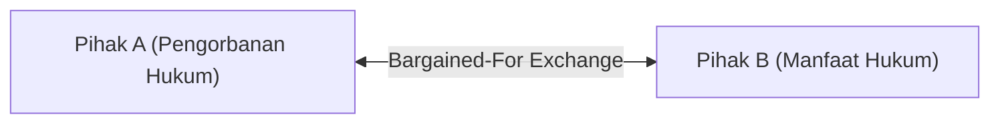

# Contract Law Foundations

A comprehensive curriculum on mutual assent, consideration doctrine, material breach, and expectation damages.

## Objective Mutual Assent
<!-- hgd:tier: 1_foundational_fluency -->
<!-- hgd:primer: "A valid contract requires mutual assent. Under the objective theory of contracts, assent is determined by a reasonable person's outward manifestation, rather than secret subjective intent (Lucy v. Zehmer)." -->
<!-- hgd:probe: "Predict contract enforceability if Party A writes and signs a formal land sale contract but secretly considers it an elaborate practical joke." -->
<!-- hgd:truth: "The contract is binding under the objective theory of contracts: assent is judged by a reasonable person's outward manifestation, not hidden subjective intent (Lucy v. Zehmer)." -->
<!-- hgd:worked: "Worked Solution: In Lucy v. Zehmer, Zehmer claimed his agreement on a restaurant napkin was merely executed in jest. The court held that an outward expression of serious intent creates a binding contract regardless of secret mental reservations." -->
<!-- hgd:models: ["objective theory", "reasonable person", "outward manifestation", "binding"] -->
<!-- hgd:options: [{"optionId":"opt_a","text":"The contract is binding under the objective theory of contracts: assent is judged by a reasonable person's outward manifestation, not hidden subjective intent (Lucy v. Zehmer).","isCorrect":true,"causalRationale":"Correct: Outward objective manifestation binds the parties regardless of secret subjective intent."},{"optionId":"opt_b","text":"The contract is void because subjective mutual assent (meeting of minds) was absent during signing.","isCorrect":false,"diagnosticAxis":"conceptGap","causalRationale":"Subjective Fallacy: Law discarded subjective intent in favor of outward reasonable manifestation."},{"optionId":"opt_c","text":"The contract is unenforceable because contracts signed in social settings are per se invalid.","isCorrect":false,"diagnosticAxis":"reasoningBug","causalRationale":"Setting Irrelevance: Location does not invalidate an otherwise formal written offer and acceptance."}] -->

### 1. Pangkal Anomali
Kita sering mengira kesepakatan hukum didasarkan pada kesamaan isi pikiran batiniah (subjective meeting of minds). Pendekatan ini runtuh seketika saat salah satu pihak menandatangani kontrak jual beli tanah resmi lalu berdalih bahwa ia hanya bercanda di dalam hati (seperti dalam kasus landmark Lucy v. Zehmer). Pengadilan tidak dapat membaca isi tengkorak kepala manusia.

### 2. Prototipe Intuitif
Bayangkan cermin pantulan di kasir toko. Cermin hanya merekam gerakan fisik tangan yang menyerahkan barang dan menandatangani kertas tanda terima. Cermin tidak bisa menangkap keraguan atau lelucon rahasia di dalam pikiran orang tersebut.

### 3. Invarian & Operasi Inti
Invarian mutlak sistem adalah **Teori Objektif Perjanjian**: keabsahan kesepakatan diukur dari manifestasi lahiriah yang dapat ditangkap oleh orang wajar (reasonable person), bukan niat subjektif rahasia.

| Apa yang Dipikirkan Pemula (Salah) | Apa yang Sebenarnya Terjadi dalam Model Mental |
|---|---|
| Kontrak batal jika penandatangan tidak bersungguh-sungguh di dalam hati. | Manifestasi lahiriah yang wajar mengikat secara mutlak tanpa memedulikan reservasi mental tersembunyi. |
| Suasana santai di restoran otomatis membatalkan keseriusan hukum. | Format dokumen tertulis yang jelas mengesampingkan dalih lelucon non-verbal. |

### 4. Notasi Sebagai Kontrak
Kesepakatan objektif dirumuskan dalam kontrak steno:
$$K = Offer(O) + Acceptance(A)$$
* `K`: Kontrak yang mengikat secara hukum (binding agreement).
* `Offer(O)`: Penawaran definitif yang dimanifestasikan ke luar.
* `Acceptance(A)`: Penerimaan tegas tanpa syarat.
* `Lucy v. Zehmer`: Preseden yurisprudensi objektivitas manifestasi lahiriah.

### 5. Uji Tegangan Batas
Prediksikan keabsahan kontrak jika Pihak A menandatangani kontrak tanah resmi namun diam-diam menganggapnya sebagai lelucon belaka!

## Consideration and Bargained-for Exchange
<!-- hgd:prereqs: ["Objective Mutual Assent"] -->
<!-- hgd:tier: 2_boundary_perturbation -->
<!-- hgd:primer: "Enforceable promises require consideration: a bargained-for exchange of legal value. Past consideration or moral gratitude does not constitute consideration for a new contract." -->
<!-- hgd:probe: "Predict whether an employer's promise to pay a retiring employee an extra bonus 'in gratitude for 30 years of past loyal service' forms an enforceable contract." -->
<!-- hgd:truth: "Unenforceable for lack of consideration: past consideration was not bargained-for in exchange for the new promise, unless promissory estoppel or written statutory reliance applies." -->
<!-- hgd:worked: "Worked Solution: Past consideration is no consideration. Because the 30 years of service were performed before the employer's promise was made, the service was not bargained for in exchange for the bonus." -->
<!-- hgd:models: ["past consideration", "bargained-for exchange", "legal detriment", "unenforceable"] -->
<!-- hgd:options: [{"optionId":"opt_a","text":"Unenforceable for lack of consideration: past consideration was not bargained-for in exchange for the new promise, unless promissory estoppel or written statutory reliance applies.","isCorrect":true,"causalRationale":"Correct: Past service cannot serve as fresh bargained-for exchange for a future promise."},{"optionId":"opt_b","text":"Enforceable because 30 years of loyal service constitutes sufficient moral obligation.","isCorrect":false,"diagnosticAxis":"conceptGap","causalRationale":"Moral Obligation Fallacy: Moral gratitude is not recognized as legal consideration in contract law."},{"optionId":"opt_c","text":"Enforceable under the doctrine of substantial performance.","isCorrect":false,"diagnosticAxis":"methodChoice","causalRationale":"Doctrine Confusion: Substantial performance applies to breach remedies, not formation consideration."}] -->

### 1. Pangkal Anomali
Di pergaulan sosial kita biasa menjanjikan hadiah atas dasar rasa terima kasih. Namun ketika seorang majikan berjanji memberikan bonus pensiun atas 30 tahun jasa masa lalu lalu mengingkarinya, hukum menolak menegakkan janji tersebut sebagai kontrak yang sah.

### 2. Prototipe Intuitif
Bayangkan timbangan jungkat-jungkit dua arah. Sebuah kontrak hanya bisa bergerak seimbang jika beban ditaruh serentak di kedua sisi: Anda memberikan nilai X karena pihak lain menyerahkan nilai Y sebagai imbalan tawar-menawar langsung (bargained-for exchange).

### 3. Invarian & Operasi Inti
Invarian mutlak sistem adalah **Mutualitas Kewajiban (Consideration)**: prestasi yang telah selesai di masa lalu (past consideration) tidak memiliki nilai timbal balik untuk mengikat janji baru.

| Apa yang Dipikirkan Pemula (Salah) | Apa yang Sebenarnya Terjadi dalam Model Mental |
|---|---|
| Janji tertulis apa pun otomatis mengikat secara hukum. | Janji wajib didukung oleh pertukaran nilai timbal balik (quid pro quo). |
| Kewajiban moral bernilai sama dengan consideration hukum. | Kewajiban moral tidak dapat dipaksakan sebagai kontrak di pengadilan. |

### 4. Notasi Sebagai Kontrak
Doktrin consideration dirumuskan dalam kontrak tawar-menawar:
$$C = Detriment(A) \leftrightarrow Benefit(B)$$
* `C`: Consideration (prestasi hukum timbal balik).
* `Detriment(A)`: Pengorbanan hukum yang diberikan pihak pertama.
* `Benefit(B)`: Manfaat yang diperoleh pihak kedua dalam pertukaran.

### 5. Uji Tegangan Batas
Prediksikan apakah janji majikan membayar bonus atas jasa 30 tahun masa lalu membentuk kontrak yang dapat ditegakkan di pengadilan!

## Material Breach and Constructive Conditions
<!-- hgd:prereqs: ["Consideration and Bargained-for Exchange"] -->
<!-- hgd:tier: 3_isomorphic_transfer -->
<!-- hgd:primer: "When a party commits an immaterial breach, the contract is not forfeited. Under substantial performance (Jacob & Youngs v. Kent), the owner must pay and can only sue for damages." -->
<!-- hgd:probe: "Predict whether a homeowner can lawfully terminate a building contract and refuse payment if the builder used identical pipe of Brand B instead of Brand A." -->
<!-- hgd:truth: "Cannot terminate: under the doctrine of substantial performance (Jacob & Youngs v. Kent), an immaterial breach only entitles the owner to difference-in-value damages, not contract forfeiture." -->
<!-- hgd:worked: "Worked Solution: In Jacob & Youngs v. Kent, the builder installed Reading pipe instead of Cohoes pipe, which were identical in quality. Justice Cardozo held that trivial variances do not discharge payment when the builder substantially performed." -->
<!-- hgd:models: ["substantial performance", "immaterial breach", "constructive condition", "damages only"] -->
<!-- hgd:options: [{"optionId":"opt_a","text":"Cannot terminate: under the doctrine of substantial performance (Jacob & Youngs v. Kent), an immaterial breach only entitles the owner to difference-in-value damages, not contract forfeiture.","isCorrect":true,"causalRationale":"Correct: Substantial performance prevents forfeiture for minor, immaterial variances."},{"optionId":"opt_b","text":"Can terminate immediately because any deviation from express contract specifications constitutes a complete material breach.","isCorrect":false,"diagnosticAxis":"conceptGap","causalRationale":"Strict Condition Fallacy: Equity rejects economic forfeiture when performance is substantially complete."},{"optionId":"opt_c","text":"Owner must pay full contract price with zero deduction because the builder acted in good faith.","isCorrect":false,"diagnosticAxis":"reasoningBug","causalRationale":"Damage Entitlement Slip: Immaterial breach still entitles the non-breaching party to nominal or difference-in-value damages."}] -->

### 1. Pangkal Anomali
Pemilik rumah sering berupaya membatalkan seluruh pembayaran kontrak pembangunan hanya karena pipa yang dipasang bermerek Reading Pipe Brand B bukannya Brand A, padahal kualitas fisiknya identik. Jika deviasi sepele membatalkan seluruh pembayaran, industri konstruksi akan lumpuh akibat pemerasan pembeli.

### 2. Prototipe Intuitif
Bayangkan saluran pipa air di sebuah bangunan. Jika sambungan pipa utama pecah dan merendam seluruh fondasi (material breach), katup air wajib ditutup total. Namun jika cat pipa luar sedikit berbeda merek (immaterial breach), air tetap mengalir lancar dan pemilik cukup meminta selisih harga cat kaleng.

### 3. Invarian & Operasi Inti
Invarian mutlak sistem adalah **Doktrin Pelaksanaan Substansial (Substantial Performance - Jacob & Youngs v. Kent)**: pelanggaran minor yang tidak melukai tujuan pokok kontrak tidak membatalkan kewajiban pihak lain, melainkan hanya memberikan hak klaim ganti rugi selisih nilai.

| Apa yang Dipikirkan Pemula (Salah) | Apa yang Sebenarnya Terjadi dalam Model Mental |
|---|---|
| Setiap pelanggaran klausul kontrak otomatis membatalkan seluruh kesepakatan. | Hukum membedakan pelanggaran material (hak terminasi) dengan pelanggaran minor (ganti rugi selisih nilai). |
| Kontraktor yang melakukan kesalahan kecil tidak berhak dibayar sepeser pun. | Kontraktor berhak atas nilai kontrak penuh dikurangi selisih depresiasi kerusakan. |

### 4. Notasi Sebagai Kontrak
Pembedaan akibat hukum pelanggaran dikontrakkan sebagai berikut:
$$Remedy = DifferenceInValue \neq ContractForfeiture$$
* `Substantial Performance`: Pemenuhan esensial tujuan kontrak.
* `Jacob & Youngs v. Kent`: Preseden penolakan pembatalan kontrak atas deviasi merek pipa minor.
* `DifferenceInValue`: Ganti rugi proporsional selisih nilai riil.

### 5. Uji Tegangan Batas
Prediksikan apakah pemilik rumah berhak membatalkan kontrak jika kontraktor memasang pipa identik merek Brand B bukannya Brand A!

## Expectation Damages and Mitigation
<!-- hgd:prereqs: ["Material Breach and Constructive Conditions"] -->
<!-- hgd:tier: 4_adversarial_dilemma -->
<!-- hgd:primer: "Contract remedies place the injured party in the position they would have occupied had the contract been performed. Under the duty to mitigate, avoidable damages cannot be recovered." -->
<!-- hgd:probe: "Predict whether an wrongfully terminated employee who rejects an identical job in the same city can recover their full unpaid contract salary." -->
<!-- hgd:truth: "Recovery is reduced by the avoidable salary under the doctrine of avoidable consequences: an aggrieved party has an affirmative duty to mitigate damages with reasonable effort." -->
<!-- hgd:worked: "Worked Solution: The injured party has a duty to mitigate damages by accepting substantially similar employment. Rejecting an identical replacement job means the resulting wage loss was avoidable and cannot be recovered from the breaching employer." -->
<!-- hgd:models: ["mitigation", "avoidable consequences", "expectation damages", "reduction"] -->
<!-- hgd:options: [{"optionId":"opt_a","text":"Recovery is reduced by the avoidable salary under the doctrine of avoidable consequences: an aggrieved party has an affirmative duty to mitigate damages with reasonable effort.","isCorrect":true,"causalRationale":"Correct: The duty to mitigate deducts losses that could have been avoided with reasonable effort."},{"optionId":"opt_b","text":"The employee recovers 100% full salary because breach damages are designed to punish wrongful termination.","isCorrect":false,"diagnosticAxis":"conceptGap","causalRationale":"Punitive Fallacy: Contract damages are compensatory, never punitive."},{"optionId":"opt_c","text":"The employee forfeits all remedies because rejecting an alternative job constitutes a waiver of breach claims.","isCorrect":false,"diagnosticAxis":"reasoningBug","causalRationale":"Waiver Confusion: Failure to mitigate only reduces damages; it does not extinguish the breach claim itself."}] -->

### 1. Pangkal Anomali
Karyawan yang dipecat secara sewenang-wenang sering kali sengaja berdiam diri di rumah dan menolak tawaran pekerjaan pengganti yang identik di kota yang sama dengan asumsi pengadilan akan memberinya gaji penuh tanpa potongan.

### 2. Prototipe Intuitif
Bayangkan sebuah perahu bocor akibat kelalaian perahu lain. Pemilik perahu berhak menuntut ongkos tambal perahu, tetapi ia tidak boleh sengaja duduk diam menonton perahu tenggelam ke dasar danau tanpa menimba air (mitigasi) lalu menuntut ganti rugi kapal selam baru.

### 3. Invarian & Operasi Inti
Invarian mutlak sistem adalah **Kewajiban Mitigasi Kerugian (Doctrine of Avoidable Consequences)**: pemulihan ganti rugi bertujuan mengembalikan posisi harapan (expectation interest), namun kerugian yang sebenarnya dapat dicegah dengan usaha wajar tidak boleh dibebankan kepada pelaku wanprestasi.

| Apa yang Dipikirkan Pemula (Salah) | Apa yang Sebenarnya Terjadi dalam Model Mental |
|---|---|
| Ganti rugi kontrak bertujuan menghukum pihak yang melanggar janji. | Ganti rugi kontrak bersifat kompensatoris untuk menutup kerugian riil, bukan denda hukuman. |
| Korban wanprestasi boleh membiarkan kerugian membesar tanpa batas. | Korban memiliki kewajiban afirmatif untuk memitigasi kerugian yang dapat dihindari. |

### 4. Notasi Sebagai Kontrak
Rumus pemulihan expectation damages dikontrakkan sebagai:
$$Damages = Loss(Expectation) - Avoidable(Mitigation)$$
* `Loss(Expectation)`: Posisi yang semestinya dinikmati korban jika kontrak terlaksana penuh.
* `Avoidable(Mitigation)`: Kerugian yang dapat dihindari dengan upaya wajar yang wajib dipotong.
* `DutyToMitigate`: Kontrak pencegahan pemborosan ekonomi (avoidable consequences).

### 5. Uji Tegangan Batas
Prediksikan apakah karyawan yang dipecat secara sewenang-wenang dapat menuntut gaji penuh setahun jika ia menolak tawaran pekerjaan identik di kota yang sama!
