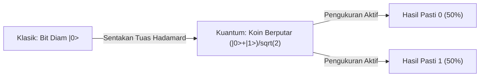
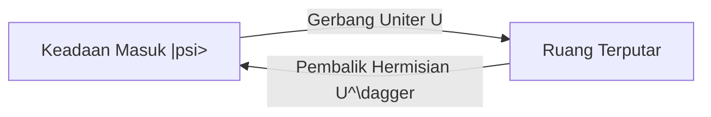
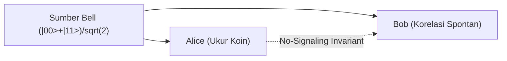

# Quantum Computing Foundations

A comprehensive curriculum on quantum information theory, superposition, entanglement, and algorithmic speedups.

## Qubits and Superposition
<!-- hgd:tier: 1_foundational_fluency -->
<!-- hgd:primer: "A classical bit is strictly 0 or 1. A qubit exists in a simultaneous linear superposition of |0> and |1>. A Hadamard gate is a foundational operation that transforms definite state |0> into an equal superposition where both outcomes become equally likely upon measurement." -->
<!-- hgd:probe: "If a qubit initialized in state |0> is transformed by a Hadamard gate into an equal superposition, predict the probability distribution of measuring |0> versus |1>." -->
<!-- hgd:truth: "Measurement collapses the equal superposition (1/sqrt(2)|0> + 1/sqrt(2)|1>) into |0> with 50% probability and |1> with 50% probability." -->
<!-- hgd:worked: "Worked Solution: The Hadamard gate maps |0> to (|0> + |1>)/sqrt(2). The probability of measuring state |k> equals the squared amplitude |1/sqrt(2)|^2 = 1/2 = 50%. Thus, measuring yields 50% probability for |0> and 50% probability for |1>." -->
<!-- hgd:models: ["hadamard", "superposition", "equal probability", "50%", "collapse"] -->
<!-- hgd:options: [{"optionId":"opt_a","text":"Equal 50% probability for |0> and 50% probability for |1>, because the Hadamard gate creates an equal superposition (|0> + |1>)/sqrt(2), and measuring collapses the probability proportional to squared amplitude |1/sqrt(2)|^2 = 0.5.","isCorrect":true,"causalRationale":"Correct! The Hadamard gate generates an equal linear superposition where amplitudes are 1/sqrt(2). Squaring the amplitude yields 0.5 for each basis state."},{"optionId":"opt_b","text":"100% probability for |0> and 0% for |1>, because an isolated bit cannot change its underlying binary value without an external classical flip operation.","isCorrect":false,"diagnosticAxis":"missingPrerequisite","causalRationale":"Classical Fallacy: Treats qubits as classical deterministic bits. Qubits obey linear quantum superposition, not classical binary states.","specificRemediation":"Review Prerequisite: Understand that qubits exist in linear superposition prior to measurement."},{"optionId":"opt_c","text":"70.7% probability for |0> and 70.7% probability for |1>, because the wave function amplitude 1/sqrt(2) translates directly into measurement probability without squaring.","isCorrect":false,"diagnosticAxis":"notationBreakdown","causalRationale":"Amplitude Squaring Slip: Confuses state amplitude (1/sqrt(2) approx 0.707) with Born rule measurement probability (|amplitude|^2).","specificRemediation":"Born Rule Invariant: Measurement probabilities are given by the absolute square of the amplitude |alpha|^2, not the raw amplitude."},{"optionId":"opt_d","text":"The qubit simultaneously outputs both 0 and 1 in reality, so measuring it records both states at the exact same physical moment.","isCorrect":false,"diagnosticAxis":"conceptGap","causalRationale":"Collapse Misconception: Measurement strictly collapses the superposition into a single definite classical outcome (|0> OR |1>), never both simultaneously.","specificRemediation":"Measurement Invariant: Measurement forces a quantum collapse into exactly one eigenvalue state."}] -->

### 1. Pangkal Anomali
Selama ini kita memproses informasi dengan saklar biner yang bernilai mutlak 0 atau 1. Cara ini bekerja sangat baik sampai kita menghadapi persoalan pencarian ruang kombinasi besar di mana cara sekuensial membutuhkan waktu lebih lama dari usia alam semesta. Saklar klasik tidak mampu merepresentasikan ruang kemungkinan paralel tanpa menduplikasi sirkuit fisik secara masif.

### 2. Prototipe Intuitif
Bayangkan alih-alih saklar lampu on/off yang kaku, kita memiliki koin logam di atas meja. Ketika koin diam terlentang di sisi '0', ia adalah bit klasik. Namun, sistem kita memiliki **Tuas Penyeimbang (dikenal sebagai Gerbang Hadamard)**. Ketika tuas Hadamard ini disentak, koin diputar kencang di atas meja. Selama koin berputar seimbang, statusnya bukan angka mutlak dan bukan gambar mutlak, melainkan kombinasi dinamis di mana kedua sisi memiliki potensi muncul yang setara saat dihentikan.

### 3. Invarian & Operasi Inti
Invarian fundamental sistem ini adalah **Konservasi Probabilitas Mutlak**: seberapa pun koin diputar atau dimanipulasi oleh gerbang Hadamard, total probabilitas seluruh kemungkinan hasil pengukuran wajib selalu bernilai tepat 100% (1.0). Operasi Hadamard membagi amplitudo keadaan secara simetris seimbang.

| Apa yang Dipikirkan Pemula (Salah) | Apa yang Sebenarnya Terjadi dalam Model Mental |
|---|---|
| Qubit menyimpan nilai 0 dan 1 sekaligus saat dibaca di layar. | Qubit hanya berada dalam superposisi saat terisolasi. Pengukuran memaksanya runtuh menjadi salah satu nilai pasti. |
| Pengukuran bersifat pasif dan tidak mengubah sistem. | Pengukuran adalah operasi fisik aktif yang menghancurkan superposisi. |
| Gerbang Hadamard mengubah koin menjadi bit acak rusak. | Hadamard adalah operasi rotasi deterministik yang presisi menciptakan superposisi seimbang. |

### 4. Notasi Sebagai Kontrak
Untuk menghindari narasi panjang, komunitas sains merekam mekanisme sentakan tuas penyeimbang Hadamard di atas dengan kontrak steno:
$$H|0\rangle = \frac{1}{\sqrt{2}}|0\rangle + \frac{1}{\sqrt{2}}|1\rangle$$
* `H`: Gerbang Hadamard (tuas penyentak yang memutar koin diam menjadi superposisi seimbang).
* `|0>`: Keadaan awal koin diam terlentang pada sisi 0.
* `1/sqrt(2)`: Amplitudo probabilitas masing-masing sisi (faktor penyeimbang simetris).
* `|0>, |1>`: Dua hasil keadaan terukur saat koin mendarat di atas meja.
* `|1/sqrt(2)|^2 + |1/sqrt(2)|^2 = 0.5 + 0.5 = 1.0`: Kontrak hukum kekekalan total probabilitas 100%.

### 5. Uji Tegangan Batas
Jika sebuah qubit diinisialisasi pada |0> lalu disentak oleh gerbang Hadamard menjadi superposisi seimbang, prediksikan distribusi probabilitas pengukurannya!

## Unitary Operations and Reversibility
<!-- hgd:tier: 2_boundary_perturbation -->
<!-- hgd:primer: "Classical computing permits irreversible operations, such as resetting a bit to 0, which destroys previous state information and dissipates heat. In quantum computing, all closed-system transformations are governed by unitary operators, which strictly preserve quantum state lengths and angles." -->
<!-- hgd:probe: "Predict why an irreversible classical operation like bit-erasure (reset to 0) cannot be represented as an isolated quantum logic gate." -->
<!-- hgd:truth: "Quantum operations must be unitary (U dagger U = I), which strictly preserves inner products and vector norms, guaranteeing 100% reversibility without entropy dissipation." -->
<!-- hgd:worked: "Worked Solution: Unitary operators U satisfy U dagger U = I, preserving the inner product <psi|phi> between all states. If two distinct states both collapsed to |0>, their distinctness would be destroyed, violating inner product conservation and unitarity." -->
<!-- hgd:models: ["unitary", "reversibility", "norm preservation", "inner product", "entropy"] -->

### 1. Pangkal Anomali
Di komputasi klasik kita terbiasa menghapus data dengan reset bit ke 0. Pendekatan ini runtuh di dunia kuantum karena penghapusan informasi menghasilkan disipasi panas termodinamika dan merusak ortogonalitas vektor keadaan.

### 2. Prototipe Intuitif
Bayangkan alih-alih perajang kertas yang menghancurkan lembaran dokumen, sistem kita adalah prisma cermin putar tanpa gesekan. Setiap berkas cahaya yang masuk dapat dikembalikan persis ke arah semula hanya dengan membalik arah putaran cermin.

### 3. Invarian & Operasi Inti
Invarian mutlak sistem adalah **Reversibilitas dan Preservasi Norma Vektor**. Tidak ada probabilitas yang boleh hilang atau bocor keluar dari sistem tertutup.

| Apa yang Dipikirkan Pemula (Salah) | Apa yang Sebenarnya Terjadi dalam Model Mental |
|---|---|
| Gerbang kuantum bebas menghapus status qubit menjadi nol. | Gerbang kuantum tertutup wajib uniter dan sepenuhnya reversibel tanpa disipasi entropi. |
| Pengurangan sudut vektor tidak mengubah panjang keadaan. | Operator uniter menjaga sudut dalam dan panjang norma vektor tetap 1.0. |

### 4. Notasi Sebagai Kontrak
Transformasi kuantum diatur oleh kontrak operator uniter steno:
$$U^\dagger U = I$$
* `U`: Operator transformasi gerbang kuantum.
* `U^\dagger`: Hermisian konjugat (pembalik rotasi cermin).
* `I`: Matriks identitas (keadaan kembali utuh tanpa kehilangan informasi).

### 5. Uji Tegangan Batas
Prediksikan mengapa operasi penghapusan bit klasik tidak dapat direpresentasikan sebagai gerbang logika kuantum terisolasi!

## Quantum Entanglement and Non-Locality
<!-- hgd:prereqs: ["Qubits and Superposition"] -->
<!-- hgd:tier: 3_isomorphic_transfer -->
<!-- hgd:primer: "When two qubits are entangled, their joint state cannot be described independently. Measuring one instantaneously determines the other across arbitrary distances, yet this correlation cannot send faster-than-light signals." -->
<!-- hgd:probe: "If Alice and Bob share an entangled Bell state (|00> + |11>)/sqrt(2), predict whether Alice can transmit an instantaneous binary message to Bob by measuring her qubit." -->
<!-- hgd:truth: "Alice cannot transmit information faster than light because Bob's local marginal probability remains exactly 50/50 until classical measurement correlations are communicated." -->
<!-- hgd:worked: "Worked Solution: While Alice's measurement instantly fixes Bob's outcome, Alice cannot choose whether she measures 0 or 1. From Bob's perspective, his density matrix remains a random 50/50 mixture. Therefore, no information is transmitted until classical signals arrive (No-Signaling Theorem)." -->
<!-- hgd:models: ["no-signaling", "marginal probability", "bell state", "faster than light", "correlation"] -->

### 1. Pangkal Anomali
Kita terbiasa menganalisis dua objek terpisah secara independen. Cara ini runtuh total saat dua partikel terjerat: status lokal salah satu pihak tidak dapat didefinisikan tanpa menyertakan pasangannya, memicu paradoks Einstein-Podolsky-Rosen.

### 2. Prototipe Intuitif
Bayangkan sepasang koin berputar di meja Alice dan Bob yang porosnya dihubungkan kawat torsi tak kasat mata. Begitu koin Alice jatuh pada sisi angka, koin Bob seketika ikut jatuh pada sisi angka, namun tak seorang pun dapat memilih sisi mana yang jatuh lebih dulu.

### 3. Invarian & Operasi Inti
Invarian mutlak sistem adalah **No-Signaling Theorem**: korelasi kuantum tidak dapat dimanfaatkan untuk komunikasi superluminal karena probabilitas lokal Bob selalu tepat 50/50 acak murni.

| Apa yang Dipikirkan Pemula (Salah) | Apa yang Sebenarnya Terjadi dalam Model Mental |
|---|---|
| Alice bisa mengirim pesan morse instan dengan mengukur qubitnya. | Alice tidak bisa mengontrol hasil pengukurannya sendiri, sehingga Bob hanya melihat derau 50/50 acak. |
| Keterikatan berarti ada kabel sinyal fisik yang melintasi ruang. | Keterikatan adalah korelasi non-lokal intrinsik dalam ruang Hilbert gabungan. |

### 4. Notasi Sebagai Kontrak
Keadaan terikat direkam dalam kontrak status Bell:
$$|\Phi^+\rangle = \frac{1}{\sqrt{2}}(|00\rangle + |11\rangle)$$
* `|\Phi^+>`: Keadaan Bell terikat antara Alice dan Bob.
* `|00>, |11>`: Korelasi hasil pengukuran bersama.
* `1/sqrt(2)`: Faktor normalisasi probabilitas marginal 50/50.

### 5. Uji Tegangan Batas
Jika Alice dan Bob berbagi keadaan Bell terjerat (|00> + |11>)/sqrt(2), prediksikan apakah Alice dapat mengirim sinyal biner seketika ke Bob!

## Quantum No-Cloning Theorem
<!-- hgd:prereqs: ["Qubits and Superposition", "Unitary Operations and Reversibility"] -->
<!-- hgd:tier: 4_adversarial_dilemma -->
<!-- hgd:primer: "Classical data can be cloned endlessly. Quantum mechanics requires all operations to be linear. If a cloning machine existed, it would have to clone both basis states and arbitrary linear combinations." -->
<!-- hgd:probe: "Predict what mathematical contradiction occurs if a unitary operator U clones an arbitrary unknown superposition state alpha|0> + beta|1>." -->
<!-- hgd:truth: "Linearity requires U(|psi>|0>) = alpha|00> + beta|11>, whereas a true copy requires (alpha|0> + beta|1>)(alpha|0> + beta|1>) containing cross-terms 2 alpha beta |01>, violating unitarity." -->
<!-- hgd:worked: "Worked Solution: By linearity, U(alpha|0> + beta|1>)|0> = alpha|00> + beta|11>. But a cloned state requires |psi>|psi> = alpha^2|00> + alpha beta|01> + alpha beta|10> + beta^2|11>. Equating the two yields cross-terms 2 alpha beta = 0, which fails for arbitrary superpositions." -->
<!-- hgd:models: ["linearity", "cross terms", "arbitrary state", "contradiction", "unitary"] -->

### 1. Pangkal Anomali
Di komputasi klasik kita dapat menduplikasi data semudah menyalin file. Tetapi di dunia kuantum, upaya membuat salinan identik dari status superposisi yang tidak diketahui selalu berujung pada kehancuran status asli.

### 2. Prototipe Intuitif
Bayangkan gelembung sabun rapuh yang bergetar lembut di udara. Untuk menduplikasi bentuk getaran tersebut ke gelembung lain, mesin cetak fisik harus menyentuh permukaannya, namun sentuhan mekanik tersebut seketika meletuskan gelembung aslinya.

### 3. Invarian & Operasi Inti
Invarian mutlak sistem adalah **Linearitas (Linearity) Operator Transformasi Kuantum**. Operator uniter harus memperlakukan basis secara linear $U(|0\rangle|0\rangle) = |00\rangle$ dan $U(|1\rangle|0\rangle) = |11\rangle$. Namun upaya menduplikasi kombinasi superposisi memunculkan suku silang cross-terms yang melanggar uniteritas.

| Apa yang Dipikirkan Pemula (Salah) | Apa yang Sebenarnya Terjadi dalam Model Mental |
|---|---|
| Kita bisa mengukur qubit diam-diam lalu membuat tiruannya. | Setiap pengukuran meruntuhkan superposisi menjadi nilai biner tunggal, menghancurkan informasi amplitudo fase. |
| Operator uniter sanggup menggandakan sembarang vektor. | Uniteritas hanya mengizinkan penyalinan basis ortogonal yang sudah diketahui, bukan kombinasi superposisi sembarang. |

### 4. Notasi Sebagai Kontrak
Larangan kloning kuantum dirumuskan dalam kontrak pertidaksamaan linearitas:
$$U(|\psi\rangle |0\rangle) = \alpha|00\rangle + \beta|11\rangle \neq |\psi\rangle |\psi\rangle$$
* `Linearity`: Tuntutan linearitas operator kuantum $U(\alpha|0\rangle + \beta|1\rangle)|0\rangle = \alpha|00\rangle + \beta|11\rangle$.
* `|00>, |11>`: Basis keadaan hasil operasi linear.
* `|\psi>`: Keadaan kuantum sembarang alpha|0> + beta|1>.
* `|0>`: Qubit target kosong yang hendak dituliskan salinan.
* `\neq`: Kontradiksi suku silang cross-terms 2 alpha beta |01> yang melanggar uniteritas.

### 5. Uji Tegangan Batas
Prediksikan kontradiksi matematis apa yang muncul jika operator uniter U mencoba menyalin superposisi sembarang!

## Grover's Search and Quadratic Speedup
<!-- hgd:prereqs: ["Unitary Operations and Reversibility", "Quantum Entanglement and Non-Locality"] -->
<!-- hgd:tier: 3_isomorphic_transfer -->
<!-- hgd:primer: "Searching an unsorted list of N items classically requires N checks on average. Grover's algorithm uses quantum wave interference to amplify target probability amplitude while canceling incorrect candidates." -->
<!-- hgd:probe: "Predict how Grover's diffusion operator amplifies the probability amplitude of the target state while suppressing non-target states." -->
<!-- hgd:truth: "Inverting the phase of the target state followed by inversion about the mean geometrically rotates the state vector toward the target basis in O(sqrt(N)) steps." -->
<!-- hgd:worked: "Worked Solution: Step 1: The oracle flips the sign of the target state amplitude (phase inversion). Step 2: The diffusion operator reflects all amplitudes across their average mean. Because the target was negative, this reflection shoots its amplitude far above the mean, achieving quadratic speedup O(sqrt(N))." -->
<!-- hgd:models: ["amplitude amplification", "inversion about mean", "geometric rotation", "quadratic speedup", "oracle"] -->

### 1. Pangkal Anomali
Mencari satu kunci di antara N gembok acak secara klasik membutuhkan rata-rata N/2 percobaan. Untuk ruang pencarian skala besar, pencarian sekuensial membutuhkan jutaan tahun komputasi.

### 2. Prototipe Intuitif
Bayangkan kolam air tenang dengan gelombang seragam. Kita menyentak gelombang target ke bawah menjadi palung negatif. Kemudian dinding pemantul rata-rata membalik seluruh gelombang: palung negatif melonjak tinggi ke atas permukaan air sementara gelombang lain meredup.

### 3. Invarian & Operasi Inti
Invarian mutlak sistem adalah **Rotasi Amplitudo Geometris Menuju Target**. Setiap putaran difusi memutar vektor keadaan mendekati keadaan solusi sebesar sudut tetap dalam $O(\sqrt{N})$ langkah.

| Apa yang Dipikirkan Pemula (Salah) | Apa yang Sebenarnya Terjadi dalam Model Mental |
|---|---|
| Grover memeriksa seluruh item basis secara instan dalam 1 langkah. | Grover memanipulasi interferensi konstruktif amplitudo secara bertahap dalam O(sqrt(N)) iterasi. |
| Inversion about the mean membatalkan pembalikan fase target. | Pembalikan terhadap rata-rata justru melipatgandakan deviasi negatif menjadi amplitudo positif tertinggi. |

### 4. Notasi Sebagai Kontrak
Operator difusi Grover dikontrakkan sebagai refleksi uniter terhadap keadaan rata-rata:
$$D = 2|s\rangle\langle s| - I$$
* `D`: Operator difusi Grover (pembalik terhadap rata-rata).
* `|s>`: Keadaan superposisi seimbang seluruh item.
* `I`: Matriks identitas inversi.
* `O(sqrt(N))`: Kontrak percepatan kuadratik atas kompleksitas klasik O(N).

### 5. Uji Tegangan Batas
Prediksikan bagaimana operator difusi Grover memperkuat amplitudo probabilitas target sambil meredam kandidat non-target!
