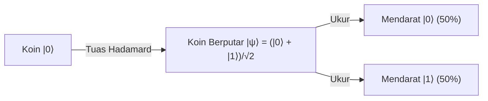
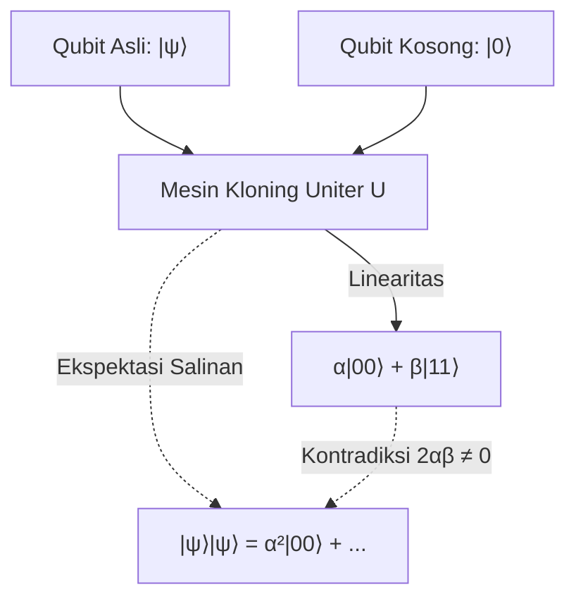

# Quantum Computing Foundations

A comprehensive, domain-agnostic curriculum on quantum information theory, superposition, entanglement, and algorithmic speedups compiled with the Human Gradient Descent paradigm.

## Qubits and Superposition
<!-- hgd:tier: 1_foundational_fluency -->
<!-- hgd:primer: "A classical bit is strictly 0 or 1. A qubit exists in a simultaneous linear superposition of |0> and |1>. A Hadamard gate transforms definite state |0> into an equal superposition where both outcomes become equally likely upon measurement." -->
<!-- hgd:probe: "If a qubit initialized in state |0> is transformed by a Hadamard gate into an equal superposition, predict the probability distribution of measuring |0> versus |1>." -->
<!-- hgd:truth: "Measurement collapses the equal superposition (1/sqrt(2)|0> + 1/sqrt(2)|1>) into |0> with 50% probability and |1> with 50% probability." -->
<!-- hgd:worked: "Worked Solution: The Hadamard gate maps |0> to (|0> + |1>)/sqrt(2). The probability of measuring state |k> equals the squared amplitude |1/sqrt(2)|^2 = 1/2 = 50%. Thus, measuring yields 50% probability for |0> and 50% probability for |1>." -->
<!-- hgd:models: ["hadamard", "superposition", "equal probability", "50%", "collapse"] -->
<!-- hgd:options: [ {"optionId": "opt_a", "text": "Equal 50% probability for |0> and 50% probability for |1>, because the Hadamard gate creates an equal superposition (|0> + |1>)/sqrt(2), and measuring collapses the probability proportional to squared amplitude |1/sqrt(2)|^2 = 0.5.", "isCorrect": true, "causalRationale": "Correct! The Hadamard gate generates an equal linear superposition where amplitudes are 1/sqrt(2). Squaring the amplitude yields 0.5 for each basis state."}, {"optionId": "opt_b", "text": "100% probability for |0> and 0% for |1>, because an isolated bit cannot change its underlying binary value without an external classical flip operation.", "isCorrect": false, "diagnosticAxis": "missingPrerequisite", "causalRationale": "Classical Fallacy: Treats qubits as classical deterministic bits. Qubits obey linear quantum superposition, not classical binary states."}, {"optionId": "opt_c", "text": "70.7% probability for |0> and 70.7% probability for |1>, because the wave function amplitude 1/sqrt(2) translates directly into measurement probability without squaring.", "isCorrect": false, "diagnosticAxis": "notationBreakdown", "causalRationale": "Amplitude Squaring Slip: Confuses state amplitude (1/sqrt(2) approx 0.707) with Born rule measurement probability (|amplitude|^2)."}, {"optionId": "opt_d", "text": "The qubit simultaneously outputs both 0 and 1 in reality, so measuring it records both states at the exact same physical moment.", "isCorrect": false, "diagnosticAxis": "conceptGap", "causalRationale": "Collapse Misconception: Measurement strictly collapses the superposition into a single definite classical outcome (|0> OR |1>), never both simultaneously."} ] -->

### 1. Pangkal Anomali
Selama puluhan tahun, seluruh revolusi komputasi digital dibangun di atas saklar listrik biner sederhana. Saklar ini hanya mengenal dua keadaan mutlak: arus mengalir (logika 1) atau arus terputus (logika 0) sesuai hukum rangkaian listrik arus searah SMA.

Pendekatan biner ini bekerja luar biasa untuk membuat kalkulator, internet, dan komputer desktop. Namun, cara ini menghadapi kebuntuan fisik saat menyelesaikan persoalan kombinatorial raksasa seperti pelipatan molekul protein obat atau faktorisasi bilangan prima besar.

Sebuah komputer klasik harus memeriksa miliaran kombinasi jalur satu demi satu secara sekuensial. Untuk ruang kemungkinan yang eksponensial, proses evaluasi sekuensial ini membutuhkan waktu operasional yang melampaui usia alam semesta.

Komputer klasik tidak mampu menampung ruang kemungkinan paralel secara serentak tanpa menduplikasi keping chip silikon secara tak terbatas. Kita membutuhkan satuan pembawa informasi baru yang mampu menyimpan potensi paralel dalam satu entitas fisik terisolasi sebelum diukur.

### 2. Prototipe Intuitif
Bayangkan alih-alih saklar lampu dinding yang kaku, kita meletakkan sebuah koin logam di atas meja laboratorium.

Ketika koin diam terlentang di sisi angka, ia merepresentasikan bit klasik bernilai '0'. Ketika koin dibalik terlentang di sisi gambar, ia bernilai '1'. Namun di atas meja ini terpasang tuas mekanis presisi yang disebut Tuas Hadamard (Gerbang Hadamard).

Ketika tuas Hadamard disentak dengan ketukan presisi, koin logam tersebut diputar kencang berdiri di atas meja. Selama koin berputar seimbang, status fisiknya bukan angka mutlak dan bukan gambar mutlak; koin berada dalam status dinamis superposisi.

Koin menyimpan potensi simetris 50% memunculkan angka dan 50% memunculkan gambar saat seseorang menepuk meja untuk menghentikan putaran tersebut (runtuhnya gelombang / collapse).



### 3. Invarian & Operasi Inti
Invarian fundamental sistem ini adalah **Konservasi Probabilitas Mutlak (Absolute Probability Conservation)**: total peluang dari seluruh kemungkinan hasil pengukuran wajib selalu bernilai tepat 100% (1.0).

Gerbang Hadamard membagi amplitudo kemungkinan secara simetris seimbang menjadi $1/\sqrt{2}$ (atau $\frac{1}{\sqrt{2}}$) pada basis Dirac $|0\rangle$ dan $|1\rangle$.

Berdasarkan Aturan Born fisika kuantum, probabilitas pengukuran fisik dihitung dari kuadrat nilai mutlak amplitudo: $(\frac{1}{\sqrt{2}})^2 + (\frac{1}{\sqrt{2}})^2 = \frac{1}{2} + \frac{1}{2} = 1.0$.

Pemula sering salah mengira qubit menampilkan 0 dan 1 sekaligus di layar monitor, padahal interaksi pengukuran aktif seketika meruntuhkan superposisi menjadi satu nilai klasik tunggal yang pasti.

| Apa yang Dipikirkan Pemula (Salah) | Apa yang Sebenarnya Terjadi dalam Model Mental |
|---|---|
| Qubit menyimpan nilai 0 dan 1 sekaligus saat dibaca di layar monitor. | Qubit hanya berada dalam superposisi saat terisolasi; pengukuran meruntuhkannya jadi nilai pasti. |
| Gerbang Hadamard mengubah koin menjadi bit acak yang rusak. | Hadamard adalah rotasi matematis deterministik presisi menciptakan superposisi seimbang. |

### 4. Notasi Sebagai Kontrak
Formalisasi matematika kuantum bertindak sebagai kontrak aljabar presisi yang merekam dinamika rotasi tuas penyeimbang Hadamard di atas meja.

Persamaan formal di bawah ini mendefinisikan transformasi uniter dari keadaan dasar pasti menuju superposisi seimbang:
$$H|0\rangle = \frac{1}{\sqrt{2}}|0\rangle + \frac{1}{\sqrt{2}}|1\rangle$$

Persamaan di atas mengunci kontrak bahwa masukan vektor $|0\rangle$ yang dikenai gerbang $H$ akan menghasilkan superposisi linear dengan bobot amplitudo $\frac{1}{\sqrt{2}}$ yang setara.

Kontrak aljabar ini menjamin bahwa setiap replikasi eksperimen akan menghasilkan distribusi probabilitas terukur 50% untuk $|0\rangle$ dan 50% untuk $|1\rangle$, menyingkirkan ambiguitas deskripsi verbal.

* `H`: Gerbang Hadamard (operator penyentak yang memutar koin diam menjadi superposisi seimbang).
* `|0>`: Notasi Dirac Ket untuk keadaan awal koin diam terlentang pada sisi 0.
* `1/sqrt(2)`: Amplitudo probabilitas simetris yang jika dikuadratkan menghasilkan peluang 0.5 (Aturan Born).

### Glosarium & Jembatan Konsep SMA
| Istilah | Konsep Formal | Jembatan Konsep SMA |
|---|---|---|
| Qubit | Satuan dasar informasi kuantum dua dimensi dalam ruang Hilbert | Koin logam di atas meja; saat diam bit biasa, saat diputar kencang qubit |

## Unitary Operations and Reversibility
<!-- hgd:prereqs: ["Qubits and Superposition"] -->
<!-- hgd:tier: 2_boundary_perturbation -->
<!-- hgd:primer: "Classical computing permits irreversible operations, like bit-erasure, destroying information and dissipating heat. In quantum computing, all closed transformations are governed by unitary operators, which strictly preserve quantum state lengths and angles without information loss." -->
<!-- hgd:probe: "Predict why an irreversible classical operation like bit-erasure (reset to 0) cannot be represented as an isolated quantum logic gate." -->
<!-- hgd:truth: "Quantum operations must be unitary (U dagger U = I), which strictly preserves inner products and vector norms, guaranteeing 100% reversibility without entropy dissipation." -->
<!-- hgd:worked: "Worked Solution: Unitary operators U satisfy U dagger U = I, preserving the inner product <psi|phi> between all states. If two distinct states both collapsed to |0>, their distinctness would be destroyed, violating inner product conservation and unitarity." -->
<!-- hgd:models: ["unitary", "reversibility", "norm preservation", "inner product", "entropy"] -->
<!-- hgd:options: [ {"optionId": "opt_a", "text": "Quantum operations must be unitary (U dagger U = I), strictly preserving vector lengths and inner products, guaranteeing 100% reversibility without entropy loss.", "isCorrect": true, "causalRationale": "Accurately identifies unitarity as the conservation law of quantum transformations."}, {"optionId": "opt_b", "text": "The reset operation produces excessive voltage that burns physical quantum chips.", "isCorrect": false, "diagnosticAxis": "conceptGap", "causalRationale": "Confuses abstract information-theoretic reversibility with physical electrical short-circuiting."}, {"optionId": "opt_c", "text": "The classical bit has higher mass than quantum states, violating classical momentum conservation.", "isCorrect": false, "diagnosticAxis": "reasoningBug", "causalRationale": "Applies classical momentum conservation where quantum linear algebraic unitarity governs."}, {"optionId": "opt_d", "text": "Unitary operators allow any arbitrary vector to increase its total probability length to 2.0 whenever needed.", "isCorrect": false, "diagnosticAxis": "notationBreakdown", "causalRationale": "Violates the norm-preservation constraint which strictly fixes total length to exactly 1.0."} ] -->

### 1. Pangkal Anomali
Dalam komputasi konvensional, kita menganggap remeh operasi penghapusan data. Saat menekan tombol Backspace atau mereset variabel menjadi nol (`x = 0`), komputer menghancurkan status informasi sebelumnya tanpa jejak.

Hukum termodinamika fisika (Prinsip Landauer) menyatakan bahwa menghapus 1 bit informasi secara permanen wajib membuang energi minimal $k_B T \ln 2$ dalam bentuk panas disipasi ke lingkungan.

Di dunia mikroskopis kuantum, pelepasan panas ini memicu gangguan termal acak yang merusak koherensi partikel kuantum seketika.

Lebih fundamental lagi, mekanika kuantum adalah teori linear tertutup. Jika suatu operasi menghapus status $|0\rangle$ dan $|1\rangle$ menjadi sama-sama $|0\rangle$, sistem kehilangan kemampuan melacak asal-usul keadaan, melanggar hukum kekekalan informasi alam semesta.

### 2. Prototipe Intuitif
Bayangkan alih-alih mesin perajang kertas yang menghancurkan dokumen, laboratorium kuantum kita dilengkapi prisma cermin optik putar tanpa gesekan.

Setiap berkas sinar laser yang dipantulkan oleh cermin ini tidak pernah kehilangan intensitas cahayanya sesuai hukum Snellius pemantulan cahaya SMA.

Jika cermin diputar sejauh $\theta$ derajat searah jarum jam (operator $U$), kita dapat mengembalikan berkas sinar tepat ke posisi semula hanya dengan memutar balik cermin sejauh $\theta$ derajat berlawanan jarum jam ($U^\dagger$).

Tidak ada seberkas cahaya pun yang diserap atau diubah menjadi panas; seluruh informasi arah dan energi sudut sinar laser terpelihara utuh dan dapat dibalikkan sempurna.

```mermaid
flowchart LR
    StateIn["Masuk |ψ⟩"] -->|Uniter U (Putar Cermin)| Trans["Terputar U|ψ⟩"]
    Trans -->|Pembalik Hermisian U†| StateIn
```

### 3. Invarian & Operasi Inti
Invarian mutlak sistem ini adalah **Preservasi Norma Vektor dan Reversibilitas Penuh (Norm Preservation & Unitary Inversion)**: panjang vektor probabilitas wajib bernilai tepat 1.0.

Setiap gerbang kuantum $U$ wajib memiliki pasangan pembalik eksak yang disebut Hermisian Konjugat ($U^\dagger$), memenuhi identitas uniter $U^\dagger U = I$.

Transformasi uniter mengawetkan perkalian titik (*inner product*) antar status kuantum, menjamin bahwa dua status yang berbeda tidak akan pernah melebur menjadi status yang sama.

Pemula sering mengira operasi reset dapat dilakukan bebas biaya, padahal dalam sistem kuantum tertutup, operasi tak reversibel dilarang keras demi menjaga konservasi entropi dan keutuhan informasi.

| Apa yang Dipikirkan Pemula (Salah) | Apa yang Sebenarnya Terjadi dalam Model Mental |
|---|---|
| Komputer kuantum bebas menghapus data bit seperti komputer biasa. | Semua gerbang kuantum wajib uniter dan dapat dibalikkan 100% tanpa disipasi informasi. |
| Memutar gerbang kuantum dapat mengubah total probabilitas menjadi 2.0. | Operator uniter menjaga norma panjang vektor tetap tepat 1.0 pada setiap rotasi. |

### 4. Notasi Sebagai Kontrak
Kekekalan informasi dalam gerbang kuantum diikat secara aljabar melalui kontrak matriks uniter.

Persamaan formal di bawah ini mendefinisikan syarat mutlak keabsahan setiap operasi logika kuantum:
$$U^\dagger U = I$$

Persamaan di atas menetapkan bahwa perkalian operator $U$ dengan konjugat transposnya ($U^\dagger$) menghasilkan matriks identitas ($I$).

Kontrak matematis ini menjamin bahwa setiap proses komputasi kuantum selalu memiliki jalur pembalikan matematis yang mengembalikan sistem ke status awal tanpa kehilangan data.

* `U`: Operator gerbang kuantum uniter (matriks rotasi keadaan kuantum).
* `$U^\dagger$`: Konjugat transpose Hermisian dari operator $U$ (pembalik arah rotasi).
* `I`: Matriks identitas netral yang menjaga status kuantum tanpa distorsi.

### Glosarium & Jembatan Konsep SMA
| Istilah | Konsep Formal | Jembatan Konsep SMA |
|---|---|---|
| Operator Uniter | Matriks transformasi linear mempertahankan panjang vektor dan hasil kali dalam | Rotasi cermin datar optik SMA; memantulkan bayangan tanpa mengubah ukuran benda |

## Quantum Entanglement and Non-Locality
<!-- hgd:prereqs: ["Qubits and Superposition"] -->
<!-- hgd:tier: 3_isomorphic_transfer -->
<!-- hgd:primer: "When two qubits are entangled, their joint state cannot be described independently. Measuring one instantaneously determines the other across arbitrary distances, yet this correlation cannot send faster-than-light signals." -->
<!-- hgd:probe: "If Alice and Bob share an entangled Bell state (|00> + |11>)/sqrt(2), predict whether Alice can transmit an instantaneous binary message to Bob by measuring her qubit." -->
<!-- hgd:truth: "Alice cannot transmit information faster than light because Bob's local marginal probability remains exactly 50/50 until classical measurement correlations are communicated." -->
<!-- hgd:worked: "Worked Solution: While Alice's measurement instantly fixes Bob's outcome, Alice cannot choose whether she measures 0 or 1. From Bob's perspective, his density matrix remains a random 50/50 mixture. Therefore, no information is transmitted until classical signals arrive (No-Signaling Theorem)." -->
<!-- hgd:models: ["no-signaling", "marginal probability", "bell state", "faster than light", "correlation"] -->
<!-- hgd:options: [ {"optionId": "opt_a", "text": "Alice cannot transmit information faster than light because Bob's local marginal probability remains exactly 50/50 until classical measurement correlations are communicated.", "isCorrect": true, "causalRationale": "Accurately articulates the No-Signaling Theorem preventing faster-than-light communication via entanglement."}, {"optionId": "opt_b", "text": "Alice transmits instantaneous binary text because measuring her qubit physically pulls Bob's qubit like a tight rope.", "isCorrect": false, "diagnosticAxis": "conceptGap", "causalRationale": "Fails to recognize that Alice cannot control which eigenvalue state her measurement collapses into."}, {"optionId": "opt_c", "text": "Entanglement breaks down immediately if the physical distance exceeds 10 meters because radio waves decay inversely with squared distance.", "isCorrect": false, "diagnosticAxis": "missingPrerequisite", "causalRationale": "Misattributes quantum non-locality to classical electromagnetic dipole radiation decay."}, {"optionId": "opt_d", "text": "Bob always measures 1 regardless of Alice's outcome because entanglement inverts polarization at long distances.", "isCorrect": false, "diagnosticAxis": "reasoningBug", "causalRationale": "Contradicts the Bell state formula where outcomes are perfectly correlated (both 0 or both 1)."} ] -->

### 1. Pangkal Anomali
Dalam fisika klasik yang dipelajari di sekolah, alam semesta bekerja berdasarkan prinsip lokalitas: sebuah benda di Jakarta tidak bisa dipengaruhi seketika oleh benda di Tokyo tanpa perantara fisik seperti gelombang radio atau kabel listrik.

Gelombang elektromagnetik perantara tersebut dibatasi oleh kecepatan cahaya $c \approx 300.000\text{ km/s}$ sesuai Teori Relativitas Khusus Einstein.

Namun ketika dua partikel kuantum membentuk status keterikatan (*entangled state*), fungsi gelombang keduanya melebur menjadi satu sistem gabungan yang tak terpisahkan.

Jika partikel Alice diukur di Jakarta, partikel Bob di London seketika menunjukkan korelasi sempurna tanpa jeda waktu; anomali non-lokalitas ini tampak seperti melanggar batas kecepatan cahaya jika disalahpahami sebagai sinyal komunikasi langsung.

### 2. Prototipe Intuitif
Bayangkan sepasang koin berputar ajaib yang disiapkan ilmuwan di laboratorium; satu koin diberikan kepada Alice di Jakarta dan pasangannya dibawa Bob ke London.

Poros putaran kedua koin terhubung tali torsi kuantum tak kasat mata di ruang matematis; selama belum disentuh, kedua koin terus berputar seimbang di meja masing-masing.

Begitu Alice menepuk koinnya di Jakarta dan koin tersebut mendarat pada sisi Angka ('0'), koin Bob di London seketika ikut berhenti pada sisi Angka ('0').

Namun Alice tidak pernah bisa memilih apakah koinnya mendarat pada Angka atau Gambar; bagi Bob di London, koinnya tampak jatuh acak 50:50, sehingga Bob tidak menerima pesan apa pun sampai Alice meneleponnya lewat telepon biasa.

```mermaid
flowchart LR
    Source["Sumber |Φ+⟩ (Entangled EPR Pair)"] -->|Koin A| Alice["Alice di Jakarta (Ukur Koin)"]
    Source -->|Koin B| Bob["Bob di London (Korelasi Spontan)"]
    Alice -.->|Korelasi Terikat Seketika| Bob
    Alice -->|Kanal Klasik (Telepon/Internet)| Bob
```

### 3. Invarian & Operasi Inti
Invarian mutlak sistem keterikatan adalah **Teorema Tanpa Sinyal (No-Signaling Theorem)**: korelasi kuantum non-lokal dilarang mengirimkan data atau pesan bermakna melampaui kecepatan cahaya.

Probabilitas marginal lokal pada instrumen Bob selalu bernilai tepat 50/50 (matriks densitas campuran acak), terlepas dari apakah Alice sudah mengukur qubitnya atau belum.

Korelasi kuantum baru dapat dibuktikan setelah kedua pihak bertemu atau bertukar catatan hasil pengukuran melalui saluran komunikasi klasik berkecepatan subluminal.

Pemula sering berkhayal bahwa keterikatan kuantum adalah kabel telepon instan antar-galaksi, padahal keacakan intrinsik pengukuran kuantum mengunci pintu transmisi informasi superluminal secara mutlak.

| Apa yang Dipikirkan Pemula (Salah) | Apa yang Sebenarnya Terjadi dalam Model Mental |
|---|---|
| Alice bisa mengirim kode morse instan ke Bob hanya dengan mengukur qubitnya. | Alice tidak bisa mengendalikan hasil pengukuran; bagi Bob datanya derau acak murni. |
| Mengukur qubit Alice seketika merusak hukum relativitas Einstein. | No-Signaling Theorem menjamin relativitas khusus tetap terpelihara sempurna. |

### 4. Notasi Sebagai Kontrak
Keadaan keterikatan simetris maksimum direkam dalam kontrak status Bell yang memadukan status dua pengamat ke dalam satu persamaan terpadu.

Persamaan keadaan Bell di bawah ini mendefinisikan superposisi tak terpisahkan antara qubit Alice dan Bob:
$$|\Phi^+\rangle = \frac{1}{\sqrt{2}}(|00\rangle + |11\rangle)$$

Persamaan di atas mengontrakkan bahwa kemungkinan pengukuran hanya menghasilkan dua pasangan status berkorelasi penuh: $|00\rangle$ (keduanya nol) atau $|11\rangle$ (keduanya satu).

Kontrak ini membuktikan bahwa matriks densitas reduksi lokal Bob $\rho_{\text{Bob}} = \frac{1}{2}I$ tetap acak sempurna, mengukuhkan bukti aljabar bahwa tidak ada transmisi informasi instan yang dimungkinkan.

* `$|\Phi^+\rangle$`: Keadaan Bell terikat simetris maksimal antara qubit Alice dan Bob.
* `|00>, |11>`: Dua kemungkinan hasil pengukuran gabungan di mana kedua pihak mencatat nilai seragam.
* `No-Signaling`: Kontrak hukum alam bahwa korelasi non-lokal tidak melanggar batas kecepatan cahaya.

### Glosarium & Jembatan Konsep SMA
| Istilah | Konsep Formal | Jembatan Konsep SMA |
|---|---|---|
| Entanglement | Fungsi gelombang gabungan dua partikel tak dapat difaktorkan mandiri | Sepasang sepatu dalam kotak; membuka kotak kiri memastikan isi kotak kanan |

## Quantum No-Cloning Theorem
<!-- hgd:prereqs: ["Qubits and Superposition", "Unitary Operations and Reversibility"] -->
<!-- hgd:tier: 4_adversarial_dilemma -->
<!-- hgd:primer: "Classical data can be duplicated endlessly. Quantum mechanics requires all transformations to be linear. A cloning operator would have to clone both basis states and arbitrary linear combinations, creating mathematical contradictions with unitarity." -->
<!-- hgd:probe: "Predict what mathematical contradiction occurs if a unitary operator U clones an arbitrary unknown superposition state alpha|0> + beta|1>." -->
<!-- hgd:truth: "Linearity requires U(|psi>|0>) = alpha|00> + beta|11>, whereas a true copy requires (alpha|0> + beta|1>)(alpha|0> + beta|1>) containing cross-terms 2 alpha beta |01>, violating unitarity." -->
<!-- hgd:worked: "Worked Solution: By linearity, U(alpha|0> + beta|1>)|0> = alpha|00> + beta|11>. But a cloned state requires |psi>|psi> = alpha^2|00> + alpha beta|01> + alpha beta|10> + beta^2|11>. Equating the two yields cross-terms 2 alpha beta = 0, which fails for arbitrary superpositions." -->
<!-- hgd:models: ["linearity", "cross terms", "arbitrary state", "contradiction", "unitary"] -->
<!-- hgd:options: [ {"optionId": "opt_a", "text": "Linearity requires U(|psi>|0>) = alpha|00> + beta|11>, whereas a true copy requires (alpha|0> + beta|1>)(alpha|0> + beta|1>) containing cross-terms 2 alpha beta |01>, violating unitarity.", "isCorrect": true, "causalRationale": "Accurately derives the algebraic cross-term contradiction proving the No-Cloning Theorem."}, {"optionId": "opt_b", "text": "The quantum copier runs out of electrical charge because cloning two qubits requires double the voltage of a 9-volt battery.", "isCorrect": false, "diagnosticAxis": "conceptGap", "causalRationale": "Mistakes mathematical linearity constraints for DC battery electrical current limitations."}, {"optionId": "opt_c", "text": "The quantum state cannot be duplicated because energy conservation forbids creating light with frequency greater than zero.", "isCorrect": false, "diagnosticAxis": "missingPrerequisite", "causalRationale": "Confuses single photon cloning prohibition with Planck-Einstein quantum frequency energy scaling."}, {"optionId": "opt_d", "text": "Cloning only fails when the input qubit has exactly 50% probability, but succeeds for all other arbitrary superpositions.", "isCorrect": false, "diagnosticAxis": "reasoningBug", "causalRationale": "Fails to see that cross-terms 2*alpha*beta only vanish for trivial basis states (alpha=0 or beta=0), failing for all superpositions."} ] -->

### 1. Pangkal Anomali
Dalam dunia komputasi digital klasik sehari-hari, tindakan menyalin data adalah operasi paling lumrah. Kita dapat menekan tombol `Ctrl+C` dan `Ctrl+V` untuk membuat jutaan salinan dokumen biner yang persis sama tanpa merusak file aslinya.

Namun saat melangkah ke ranah informasi kuantum, kemampuan menyalin data ini runtuh total di hadapan hukum fisika fundamental.

Alam semesta melarang keras pembuatan salinan identik dari suatu keadaan kuantum sembarang yang tidak diketahui tanpa menghancurkan keadaan aslinya.

Ketidakmampuan membuat salinan duplikat ini menjadi tantangan arsitektural masif dalam perancangan kode koreksi kesalahan kuantum (*quantum error correction*) dan pencadangan memori (*backup*), menuntut teknik perlindungan informasi baru tanpa kloning langsung.

### 2. Prototipe Intuitif
Bayangkan sebuah gelembung busa sabun yang sangat tipis dan rapuh sedang melayang bergetar di udara laboratorium.

Pola getaran permukaan gelembung sabun tersebut membawa informasi amplitudo kuantum yang sangat presisi dan unik.

Jika Anda ingin menduplikasi pola getaran gelembung sabun tersebut ke gelembung kedua, mesin pencetak Anda harus menempelkan jarum sensor mekanis untuk membaca kontur lekukan permukaannya.

Namun hukum alam menyatakan bahwa begitu jarum sensor menyentuh kulit gelembung sabun, gelembung itu seketika meletus hancur; Anda hanya memperoleh satu angka koordinat titik sentuh, sedangkan seluruh spektrum getaran halus lainnya musnah selamanya.



### 3. Invarian & Operasi Inti
Invarian mutlak sistem ini adalah **Linearitas Operator Transformasi Kuantum (Linearity of Quantum Mechanics)**.

Dalam aljabar linear SMA, fungsi linear mematuhi sifat $f(x + y) = f(x) + f(y)$ dan dilarang memunculkan suku perkalian silang secara sembarangan.

Jika mesin kloning uniter sanggup menyalin status basis $U(|0\rangle|0\rangle) = |00\rangle$ dan $U(|1\rangle|0\rangle) = |11\rangle$, maka ketika diberi masukan superposisi $\alpha|0\rangle + \beta|1\rangle$, hukum linearitas memaksakan hasil $\alpha|00\rangle + \beta|11\rangle$.

Padahal salinan mandiri sejati membutuhkan perkalian tensor $(\alpha|0\rangle + \beta|1\rangle)^{\otimes 2}$ yang memunculkan suku silang $2\alpha\beta|01\rangle$, menghasilkan kontradiksi aljabar mutlak yang membuktikan mesin kloning kuantum mustahil ada secara fisik.

| Apa yang Dipikirkan Pemula (Salah) | Apa yang Sebenarnya Terjadi dalam Model Mental |
|---|---|
| Kita bisa mengukur qubit diam-diam lalu membuat tiruannya dengan komputer klasik. | Setiap pengukuran meruntuhkan superposisi, menghancurkan informasi fase kuantum asli. |
| Mesin kloning gagal karena teknologi fabrikasi chip kuantum belum maju. | Larangan kloning adalah hukum fundamental aljabar alam, bukan kendala perangkat keras. |

### 4. Notasi Sebagai Kontrak
Kemustahilan kloning kuantum diformalkan dalam kontrak pertidaksamaan linearitas aljabar uniter.

Hubungan pertidaksamaan di bawah ini merangkum pembuktian formal Teorema No-Cloning:
$$U(|\psi\rangle |0\rangle) = \alpha|00\rangle + \beta|11\rangle \neq |\psi\rangle |\psi\rangle$$

Persamaan di atas menegaskan bahwa transformasi uniter $U$ hanya dapat menghasilkan kombinasi linear ortogonal, dan tidak mampu menghasilkan produk tensor mandiri $|\psi\rangle|\psi\rangle$ untuk status superposisi sembarang.

Kontrak pertidaksamaan ini memberikan jaminan matematis bagi protokol keamanan kriptografi kuantum bahwa setiap upaya penyadapan data kuantum akan selalu meninggalkan jejak gangguan yang terdeteksi seketika.

* `U`: Operator mesin kloning uniter yang diasumsikan ada secara hipotetis.
* `$|\psi\rangle$`: Vektor keadaan superposisi sembarang $\alpha|0\rangle + \beta|1\rangle$.
* `$\neq$`: Tanda ketidaksamaan mutlak akibat adanya suku silang non-nol $2\alpha\beta|01\rangle \neq 0$.

### Glosarium & Jembatan Konsep SMA
| Istilah | Konsep Formal | Jembatan Konsep SMA |
|---|---|---|
| No-Cloning Theorem | Teorema transformasi uniter dilarang menduplikasi status sembarang | Mencoba melukis asap di udara; begitu kuas menyentuh asap, bentuk aslinya buyar |

## Grover's Search and Quadratic Speedup
<!-- hgd:prereqs: ["Unitary Operations and Reversibility", "Quantum Entanglement and Non-Locality"] -->
<!-- hgd:tier: 3_isomorphic_transfer -->
<!-- hgd:primer: "Searching an unsorted database of N items classically requires O(N) queries on average. Grover's algorithm uses quantum wave interference to iteratively amplify the target probability amplitude while canceling incorrect candidates in O(sqrt(N)) steps." -->
<!-- hgd:probe: "Predict how Grover's diffusion operator amplifies the probability amplitude of the target state while suppressing non-target states." -->
<!-- hgd:truth: "Inverting the phase of the target state followed by inversion about the mean geometrically rotates the state vector toward the target basis in O(sqrt(N)) steps." -->
<!-- hgd:worked: "Worked Solution: Step 1: The oracle flips the sign of the target state amplitude (phase inversion). Step 2: The diffusion operator reflects all amplitudes across their average mean. Because the target was negative, this reflection shoots its amplitude far above the mean, achieving quadratic speedup O(sqrt(N))." -->
<!-- hgd:models: ["amplitude amplification", "inversion about mean", "geometric rotation", "quadratic speedup", "oracle"] -->
<!-- hgd:options: [ {"optionId": "opt_a", "text": "Inverting the phase of the target state followed by inversion about the mean geometrically rotates the state vector toward the target basis in O(sqrt(N)) steps.", "isCorrect": true, "causalRationale": "Accurately articulates the two-step amplitude amplification cycle of Grover's algorithm."}, {"optionId": "opt_b", "text": "Grover checks all N entries simultaneously in exactly 1 step because quantum computers have infinite parallel cores.", "isCorrect": false, "diagnosticAxis": "conceptGap", "causalRationale": "Magical Thinking Fallacy: Confuses quantum amplitude interference with fictitious infinite classical hardware replication."}, {"optionId": "opt_c", "text": "The diffusion operator physically sorts the database in memory using classical quicksort before measuring.", "isCorrect": false, "diagnosticAxis": "missingPrerequisite", "causalRationale": "Fails to recognize that Grover operates on completely unsorted, black-box oracle databases."}, {"optionId": "opt_d", "text": "The oracle changes the probability of the target state to 100% on the very first query without needing diffusion.", "isCorrect": false, "diagnosticAxis": "reasoningBug", "causalRationale": "Ignores that the oracle only flips the phase (sign), leaving the absolute measurement probability unchanged without diffusion."} ] -->

### 1. Pangkal Anomali
Bayangkan Anda memegang buku telepon raksasa berisi $N = 1.000.000$ nama orang yang nomor teleponnya disusun acak total tanpa urutan abjad, lalu diminta mencari siapa pemilik nomor tertentu.

Secara komputasi klasik, tidak ada trik pintar selain membuka lembar demi lembar dari halaman awal hingga akhir, membutuhkan rata-rata $N/2 = 500.000$ pemeriksaan linear.

Jika basis data berskala raksasa ($N = 10^{12}$ data), komputer klasik supercepat pun akan menyita waktu puluhan tahun untuk menelusuri pencarian dengan kompleksitas $\mathcal{O}(N)$.

Kelambatan klasik ini bersumber dari perlakuan data sebagai entitas diskrit terpisah: memeriksa satu data yang salah sama sekali tidak memberikan petunjuk arah di mana posisi data yang benar berada.

### 2. Prototipe Intuitif
Bayangkan sebuah kolam air tenang melingkar dengan $N$ gelombang kecil yang bergetar pada ketinggian rata-rata yang sama persis di mana satu di antaranya adalah target rahasia kita.

Algoritma Grover mengeksekusi dua ketukan ritmis berulang pada permukaan kolam air tersebut.

Ketukan pertama (Oracle Kuantum) menyentak gelombang target ke bawah, membalik arah getarannya menjadi palung negatif (pembalikan fase $-1$) tanpa mengubah tingginya.

Ketukan kedua (Operator Difusi) memasang dinding pemantul yang membalik seluruh gelombang terhadap garis tinggi rata-rata air kolam; karena gelombang target berada jauh di bawah garis rata-rata, pantulan ini membuat tinggi gelombang target melesat melonjak ke atas sementara gelombang lain tertekan mendekati nol.


### 3. Invarian & Operasi Inti
Invarian mutlak sistem pencarian Grover adalah **Rotasi Geometris Amplitudo Menuju Target (Geometric Amplitude Rotation)**.

Setiap siklus Oracle dan Difusi memutar vektor status kuantum di bidang dua dimensi mendekati sumbu target dengan sudut rotasi konstan $\theta \approx 2/\sqrt{N}$.

Sistem hanya memerlukan sekitar $\frac{\pi}{4}\sqrt{N} = \mathcal{O}(\sqrt{N})$ iterasi untuk membawa probabilitas pengukuran target mendekati 100%.

Pemula kerap mengira Grover memeriksa seluruh data dalam 1 langkah atau mengasumsikan makin banyak iterasi makin baik, padahal iterasi berlebih (*over-rotation*) justru memutar vektor menjauhi target kembali ke titik nol.

| Apa yang Dipikirkan Pemula (Salah) | Apa yang Sebenarnya Terjadi dalam Model Mental |
|---|---|
| Grover memeriksa seluruh 1.000.000 data secara instan dalam 1 detik. | Grover memanipulasi interferensi gelombang secara bertahap dalam $O(\sqrt{N})$ iterasi rotasi. |
| Melakukan iterasi sebanyak-banyaknya pasti membuat pencarian semakin akurat. | Iterasi berlebih (*over-rotation*) memutar vektor kuantum melintasi target kembali ke nol. |

### 4. Notasi Sebagai Kontrak
Operator difusi Grover dikontrakkan sebagai refleksi uniter terhadap keadaan rata-rata superposisi basis data.

Formula operator difusi di bawah ini mengatur pantulan gelombang amplitudo secara deterministik:
$$D = 2|s\rangle\langle s| - I$$

Persamaan di atas mendefinisikan operator difusi ($D$) sebagai inversi terhadap rata-rata superposisi seimbang $|s\rangle$ dikurangi matriks identitas ($I$).

Kontrak aljabar ini membuktikan secara matematis bahwa pencarian pada data tak terstruktur mencapai batas percepatan kuadratik $\mathcal{O}(\sqrt{N})$ yang optimal sesuai batasan teori informasi kuantum.

* `D`: Operator difusi Grover (pembalik seluruh amplitudo terhadap nilai rata-rata mean).
* `|s>`: Vektor keadaan superposisi seimbang seluruh basis data $\frac{1}{\sqrt{N}}\sum |x\rangle$.
* `$\mathcal{O}(\sqrt{N})$`: Kontrak percepatan kuadratik atas kompleksitas pencarian klasik $\mathcal{O}(N)$.

### Glosarium & Jembatan Konsep SMA
| Istilah | Konsep Formal | Jembatan Konsep SMA |
|---|---|---|
| Algoritma Grover | Pencarian kuantum database tak terstruktur dengan kompleksitas $\mathcal{O}(\sqrt{N})$ | Memilih kelereng hitam di antara 1.000.000 kelereng putih dengan 785 ayunan saringan |
