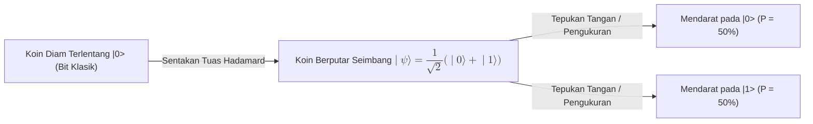
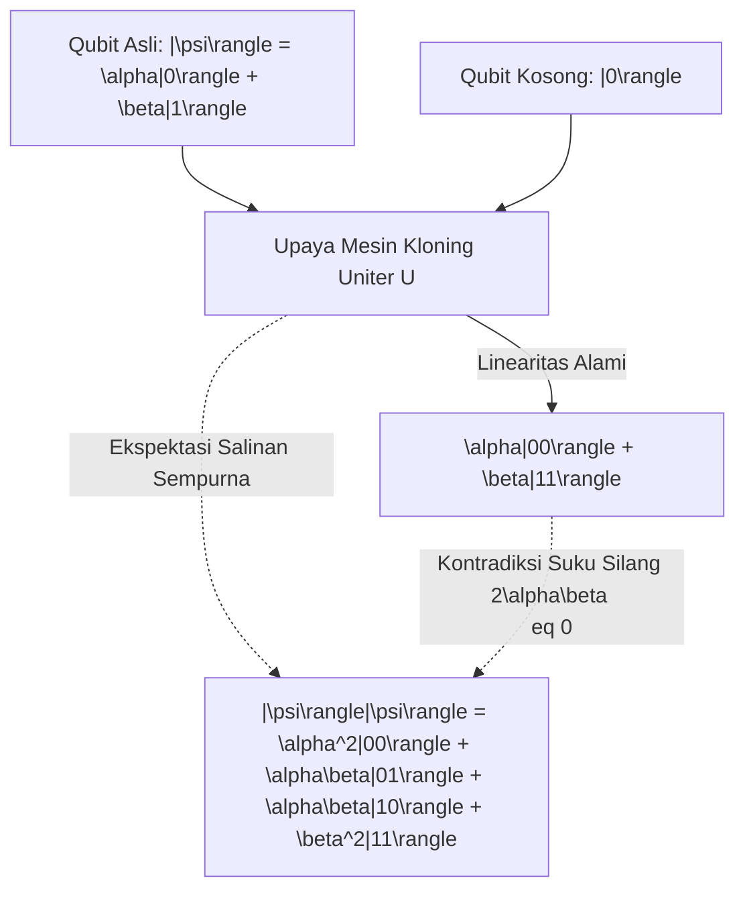

# Quantum Computing Foundations

A comprehensive, domain-agnostic curriculum on quantum information theory, superposition, entanglement, and algorithmic speedups compiled with the Human Gradient Descent paradigm.

## Qubits and Superposition
<!-- hgd:tier: 1_foundational_fluency -->
<!-- hgd:primer: "A classical bit is strictly 0 or 1. A qubit exists in a simultaneous linear superposition of |0> and |1>. A Hadamard gate transforms definite state |0> into an equal superposition where both outcomes become equally likely upon measurement." -->
<!-- hgd:probe: "If a qubit initialized in state |0> is transformed by a Hadamard gate into an equal superposition, predict the probability distribution of measuring |0> versus |1>." -->
<!-- hgd:truth: "Measurement collapses the equal superposition (1/sqrt(2)|0> + 1/sqrt(2)|1>) into |0> with 50% probability and |1> with 50% probability." -->
<!-- hgd:worked: "Worked Solution: The Hadamard gate maps |0> to (|0> + |1>)/sqrt(2). The probability of measuring state |k> equals the squared amplitude |1/sqrt(2)|^2 = 1/2 = 50%. Thus, measuring yields 50% probability for |0> and 50% probability for |1>." -->
<!-- hgd:models: ["hadamard", "superposition", "equal probability", "50%", "collapse"] -->
<!-- hgd:options: [ {"optionId": "opt_a", "text": "Equal 50% probability for |0> and 50% probability for |1>, because the Hadamard gate creates an equal superposition (|0> + |1>)/sqrt(2), and measuring collapses the probability proportional to squared amplitude |1/sqrt(2)|^2 = 0.5.", "isCorrect": true, "causalRationale": "Correct! The Hadamard gate generates an equal linear superposition where amplitudes are 1/sqrt(2). Squaring the amplitude yields 0.5 for each basis state."}, {"optionId": "opt_b", "text": "100% probability for |0> and 0% for |1>, because an isolated bit cannot change its underlying binary value without an external classical flip operation.", "isCorrect": false, "diagnosticAxis": "missingPrerequisite", "causalRationale": "Classical Fallacy: Treats qubits as classical deterministic bits. Qubits obey linear quantum superposition, not classical binary states."}, {"optionId": "opt_c", "text": "70.7% probability for |0> and 70.7% probability for |1>, because the wave function amplitude 1/sqrt(2) translates directly into measurement probability without squaring.", "isCorrect": false, "diagnosticAxis": "notationBreakdown", "causalRationale": "Amplitude Squaring Slip: Confuses state amplitude (1/sqrt(2) approx 0.707) with Born rule measurement probability (|amplitude|^2)."}, {"optionId": "opt_d", "text": "The qubit simultaneously outputs both 0 and 1 in reality, so measuring it records both states at the exact same physical moment.", "isCorrect": false, "diagnosticAxis": "conceptGap", "causalRationale": "Collapse Misconception: Measurement strictly collapses the superposition into a single definite classical outcome (|0> OR |1>), never both simultaneously."} ] -->

### 1. Pangkal Anomali
Selama puluhan tahun, seluruh revolusi komputasi digital dibangun di atas saklar listrik sederhana. Saklar ini hanya mengenal dua keadaan mutlak: arus mengalir (logika 1) atau arus terputus (logika 0). Hukum rangkaian listrik arus searah yang kita pelajari di bangku SMA mengajarkan bahwa sebuah lampu di kamar tidur hanya bisa menyala atau padam.

Pendekatan biner ini bekerja luar biasa untuk membuat kalkulator, internet, dan smartphone. Namun, cara ini menghadapi dinding kebuntuan fisik saat kita mencoba menyelesaikan persoalan komputasi kombinatorial raksasa. Bayangkan Anda disuruh mencari rute terpendek di antara 100 kota, atau melipat rantai molekul protein obat kanker. Sebuah komputer klasik harus memeriksa kombinasi jalur tersebut satu demi satu secara berurutan. Untuk ruang kemungkinan yang memiliki miliaran kombinasi, proses evaluasi sekuensial ini membutuhkan waktu lebih lama dari usia alam semesta!

Komputer klasik tidak mampu menampung seluruh ruang kemungkinan paralel secara bersamaan tanpa menduplikasi keping chip silikon dalam jumlah yang mustahil dibuat secara fisik. Kita membutuhkan satuan pembawa informasi baru yang mampu menyimpan potensi paralel sebelum dievaluasi.

### 2. Prototipe Intuitif
Bayangkan alih-alih saklar lampu dinding yang kaku, kita meletakkan sebuah koin logam di atas meja laboratorium.

Ketika koin diam terlentang di sisi angka, ia merepresentasikan bit klasik bernilai '0'. Ketika koin dibalik terlentang di sisi gambar, ia bernilai '1'. Namun di atas meja ini terpasang sebuah tuas mekanis presisi yang disebut **Tuas Hadamard (Gerbang Hadamard)**.

Ketika tuas Hadamard disentak dengan ketukan presisi, koin logam tersebut tidak sekadar dibalik, melainkan diputar kencang berdiri di atas meja. Selama koin berputar kencang seimbang, status fisiknya bukan angka mutlak dan bukan gambar mutlak. Koin berada dalam status dinamis yang memiliki potensi 50% memunculkan angka dan 50% memunculkan gambar saat seseorang menepuk meja untuk menghentikan putaran tersebut.



### 3. Invarian & Operasi Inti
Invarian fundamental sistem ini adalah **Konservasi Probabilitas Mutlak (Absolute Probability Conservation)**: seberapa pun koin diputar atau dimanipulasi oleh gerbang logika kuantum, total peluang dari seluruh kemungkinan hasil pengukuran wajib selalu bernilai tepat 100% ($1.0$).

Di tingkat mekanika gelombang, gerbang Hadamard membagi amplitudo kemungkinan secara simetris seimbang menjadi $\frac{1}{\sqrt{2}}$. Karena aturan alam (Aturan Born) menyatakan bahwa peluang fisik adalah kuadrat dari amplitudo, maka $(\frac{1}{\sqrt{2}})^2 + (\frac{1}{\sqrt{2}})^2 = \frac{1}{2} + \frac{1}{2} = 1.0$.

| Apa yang Dipikirkan Pemula (Salah) | Apa yang Sebenarnya Terjadi dalam Model Mental |
|---|---|
| Qubit menyimpan nilai 0 dan 1 sekaligus saat dibaca di layar monitor. | Qubit hanya berada dalam superposisi saat terisolasi. Pembacaan aktif memaksanya runtuh menjadi salah satu nilai biner pasti. |
| Pengukuran bersifat pasif dan tidak mengubah sistem fisik. | Pengukuran adalah interaksi fisik aktif yang seketika menghancurkan superposisi kuantum. |
| Gerbang Hadamard mengubah koin menjadi bit acak yang rusak. | Hadamard adalah rotasi matematis deterministik yang presisi menciptakan superposisi seimbang. |

### 4. Notasi Sebagai Kontrak
Untuk menghindari narasi panjang, komunitas sains merekam mekanisme sentakan tuas penyeimbang Hadamard di atas dengan kontrak steno matematika:
$$H|0\rangle = \frac{1}{\sqrt{2}}|0\rangle + \frac{1}{\sqrt{2}}|1\rangle$$

Persamaan di atas adalah cetak biru formal yang merangkum seluruh perilaku mekanika fisik:
* `H`: Gerbang Hadamard (tuas penyentak yang memutar koin diam menjadi superposisi seimbang).
* `|0>`: Notasi Dirac Ket untuk keadaan awal koin diam terlentang pada sisi 0.
* `1/sqrt(2)`: Amplitudo probabilitas masing-masing sisi (faktor penyeimbang simetris).
* `|0>, |1>`: Dua hasil keadaan terukur saat koin mendarat di atas meja.
* `|1/sqrt(2)|^2 + |1/sqrt(2)|^2 = 0.5 + 0.5 = 1.0`: Kontrak hukum kekekalan total probabilitas 100%.

### Glosarium & Jembatan Konsep SMA

| Istilah | Konsep Formal | Jembatan Konsep SMA |
|---|---|---|
| Qubit | Satuan dasar informasi kuantum berupa vektor keadaan berdimensi dua dalam ruang Hilbert | Koin logam di atas meja; saat diam terlentang ia bit biasa, saat diputar kencang ia qubit |
| Superposisi | Prinsip penjumlahan linear dari dua keadaan kuantum ortogonal sebelum pengukuran | Koin yang sedang berputar kencang; menyimpan potensi kedua sisi secara dinamis |
| Gerbang Hadamard | Operator uniter yang merotasi basis komputasi menjadi superposisi probabilitas seimbang | Tuas sentak presisi yang menyenggol koin diam agar mulai berputar seimbang di meja |
| Notasi Ket \|ψ⟩ | Notasi bra-ket Dirac untuk merepresentasikan vektor keadaan kuantum | Simbol kurung vektor penunjuk arah panah di koordinat Kartesius $(x,y)$ pelajaran Fisika SMA |
| Amplitudo Probabilitas | Bilangan kompleks yang kuadrat mutlaknya menghasilkan nilai peluang pengukuran fisik | Tinggi puncak gelombang air; semakin tinggi ombak, semakin besar energi yang dilepaskan saat menabrak karang |
| Runtuhnya Gelombang (Collapse) | Transisi diskontinu dari keadaan superposisi menjadi satu nilai tunggal akibat pengukuran | Menepuk telapak tangan ke koin yang sedang berputar di meja, memaksanya diam di satu sisi |

---

## Unitary Operations and Reversibility
<!-- hgd:prereqs: ["Qubits and Superposition"] -->
<!-- hgd:tier: 2_boundary_perturbation -->
<!-- hgd:primer: "Classical computing permits irreversible operations, like bit-erasure, destroying information and dissipating heat. In quantum computing, all closed transformations are governed by unitary operators, which strictly preserve quantum state lengths and angles without information loss." -->
<!-- hgd:probe: "Predict why an irreversible classical operation like bit-erasure (reset to 0) cannot be represented as an isolated quantum logic gate." -->
<!-- hgd:truth: "Quantum operations must be unitary (U dagger U = I), which strictly preserves inner products and vector norms, guaranteeing 100% reversibility without entropy dissipation." -->
<!-- hgd:worked: "Worked Solution: Unitary operators U satisfy U dagger U = I, preserving the inner product <psi|phi> between all states. If two distinct states both collapsed to |0>, their distinctness would be destroyed, violating inner product conservation and unitarity." -->
<!-- hgd:models: ["unitary", "reversibility", "norm preservation", "inner product", "entropy"] -->
<!-- hgd:options: [ {"optionId": "opt_a", "text": "Quantum operations must be unitary (U dagger U = I), strictly preserving vector lengths and inner products, guaranteeing 100% reversibility without entropy loss.", "isCorrect": true, "causalRationale": "Accurately identifies unitarity as the conservation law of quantum transformations."}, {"optionId": "opt_b", "text": "The reset operation produces excessive voltage that burns physical quantum chips.", "isCorrect": false, "diagnosticAxis": "conceptGap", "causalRationale": "Confuses abstract information-theoretic reversibility with physical electrical short-circuiting."}, {"optionId": "opt_c", "text": "The classical bit has higher mass than quantum states, violating classical momentum conservation.", "isCorrect": false, "diagnosticAxis": "reasoningBug", "causalRationale": "Applies classical momentum conservation where quantum linear algebraic unitarity governs."}, {"optionId": "opt_d", "text": "Unitary operators allow any arbitrary vector to increase its total probability length to 2.0 whenever needed.", "isCorrect": false, "diagnosticAxis": "notationBreakdown", "causalRationale": "Violates the norm-preservation constraint which strictly fixes total length to exactly 1.0."} ] -->

### 1. Pangkal Anomali
Dalam komputasi konvensional, kita menganggap remeh operasi penghapusan data. Saat Anda mengetik tombol `Backspace` atau menimpa variabel dengan angka 0 (`x = 0`), komputer menghancurkan status informasi sebelumnya tanpa jejak.

Hukum termodinamika yang dipelajari di bangku SMA (Prinsip Landauer) menyatakan bahwa setiap kali kita menghapus 1 bit informasi secara permanen, sistem wajib membuang energi minimal sebesar $k_B T \ln 2$ dalam bentuk panas ke lingkungan. Di dunia mikroskopis kuantum, panas ini memicu getaran acak (*thermal noise*) yang menghancurkan koherensi partikel kuantum seketika.

Lebih mendalam lagi, mekanika kuantum adalah teori linier. Jika sebuah operasi menghapus status |0> dan status |1> menjadi sama-sama |0>, maka kita kehilangan kemampuan melacak dari mana keadaan tersebut berasal. Kemampuan membalikkan waktu (*time-reversibility*) lenyap, dan hukum kekekalan informasi alam semesta dilanggar.

### 2. Prototipe Intuitif
Bayangkan alih-alih mesin penghancur kertas kantor yang merajang dokumen menjadi debu tak berbekas, laboratorium kuantum kita dilengkapi dengan sebuah prisma cermin optik putar tanpa gesekan.

Setiap berkas sinar laser yang dipantulkan oleh cermin ini tidak pernah kehilangan intensitas cahayanya. Sudut datang selalu sama dengan sudut pantul sesuai hukum Snellius pemantulan cahaya di SMA. Jika cermin diputar sejauh $\theta$ derajat searah jarum jam, kita dapat mengembalikan berkas sinar tepat ke posisi awalnya hanya dengan memutar balik cermin sejauh $\theta$ derajat berlawanan jarum jam.

```mermaid
flowchart LR
    StateIn["Keadaan Masuk |\psi\rangle"] -->|Gerbang Uniter U (Rotasi Cermin)| Trans["Keadaan Terputar U|\psi\rangle"]
    Trans -->|Pembalik Hermisian U^\dagger (Rotasi Balik)| StateIn
```

### 3. Invarian & Operasi Inti
Invarian mutlak sistem ini adalah **Preservasi Norma Vektor dan Reversibilitas Penuh (Norm Preservation & Unitary Inversion)**: panjang vektor probabilitas dalam ruang kuantum wajib selalu bernilai tepat 1.0, dan setiap gerbang kuantum $U$ wajib memiliki pasangan pembalik eksak yang disebut Hermisian Konjugat ($U^\dagger$).

Dalam bahasa geometri SMA, gerbang kuantum tidak pernah meregangkan atau memendekkan panjang anak panah vektor; gerbang kuantum murni hanya merotasi arah anak panah tersebut di ruang koordinat.

| Apa yang Dipikirkan Pemula (Salah) | Apa yang Sebenarnya Terjadi dalam Model Mental |
|---|---|
| Gerbang kuantum bebas menghapus status qubit menjadi nol kapan saja. | Gerbang kuantum terisolasi wajib uniter dan sepenuhnya reversibel tanpa kehilangan informasi. |
| Pengurangan sudut vektor dapat memperkecil total peluang menjadi 0.8. | Operator uniter menjaga sudut dalam dan panjang norma vektor tetap tepat 1.0. |
| Konjugat hermisian adalah perkalian matriks biasa tanpa sifat fisik. | Hermisian konjugat adalah operasi fisik pembalik rotasi yang mengembalikan sistem ke asal. |

### 4. Notasi Sebagai Kontrak
Transformasi kuantum diatur oleh kontrak operator uniter steno:
$$U^\dagger U = I$$

Formula ringkas ini adalah paspor legalitas bagi setiap operasi gerbang logika kuantum:
* `U`: Operator transformasi gerbang kuantum (rotasi cermin maju).
* `U^\dagger`: Hermisian konjugat dari matriks U (rotasi cermin mundur pembalik keadaan).
* `I`: Matriks identitas (keadaan kembali utuh tanpa distorsi atau kehilangan informasi).
* `\langle\psi|\phi\rangle`: Perkalian titik (inner product) antar dua vektor keadaan yang selalu kekal.

### Glosarium & Jembatan Konsep SMA

| Istilah | Konsep Formal | Jembatan Konsep SMA |
|---|---|---|
| Operator Uniter | Matriks transformasi linear yang mempertahankan panjang vektor dan hasil kali dalam | Prisma cermin putar yang membelokkan berkas cahaya tanpa menyerap intensitas energinya |
| Hermisian Konjugat (Dagger †) | Operasi transposisi matriks yang dipadukan dengan konjugasi bilangan kompleks | Putaran balik cermin berlawanan arah jarum jam untuk membatalkan pantulan sinar |
| Matriks Identitas (I) | Matriks skalar diagonal yang tidak mengubah vektor saat dikalikan | Angka 1 dalam perkalian matematika biasa ($x \times 1 = x$); keadaan sistem tidak berubah |
| Reversibilitas | Sifat proses termodinamika ideal yang dapat dibalik tanpa meninggalkan jejak panas | Ayunan bandul sederhana tanpa gesekan udara; energi mekanik kekal bolak-balik selamanya |
| Ortogonalitas | Hubungan dua vektor yang membentuk sudut siku-siku 90 derajat (inner product bernilai nol) | Sumbu X dan sumbu Y pada diagram Kartesius pelajaran matematika koordinat |
| Prinsip Landauer | Batas fisik termodinamika bahwa penghapusan informasi menghasilkan disipasi energi panas | Dinamo sepeda yang menjadi hangat saat digosokkan ke roda untuk menyalakan lampu |

---

## Quantum Entanglement and Non-Locality
<!-- hgd:prereqs: ["Qubits and Superposition"] -->
<!-- hgd:tier: 3_isomorphic_transfer -->
<!-- hgd:primer: "When two qubits are entangled, their joint state cannot be described independently. Measuring one instantaneously determines the other across arbitrary distances, yet this correlation cannot send faster-than-light signals." -->
<!-- hgd:probe: "If Alice and Bob share an entangled Bell state (|00> + |11>)/sqrt(2), predict whether Alice can transmit an instantaneous binary message to Bob by measuring her qubit." -->
<!-- hgd:truth: "Alice cannot transmit information faster than light because Bob's local marginal probability remains exactly 50/50 until classical measurement correlations are communicated." -->
<!-- hgd:worked: "Worked Solution: While Alice's measurement instantly fixes Bob's outcome, Alice cannot choose whether she measures 0 or 1. From Bob's perspective, his density matrix remains a random 50/50 mixture. Therefore, no information is transmitted until classical signals arrive (No-Signaling Theorem)." -->
<!-- hgd:models: ["no-signaling", "marginal probability", "bell state", "faster than light", "correlation"] -->
<!-- hgd:options: [ {"optionId": "opt_a", "text": "Alice cannot transmit information faster than light because Bob's local marginal probability remains exactly 50/50 until classical measurement correlations are communicated.", "isCorrect": true, "causalRationale": "Accurately articulates the No-Signaling Theorem preventing faster-than-light communication via entanglement."}, {"optionId": "opt_b", "text": "Alice transmits instantaneous binary text because measuring her qubit physically pulls Bob's qubit like a tight rope.", "isCorrect": false, "diagnosticAxis": "conceptGap", "causalRationale": "Fails to recognize that Alice cannot control which eigenvalue state her measurement collapses into."}, {"optionId": "opt_c", "text": "Entanglement breaks down immediately if the physical distance exceeds 10 meters because radio waves decay inversely with squared distance.", "isCorrect": false, "diagnosticAxis": "missingPrerequisite", "causalRationale": "Misattributes quantum non-locality to classical electromagnetic dipole radiation decay."}, {"optionId": "opt_d", "text": "Bob always measures 1 regardless of Alice's outcome because entanglement inverts polarization at long distances.", "isCorrect": false, "diagnosticAxis": "reasoningBug", "causalRationale": "Contradicts the Bell state formula where outcomes are perfectly correlated (both 0 or both 1)."} ] -->

### 1. Pangkal Anomali
Dalam fisika klasik yang kita pelajari di sekolah, alam semesta bekerja berdasarkan prinsip lokalitas (Locality): sebuah benda di Jakarta tidak bisa dipengaruhi secara langsung oleh benda di Tokyo kecuali ada perantara fisik seperti kabel listrik, gelombang radio, atau tumbukan mekanik yang merambat dengan kecepatan maksimal cahaya ($c \approx 300.000\text{ km/s}$).

Namun, ketika dua partikel kuantum mengalami interaksi erat dan membentuk status keterikatan (*entangled state*), status kedua partikel tersebut melebur menjadi satu fungsi gelombang tunggal yang tak dapat dipisahkan secara matematis. Jika satu partikel dibawa ke planet Mars dan partikel lainnya berada di Bumi, mengukur partikel di Bumi seketika membuat partikel di Mars menunjukkan hasil yang berkorelasi sempurna tanpa jeda waktu sedikit pun!

Kenyataan ini sempat membuat Albert Einstein menolaknya sebagai *"spooky action at a distance"* (aksi hantu dari kejauhan). Bagaimana mungkin hukum relativitas khusus tidak dilanggar jika korelasi terjadi seketika?

### 2. Prototipe Intuitif
Bayangkan sepasang koin berputar ajaib yang disiapkan oleh seorang ilmuwan di laboratorium. Satu koin diberikan kepada Alice di Jakarta, dan koin pasangannya diberikan kepada Bob di London.

Koin ini bukan koin biasa; poros putaran keduanya terhubung oleh sebuah tali torsi kuantum tak kasat mata di ruang matematis. Selama tidak ada yang menyentuh, kedua koin terus berputar kencang di atas meja masing-masing.

Begitu Alice menepuk koinnya di Jakarta dan koin tersebut mendarat pada sisi Angka ('0'), tali torsi tak kasat mata membuat koin Bob di London seketika ikut berhenti pada sisi Angka ('0'). Namun kuncinya adalah: **Alice tidak pernah bisa memilih apakah koinnya akan berhenti pada Angka atau Gambar**. Dari sudut pandang Bob di London, koinnya tetap terasa jatuh secara acak 50:50. Bob tidak tahu bahwa Alice sudah menepuk koin sampai Alice menelepon Bob melalui telepon biasa.

```mermaid
flowchart LR
    Source["Sumber Partikel Terikat |\Phi^+\rangle"] -->|Koin A| Alice["Alice di Jakarta (Ukur Koin)"]
    Source -->|Koin B| Bob["Bob di London (Korelasi Spontan)"]
    Alice -.->|Korelasi Terikat Seketika| Bob
    Alice -->|Kanal Klasik Kecepatan Cahaya (Telepon/Internet)| Bob
```

### 3. Invarian & Operasi Inti
Invarian mutlak sistem keterikatan adalah **Teorema Tanpa Sinyal (No-Signaling Theorem)**: korelasi kuantum non-lokal tidak pernah bisa dimanfaatkan untuk mengirimkan data atau pesan bermakna lebih cepat dari cahaya.

Probabilitas marginal lokal pada instrumen Bob selalu bernilai tepat 50/50 (50% untuk hasil 0 dan 50% untuk hasil 1), terlepas dari apa pun yang dilakukan Alice di tempat yang sangat jauh. Korelasi baru bisa terbukti setelah data pengukuran kedua belah pihak dicocokkan melalui saluran komunikasi klasik biasa.

| Apa yang Dipikirkan Pemula (Salah) | Apa yang Sebenarnya Terjadi dalam Model Mental |
|---|---|
| Alice bisa mengirim kode morse instan ke Bob hanya dengan mengukur qubitnya. | Alice tidak bisa mengendalikan hasil runtuhnya gelombang, sehingga bagi Bob hasilnya tetap tampak seperti derau acak murni. |
| Keterikatan berarti ada gelombang radio tak kasat mata yang merambat super cepat. | Keterikatan adalah korelasi statistik non-lokal dalam ruang probabilitas gabungan, bukan gelombang fisik perantara. |
| Jika Alice tidak mengukur qubitnya, qubit Bob tidak memiliki probabilitas. | Masing-masing qubit selalu memiliki probabilitas marginal lokal 50:50 yang independen saat diamati terisolasi. |

### 4. Notasi Sebagai Kontrak
Keadaan keterikatan maksimum direkam dalam kontrak status Bell:
$$|\Phi^+\rangle = \frac{1}{\sqrt{2}}(|00\rangle + |11\rangle)$$

Kontrak persamaan ini mendefinisikan ikatan tak terpisahkan antara dua pengamat:
* `|\Phi^+>`: Keadaan Bell terikat simetris antara qubit Alice dan qubit Bob.
* `|00>`: Kemungkinan bersama di mana Alice mengukur 0 DAN Bob mengukur 0.
* `|11>`: Kemungkinan bersama di mana Alice mengukur 1 DAN Bob mengukur 1.
* `1/sqrt(2)`: Faktor penyeimbang normalisasi yang menjamin total probabilitas $(1/\sqrt{2})^2 + (1/\sqrt{2})^2 = 0.5 + 0.5 = 1.0$.
* `\rho_{Bob} = \frac{1}{2}|0\rangle\langle 0| + \frac{1}{2}|1\rangle\langle 1|`: Matriks densitas lokal Bob yang membuktikan ketiadaan sinyal superluminal.

### Glosarium & Jembatan Konsep SMA

| Istilah | Konsep Formal | Jembatan Konsep SMA |
|---|---|---|
| Quantum Entanglement | Kondisi di mana fungsi gelombang gabungan dua partikel tidak dapat difaktorkan menjadi perkalian status mandiri | Sepasang sepatu dalam dua kotak tertutup; jika Anda membuka satu kotak dan melihat sepatu kiri, kotak kedua pasti berisi sepatu kanan |
| Bell State | Satu dari empat keadaan kuantum dua-qubit terikat secara maksimal yang membentuk basis ortonormal | Pasangan koin yang selalu mendarat pada sisi yang persis seragam saat dihentikan bersama |
| No-Signaling Theorem | Teorema dalam teori informasi kuantum bahwa korelasi Bell tidak dapat mentransmisikan informasi melampaui kecepatan cahaya | Mengetahui isi kotak sepatu tidak membuat Anda bisa mengirim pesan SMS ke teman Anda tanpa pulsa seluler |
| Non-Locality | Karakteristik fisika kuantum di mana hasil pengukuran lokal bergantung pada pengukuran jarak jauh tanpa pertukaran energi | Dua magnet yang terasa saling tolak menolak di udara, namun dalam ruang status probabilitas |
| Probabilitas Marginal | Peluang terjadinya suatu kejadian lokal dengan mengabaikan seluruh variabel di lokasi luar | Melempar dadu di kamar sendiri; peluang munculnya angka 4 tetap 1/6 terlepas dari apa yang sedang terjadi di luar rumah |
| Kecepatan Cahaya (c) | Batas kecepatan universal perambatan materi dan informasi di ruang hampa ($3 \times 10^8\text{ m/s}$) | Pelajaran Fisika Optik SMA: tidak ada sinyal atau informasi apa pun yang bisa mendahului berkas cahaya |

---

## Quantum No-Cloning Theorem
<!-- hgd:prereqs: ["Qubits and Superposition", "Unitary Operations and Reversibility"] -->
<!-- hgd:tier: 4_adversarial_dilemma -->
<!-- hgd:primer: "Classical data can be duplicated endlessly. Quantum mechanics requires all transformations to be linear. A cloning operator would have to clone both basis states and arbitrary linear combinations, creating mathematical contradictions with unitarity." -->
<!-- hgd:probe: "Predict what mathematical contradiction occurs if a unitary operator U clones an arbitrary unknown superposition state alpha|0> + beta|1>." -->
<!-- hgd:truth: "Linearity requires U(|psi>|0>) = alpha|00> + beta|11>, whereas a true copy requires (alpha|0> + beta|1>)(alpha|0> + beta|1>) containing cross-terms 2 alpha beta |01>, violating unitarity." -->
<!-- hgd:worked: "Worked Solution: By linearity, U(alpha|0> + beta|1>)|0> = alpha|00> + beta|11>. But a cloned state requires |psi>|psi> = alpha^2|00> + alpha beta|01> + alpha beta|10> + beta^2|11>. Equating the two yields cross-terms 2 alpha beta = 0, which fails for arbitrary superpositions." -->
<!-- hgd:models: ["linearity", "cross terms", "arbitrary state", "contradiction", "unitary"] -->
<!-- hgd:options: [ {"optionId": "opt_a", "text": "Linearity requires U(|psi>|0>) = alpha|00> + beta|11>, whereas a true copy requires (alpha|0> + beta|1>)(alpha|0> + beta|1>) containing cross-terms 2 alpha beta |01>, violating unitarity.", "isCorrect": true, "causalRationale": "Accurately derives the algebraic cross-term contradiction proving the No-Cloning Theorem."}, {"optionId": "opt_b", "text": "The quantum copier runs out of electrical charge because cloning two qubits requires double the voltage of a 9-volt battery.", "isCorrect": false, "diagnosticAxis": "conceptGap", "causalRationale": "Mistakes mathematical linearity constraints for DC battery electrical current limitations."}, {"optionId": "opt_c", "text": "The quantum state cannot be duplicated because energy conservation forbids creating light with frequency greater than zero.", "isCorrect": false, "diagnosticAxis": "missingPrerequisite", "causalRationale": "Confuses single photon cloning prohibition with Planck-Einstein quantum frequency energy scaling."}, {"optionId": "opt_d", "text": "Cloning only fails when the input qubit has exactly 50% probability, but succeeds for all other arbitrary superpositions.", "isCorrect": false, "diagnosticAxis": "reasoningBug", "causalRationale": "Fails to see that cross-terms 2*alpha*beta only vanish for trivial basis states (alpha=0 or beta=0), failing for all superpositions."} ] -->

### 1. Pangkal Anomali
Dalam dunia komputasi klasik sehari-hari, tindakan menduplikasi data adalah hal yang paling sepele. Anda bisa menekan tombol `Ctrl+C` dan `Ctrl+V` untuk menyalin dokumen, lagu, atau video digital menjadi jutaan salinan identik tanpa merusak file aslinya sedikit pun.

Namun saat Anda melangkah ke ranah kuantum, fondasi penyalinan ini hancur total. Alam semesta melarang keras pembuatan salinan identik dari suatu keadaan kuantum yang tidak diketahui! Anda tidak bisa membuat mesin fotokopi kuantum.

Mengapa hal ini menjadi anomali besar? Karena dalam pembuatan program komputer (misalnya penanganan kesalahan / *error correction* atau pencadangan memori / *backup*), menduplikasi data adalah pertahanan utama saat terjadi gangguan. Tanpa kemampuan menyalin bit, bagaimana arsitektur komputasi kuantum bisa melindungi informasi dari kerusakan?

### 2. Prototipe Intuitif
Bayangkan sebuah gelembung busa sabun yang sangat tipis dan rapuh sedang melayang bergetar di udara. Bentuk getaran permukaan gelembung tersebut membawa informasi rahasia yang unik.

Jika Anda ingin menduplikasi pola getaran gelembung itu ke gelembung kedua, mesin pencetak Anda harus menempelkan sensor fisik untuk mengukur lekukan permukaannya. Tetapi hukum alam menyatakan bahwa begitu sensor menyentuh permukaan gelembung sabun, gelembung itu seketika meletus dan musnah! Anda hanya mendapatkan satu angka kasar di titik sentuhan, sedangkan seluruh getaran halus di bagian lainnya lenyap selamanya.



### 3. Invarian & Operasi Inti
Invarian mutlak sistem ini adalah **Linearitas Operator Transformasi Kuantum (Linearity of Quantum Mechanics)**.

Dalam aljabar linear SMA, jika sebuah fungsi bersifat linear $f(x + y) = f(x) + f(y)$, maka fungsi tersebut tidak boleh memunculkan suku perkalian kuadrat secara tiba-tiba.

Jika sebuah mesin kloning uniter $U$ sanggup menyalin status basis $U(|0\rangle|0\rangle) = |00\rangle$ dan $U(|1\rangle|0\rangle) = |11\rangle$, maka ketika mesin tersebut diberi masukan superposisi linear $\alpha|0\rangle + \beta|1\rangle$, hukum linearitas memaksakan hasilnya menjadi $\alpha|00\rangle + \beta|11\rangle$.

Padahal, salinan sempurna sejati membutuhkan perkalian tensor $(\alpha|0\rangle + \beta|1\rangle) \otimes (\alpha|0\rangle + \beta|1\rangle) = \alpha^2|00\rangle + \alpha\beta|01\rangle + \beta\alpha|10\rangle + \beta^2|11\rangle$. Muncul suku silang $\alpha\beta$ yang tidak mungkin dipenuhi kecuali salah satu dari $\alpha$ atau $\beta$ bernilai nol (yang berarti bukan superposisi, melainkan bit klasik biasa)!

| Apa yang Dipikirkan Pemula (Salah) | Apa yang Sebenarnya Terjadi dalam Model Mental |
|---|---|
| Kita bisa mengukur qubit diam-diam lalu membuat tiruannya dengan komputer klasik. | Setiap pengukuran meruntuhkan superposisi menjadi satu nilai tunggal, menghancurkan informasi fase kuantum asli. |
| Teorema ini membuktikan bahwa komputer kuantum cacat dan tidak berguna. | Teorema ini justru menjadi dasar keamanan mutlak Kriptografi Kuantum (QKD) yang mustahil disadap tanpa ketahuan. |
| Mesin kloning gagal karena teknologi fabrikasi chip kuantum manusia belum maju. | Larangan kloning adalah hukum fundamental aljabar alam semesta, bukan kelemahan rekayasa perangkat keras. |

### 4. Notasi Sebagai Kontrak
Teorema pelarangan kloning dirumuskan dalam kontrak pertidaksamaan linearitas aljabar:
$$U(|\psi\rangle |0\rangle) = \alpha|00\rangle + \beta|11\rangle \neq |\psi\rangle |\psi\rangle$$

Persamaan kontrak formal ini membuktikan kemustahilan kloning secara matematis:
* `U`: Operator mesin kloning uniter yang diasumsikan ada.
* `|\psi>`: Vektor keadaan superposisi sembarang $\alpha|0\rangle + \beta|1\rangle$.
* `|0>`: Qubit target awal yang disiapkan sebagai kertas kosong.
* `\alpha|00> + \beta|11>`: Hasil wajib berdasarkan prinsip linearitas mekanika kuantum.
* `|\psi>|\psi>`: Hasil salinan mandiri yang diharapkan pengamat.
* `\neq`: Tanda ketidaksamaan mutlak akibat adanya suku silang $2\alpha\beta|01\rangle \neq 0$.

### Glosarium & Jembatan Konsep SMA

| Istilah | Konsep Formal | Jembatan Konsep SMA |
|---|---|---|
| No-Cloning Theorem | Teorema bahwa tidak ada transformasi uniter yang dapat menduplikasi keadaan kuantum sembarang | Melukis bayangan asap di udara; begitu kuas menyentuh asap, bentuk asli asap buyar tertiup angin |
| Linearitas (Linearity) | Sifat pemetaan matematis yang mempertahankan penjumlahan dan perkalian skalar | Fungsi garis lurus $f(x) = ax$ di mana $f(x_1 + x_2) = f(x_1) + f(x_2)$ tanpa suku kuadrat lengkung |
| Suku Silang (Cross-Terms) | Komponen perkalian silang seperti $2xy$ yang muncul saat mengalikan suku aljabar $(x+y)^2$ | Rumus aljabar SMP/SMA: $(a+b)^2 = a^2 + 2ab + b^2$; suku $2ab$ adalah suku silang |
| Vektor Basis | Himpunan vektor satuan ortogonal yang menjadi fondasi pembentuk seluruh ruang vektor | Sumbu koordinat panah $\hat{i}$ dan $\hat{j}$ dalam pelajaran vektor matematika SMA |
| Kriptografi Kuantum (QKD) | Protokol distribusi kunci enkripsi rahasia yang dilindungi oleh teorema no-cloning | Amplop surat bersegel lilin yang hancur berkeping-keping jika ada pihak ketiga yang mencoba mengintip |
| Perkalian Tensor (⊗) | Operasi penggabungan dua ruang vektor independen menjadi satu ruang gabungan berdimensi tinggi | Menggabungkan kemungkinan melempar dua buah koin sekaligus ($2 \times 2 = 4$ hasil kombinasi) |

---

## Grover's Search and Quadratic Speedup
<!-- hgd:prereqs: ["Unitary Operations and Reversibility", "Quantum Entanglement and Non-Locality"] -->
<!-- hgd:tier: 3_isomorphic_transfer -->
<!-- hgd:primer: "Searching an unsorted database of N items classically requires O(N) queries on average. Grover's algorithm uses quantum wave interference to iteratively amplify the target probability amplitude while canceling incorrect candidates in O(sqrt(N)) steps." -->
<!-- hgd:probe: "Predict how Grover's diffusion operator amplifies the probability amplitude of the target state while suppressing non-target states." -->
<!-- hgd:truth: "Inverting the phase of the target state followed by inversion about the mean geometrically rotates the state vector toward the target basis in O(sqrt(N)) steps." -->
<!-- hgd:worked: "Worked Solution: Step 1: The oracle flips the sign of the target state amplitude (phase inversion). Step 2: The diffusion operator reflects all amplitudes across their average mean. Because the target was negative, this reflection shoots its amplitude far above the mean, achieving quadratic speedup O(sqrt(N))." -->
<!-- hgd:models: ["amplitude amplification", "inversion about mean", "geometric rotation", "quadratic speedup", "oracle"] -->
<!-- hgd:options: [ {"optionId": "opt_a", "text": "Inverting the phase of the target state followed by inversion about the mean geometrically rotates the state vector toward the target basis in O(sqrt(N)) steps.", "isCorrect": true, "causalRationale": "Accurately articulates the two-step amplitude amplification cycle of Grover's algorithm."}, {"optionId": "opt_b", "text": "Grover checks all N entries simultaneously in exactly 1 step because quantum computers have infinite parallel cores.", "isCorrect": false, "diagnosticAxis": "conceptGap", "causalRationale": "Magical Thinking Fallacy: Confuses quantum amplitude interference with fictitious infinite classical hardware replication."}, {"optionId": "opt_c", "text": "The diffusion operator physically sorts the database in memory using classical quicksort before measuring.", "isCorrect": false, "diagnosticAxis": "missingPrerequisite", "causalRationale": "Fails to recognize that Grover operates on completely unsorted, black-box oracle databases."}, {"optionId": "opt_d", "text": "The oracle changes the probability of the target state to 100% on the very first query without needing diffusion.", "isCorrect": false, "diagnosticAxis": "reasoningBug", "causalRationale": "Ignores that the oracle only flips the phase (sign), leaving the absolute measurement probability unchanged without diffusion."} ] -->

### 1. Pangkal Anomali
Bayangkan Anda memegang sebuah buku telepon raksasa berisi 1.000.000 nama orang yang nomor teleponnya disusun acak total tanpa urutan abjad. Anda diberikan satu nomor telepon tertentu dan diminta mencari siapa pemilik nomor tersebut.

Secara komputasi klasik, tidak ada trik pintar yang bisa dilakukan selain membuka lembar demi lembar dari halaman pertama sampai halaman terakhir. Rata-rata Anda harus memeriksa $N/2 = 500.000$ kali panggilan. Jika database berisi $N = 10^{12}$ data, komputer tercepat di dunia pun akan kehabisan waktu puluhan tahun untuk melakukan pencarian linear $O(N)$.

Mengapa komputasi klasik begitu lambat? Karena komputasi klasik memperlakukan data sebagai entitas diskrit yang terpisah. Menemukan satu data yang salah tidak memberikan petunjuk apa pun tentang di mana data yang benar berada.

### 2. Prototipe Intuitif
Bayangkan sebuah kolam air tenang berbentuk lingkaran. Di atas permukaan air kolam ini terdapat $N$ gelombang kecil yang bergetar dengan ketinggian rata-rata yang sama persis. Satu di antara gelombang tersebut adalah target rahasia yang ingin kita temukan.

Algoritma Grover bekerja seperti dua ketukan ritmis pada kolam:
1. **Ketukan Pertama (Oracle Kuantum)**: Kita menyentak titik gelombang target ke bawah, membalik arah getarannya menjadi palung negatif (pembalikan fase $-1$). Tingginya sama, tetapi arahnya menusuk ke bawah air.
2. **Ketukan Kedua (Operator Difusi / Refleksi Rata-Rata)**: Kita memasang dinding pemantul yang membalik seluruh gelombang terhadap garis tinggi rata-rata air kolam.

Karena gelombang target berada jauh di bawah garis rata-rata (negatif), pantulan terhadap garis rata-rata membuat tinggi gelombang target melesat melonjak sangat tinggi di atas permukaan air! Sebaliknya, gelombang-gelombang lain yang berada sedikit di atas rata-rata justru tertekan turun mendekati nol.

```mermaid
flowchart LR
    Step0["1. Superposisi Rata: Semua Item Amplitudo +1/\sqrt{N}"] --> Step1["2. Oracle: Balik Tanda Target Menjadi -1/\sqrt{N}"]
    Step1 --> Step2["3. Operator Difusi: Refleksi Terhadap Nilai Rata-Rata (Mean)"]
    Step2 --> Step3["4. Amplitudo Target Melonjak Tinggi (P \approx 100%)"]
    Step3 -.->|Ulangi O(\sqrt{N}) Kali| FinalMeasure["Ukur: Menemukan Target Presisi"]
```

### 3. Invarian & Operasi Inti
Invarian mutlak sistem pencarian Grover adalah **Rotasi Geometris Amplitudo Menuju Target (Geometric Amplitude Rotation)**.

Setiap siklus (Oracle + Difusi) memutar vektor status kuantum di bidang dua dimensi mendekati sumbu target dengan sudut rotasi konstan $\theta \approx 2/\sqrt{N}$. Untuk mencapai probabilitas pengukuran mendekati 100%, sistem hanya membutuhkan jumlah langkah sebanyak:
$$\text{Langkah Optimal} \approx \frac{\pi}{4}\sqrt{N} = O(\sqrt{N})$$

Jika $N = 1.000.000$ data, komputer klasik butuh 500.000 pemeriksaan, sedangkan algoritma Grover hanya butuh sekitar $\frac{\pi}{4}\sqrt{1.000.000} \approx 785$ iterasi! Ini adalah lompatan percepatan kuadratik (*quadratic speedup*) yang sangat masif.

| Apa yang Dipikirkan Pemula (Salah) | Apa yang Sebenarnya Terjadi dalam Model Mental |
|---|---|
| Grover memeriksa seluruh 1.000.000 data secara instan dalam 1 detik. | Grover memanipulasi interferensi gelombang secara bertahap dalam $O(\sqrt{N})$ iterasi rotasi. |
| Pembalikan tanda target oleh Oracle langsung mengubah peluangnya menjadi 100%. | Oracle hanya membalik fase negatif; peluang fisik $|-x|^2 = x^2$ tetap sama sampai dibalik oleh operator difusi. |
| Melakukan iterasi sebanyak-banyaknya pasti membuat pencarian semakin akurat. | Karena Grover adalah rotasi sudut, melakukan iterasi berlebih (*over-rotation*) justru memutar vektor menjauhi target kembali ke nol! |

### 4. Notasi Sebagai Kontrak
Operator difusi Grover dikontrakkan sebagai refleksi uniter terhadap keadaan rata-rata superposisi:
$$D = 2|s\rangle\langle s| - I$$

Persamaan formal ini mengatur pantulan gelombang amplitudo di atas kertas matematika:
* `D`: Operator difusi Grover (pembalik seluruh amplitudo terhadap nilai rata-rata).
* `|s>`: Vektor keadaan superposisi seimbang seluruh basis data $\frac{1}{\sqrt{N}}\sum_{x=0}^{N-1}|x\rangle$.
* `|s><s|`: Proyektor rata-rata ruang kuantum.
* `I`: Matriks identitas inversi pembalik tanda.
* `O(sqrt(N))`: Kontrak percepatan kuadratik atas kompleksitas pencarian klasik $O(N)$.

### Glosarium & Jembatan Konsep SMA

| Istilah | Konsep Formal | Jembatan Konsep SMA |
|---|---|---|
| Algoritma Grover | Algoritma pencarian kuantum untuk database tak terstruktur dengan kompleksitas $O(\sqrt{N})$ | Memilih satu kelereng warna hitam di antara 1.000.000 kelereng putih hanya dengan 785 ayunan saringan getar |
| Oracle Kuantum | Gerbang kotak hitam yang menandai status target dengan membalik tanda fase amplitudo ($(-1)^{f(x)}$) | Guru yang memberi tanda centang merah kecil di bagian belakang lembar jawaban siswa yang benar |
| Pembalikan Fase (Phase Inversion) | Mengalikan amplitudo status kuantum tertentu dengan bilangan -1 tanpa mengubah peluang awalnya | Membalik gelombang air puncak menjadi palung gelombang di bawah permukaan air kolam |
| Inversion about the Mean | Operasi refleksi aljabar di mana setiap elemen $x_i$ dipetakan menjadi $2\mu - x_i$ terhadap rata-rata $\mu$ | Nilai ujian: jika rata-rata kelas 60, murid yang dapat nilai -20 dicerminkan melesat naik menjadi $2(60) - (-20) = 140$ |
| Interferensi Konstruktif | Perpaduan dua gelombang yang sefase sehingga saling memperkuat dan memperbesar amplitudo | Pelajaran Gelombang Fisika SMA: dua puncak gelombang air bertemu dan menghasilkan ombak yang dua kali lebih tinggi |
| Interferensi Destruktif | Perpaduan dua gelombang yang berlawanan fase sehingga saling meniadakan dan meratakan amplitudo | Puncak gelombang bertemu palung gelombang air sehingga permukaan air menjadi tenang dan datar |
