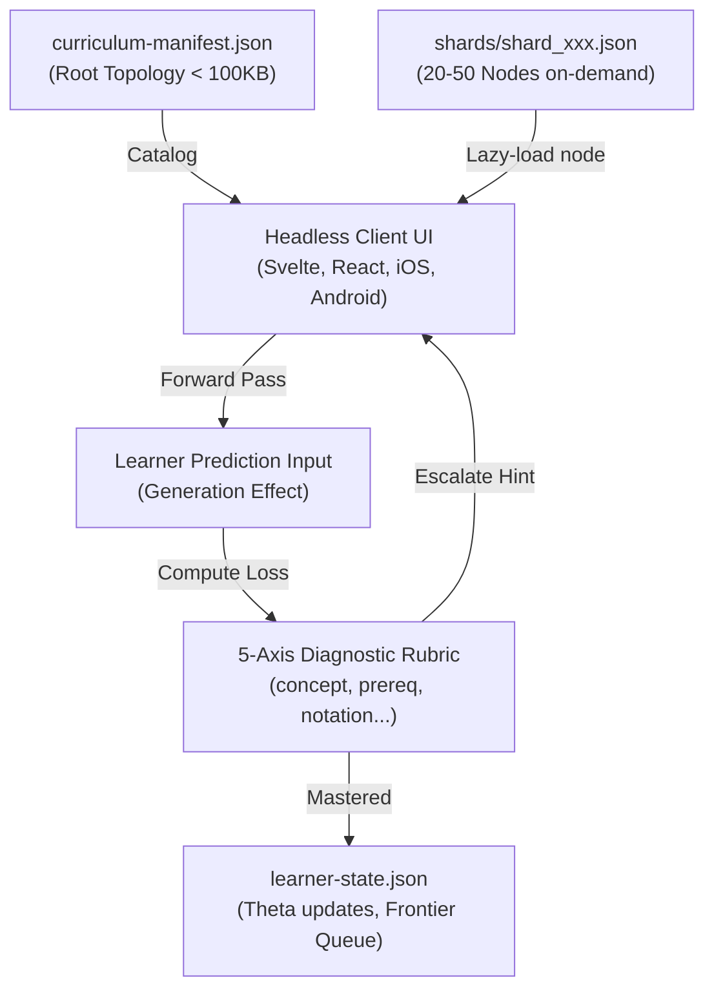

# HGD Reference Headless UI Implementation

> **Standard**: October 2026 Headless UI Specification  
> **Architecture Pattern**: Zero-Backend Static JSON Consumer

This directory provides a reference implementation showcasing how modern web, mobile, or desktop frontends consume **Human Gradient Descent (HGD)** JSON schemas directly.

---

## 🎯 Architecture Contract



1. **Zero-Backend Dependency**:
   The client does not require an active backend server; it directly loads static JSON manifests and shard files over HTTP/S or from local file storage.
2. **$O(1)$ Memory Overhead**:
   Only the small root manifest and the active node shard are in memory at any point in time, even if the total curriculum scales to 500,000+ nodes.
3. **Pacing & Epoch Engine**:
   Demonstrates both **Time-Bounded Sprint** (with countdown bar, stagnation warning, and auto-hint escalation) and **Self-Paced Mastery**.
4. **5-Axis Diagnostic Visualization**:
   Renders real-time telemetry for:
   - $l_{\text{concept}}$: Concept Gap
   - $l_{\text{prereq}}$: Missing Prerequisite
   - $l_{\text{notation}}$: Notation Breakdown
   - $l_{\text{strategy}}$: Method Choice
   - $l_{\text{reasoning}}$: Reasoning Bug
5. **Divergence Rollback**:
   Detects loss divergence across multiple failed attempts and prompts a 1-click rollback to the last milestone checkpoint.

---

## 🚀 Running the Reference UI Locally

Because modern browsers enforce CORS security policies for ES Modules loaded via `file://`, serve the `examples/` directory using any local static file server:

### Option 1: Bun (Recommended)
```bash
bunx serve examples
# Then open http://localhost:3000/reference-ui/ in your browser
```

### Option 2: Python
```bash
python3 -m http.server 8080 --directory examples
# Then open http://localhost:8080/reference-ui/ in your browser
```

---

## 🧩 Domain Agnostic Verification
The reference UI includes a top-level dropdown allowing instant toggling between:
- **Quantum Computing**: Demonstrating STEM equations, boundary perturbations, and quantum physics invariants.
- **Contract Law Basics**: Demonstrating legal heuristics, consideration doctrine, and promissory estoppel boundary conditions.
