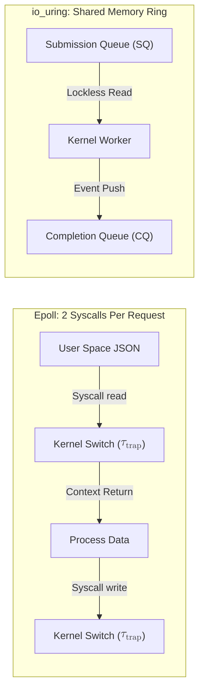
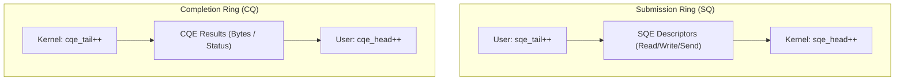
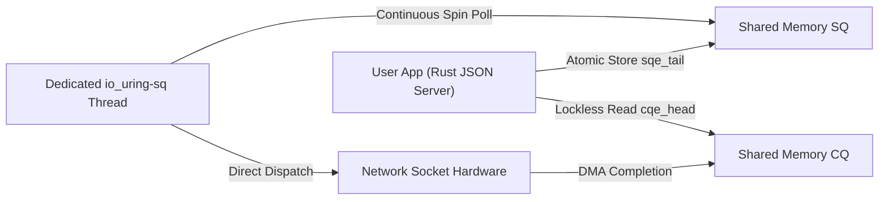

# Rust io_uring: Zero-Syscall Asynchronous I/O Architecture

An advanced systems engineering curriculum compiled with the Human Gradient Descent paradigm. Explores the physical shift from readiness-based epoll context-switching to completion-based shared memory ring buffers in Linux and Rust.

## The Syscall Tax and Context Switch Inadequacy
<!-- hgd:tier: 1_foundational_fluency -->
<!-- hgd:primer: "Traditional network servers rely on epoll readiness. Handling each incoming request requires repeated read and write syscalls, forcing the CPU to switch between user and kernel space, invalidating processor caches under heavy load." -->
<!-- hgd:probe: "Predict: Why does an epoll JSON server hit a throughput ceiling when handling 500,000 requests per second even when network bandwidth is plenty?" -->
<!-- hgd:truth: "The CPU spends the majority of its execution cycles in kernel trap transitions and TLB cache flushes caused by millions of context switches rather than executing application JSON logic." -->
<!-- hgd:worked: "Worked Solution: At 500k RPS, 2 syscalls per request yields 1,000,000 context switches per second. Each context switch incurs 1.2 to 2.5 microseconds in register saving and memory barrier penalties, consuming over 70% of available CPU clock cycles." -->
<!-- hgd:models: ["syscall", "context switch", "epoll", "tlb flush", "kernel trap", "throughput ceiling"] -->
<!-- hgd:options: [
  {"optionId": "opt_a", "text": "The CPU spends the majority of its execution cycles in kernel trap transitions and TLB cache flushes caused by millions of context switches rather than serializing JSON.", "isCorrect": true, "causalRationale": "Accurately identifies the physical cost of user-to-kernel boundary crossings at scale."},
  {"optionId": "opt_b", "text": "The JSON parser exceeds memory limits because Rust cannot free heap allocations without an active garbage collection pass.", "isCorrect": false, "diagnosticAxis": "conceptGap", "causalRationale": "Misattributes system bottleneck to language runtime memory management rather than OS I/O overhead."},
  {"optionId": "opt_c", "text": "TCP sockets automatically terminate connections when packets arrive faster than 100 microseconds apart.", "isCorrect": false, "diagnosticAxis": "reasoningBug", "causalRationale": "Invents a fictitious network protocol cutoff rule unsupported by transport layer specifications."}
] -->

### 1. Pangkal Anomali
Selama ini server web klasik berbasis `epoll` bekerja dengan pola kesiapan (*readiness*). Setiap kali data siap, aplikasi wajib memanggil *syscall* `read()` dan `write()`. Pada beban ekstrem (500.000 RPS), CPU membuang lebih dari 70% energinya hanya untuk bolak-balik menyeberangi perbatasan proteksi *ring 3* (user) dan *ring 0* (kernel), memicu invalidasi cache TLB.

### 2. Prototipe Intuitif
Physical sandbox model: Bayangkan kantor pos di mana setiap kali Anda ingin mengirim atau mengambil 1 lembar surat, Anda harus mengetuk pintu satpam, diperiksa paspor, dan menunggu pintu gerbang dibuka satu per satu. Sistem *io_uring* mengganti pintu gerbang itu dengan ban berjalan (*conveyor belt*) bersama tanpa satpam di mana surat ditaruh langsung ke wadah putar.

### 3. Invarian & Operasi Inti
Invarian fundamental sistem ini adalah **Dual-Ring Shared Memory Separation**: ruang memori antrean pengajuan (*Submission Queue*) dan penyelesaian (*Completion Queue*) dipetakan ke dalam memori bersama via `mmap`. Pertukaran data terjadi secara asinkron tanpa *syscall* pemblokir.

| Apa yang Dipikirkan Pemula (Salah) | Apa yang Sebenarnya Terjadi dalam Model Mental |
|---|---|
| Mengira io_uring hanya epoll versi lebih baru | io_uring adalah model *completion-based* (Proactor), bukan *readiness-based* (Reactor) |
| Mengira syscall membaca data langsung tanpa jeda | Setiap syscall memicu penyalinan konteks register CPU dan flushing pipeline instruksi |
| Mengira kernel wajib dipanggil saat menaruh tugas I/O | Tugas ditaruh langsung ke memori RAM bersama tanpa interupsi perangkat keras |

### 4. Notasi Sebagai Kontrak
Formula penghematan beban konteks kernel:
$$\mathcal{O}(\text{Syscall Overhead}) = 2N \cdot \tau_{\text{switch}} \xrightarrow{\text{io\_uring}} \mathcal{O}(1)$$
* `N`: Jumlah transaksi permintaan HTTP JSON per detik.
* `\tau_{switch}`: Penalti latensi penyeberangan proteksi prosesor (1.2 - 2.5 mikrodetik).
* `\mathcal{O}(1)`: Pengajuan batch tanpa pembengkakan transisi trap kernel.

### 5. Uji Tegangan Batas
Jika beban server dinaikkan dari 50.000 RPS ke 500.000 RPS, prediksikan faktor apa yang membedakan kurva utilisasi CPU antara server epoll dan server io_uring!

## Submission and Completion Ring Mechanics
<!-- hgd:prereqs: ["The Syscall Tax and Context Switch Inadequacy"] -->
<!-- hgd:tier: 2_boundary_perturbation -->
<!-- hgd:primer: "io_uring operates via two lockless ring buffers: the Submission Queue (SQ) where user space writes I/O requests, and the Completion Queue (CQ) where the kernel posts completed results." -->
<!-- hgd:probe: "Predict: What occurs when the user application enqueues Submission Queue Entries (SQEs) faster than the kernel consumes them, filling the ring buffer?" -->
<!-- hgd:truth: "The submission ring overflows and returns an explicit -EBUSY or backpressure status, requiring the user application to submit pending entries and wait for completion queue drains." -->
<!-- hgd:worked: "Worked Solution: The SQ ring uses atomic head and tail pointers. When tail - head equals the ring capacity, the ring is full. Calling io_uring_enter flushes the batch to kernel execution, clearing room for subsequent submissions." -->
<!-- hgd:models: ["submission queue", "completion queue", "ring buffer", "sqe", "cqe", "overflow", "ebusy"] -->
<!-- hgd:options: [
  {"optionId": "opt_a", "text": "The submission ring overflows and returns an explicit -EBUSY status, requiring the application to submit pending entries and await completions.", "isCorrect": true, "causalRationale": "Accurately describes circular buffer backpressure under queue saturation."},
  {"optionId": "opt_b", "text": "The kernel silently drops old socket connections without notifying the application.", "isCorrect": false, "diagnosticAxis": "conceptGap", "causalRationale": "Mistakes ring buffer saturation for ungraceful network packet dropping."},
  {"optionId": "opt_c", "text": "The ring dynamically doubles its size in physical RAM without kernel reallocation limits.", "isCorrect": false, "diagnosticAxis": "notationBreakdown", "causalRationale": "Ignores the fixed mmap ring capacity negotiated at initialization."}
] -->

### 1. Pangkal Anomali
Jika antrean I/O menggunakan struktur antrean biasa dengan penguncian (*mutex*), perebutan kunci antara *thread* aplikasi dan kernel akan menghancurkan skalabilitas multi-inti prosesor (*lock contention*).

### 2. Prototipe Intuitif
Physical sandbox model: Bayangkan wadah jam putar melingkar dengan dua jarum jam independen: jarum hijau dikendalikan Anda (ekor penulis), dan jarum merah dikendalikan petugas dapur (kepala pembaca). Tak ada yang perlu berbicara atau memegang kunci; masing-masing hanya memajukan jarumnya sendiri secara melingkar.

### 3. Invarian & Operasi Inti
Invarian fundamental antrean adalah **Lockless Single-Producer Single-Consumer (SPSC)**: aplikasi pengguna hanya memodifikasi `sq_tail` dan membaca `cq_head`, sedangkan kernel Linux hanya memodifikasi `sq_head` dan menulis `cq_tail`. Keduanya beroperasi tanpa *mutex lock*.

| Apa yang Dipikirkan Pemula (Salah) | Apa yang Sebenarnya Terjadi dalam Model Mental |
|---|---|
| Mengira SQ dan CQ memerlukan mutex lock bersama | Pointer kepala dan ekor dipisahkan pada cache line berbeda dengan operasi atomik |
| Mengira hasil I/O langsung menimpa data yang dikirim | Hasil selesai ditulis ke antrean CQ terpisah dengan status kode return bytes |

### 4. Notasi Sebagai Kontrak
Formula kondisi kapasitas cincin sirkular:
$$\text{Free Slots} = \text{Ring Capacity} - (\text{sq\_tail} - \text{sq\_head})$$
* `Ring Capacity`: Kapasitas slot cincin yang dinegosiasikan saat inisialisasi ($2^N$).
* `SQEs`: Submission Queue Entries (lembar deskriptor tugas pengajuan I/O yang ditulis ke antrean SQ).
* `sq_tail`: Indeks atomik posisi pengajuan oleh aplikasi pengguna.
* `sq_head`: Indeks atomik konsumsi tugas oleh kernel Linux.

### 5. Uji Tegangan Batas
Prediksikan apa yang terjadi pada konsumsi memori dan latensi jika sebuah server salah menyetel kapasitas ring buffer menjadi terlalu kecil di bawah beban burst tinggi!

## Kernel Polling via IORING_SETUP_SQPOLL
<!-- hgd:prereqs: ["Submission and Completion Ring Mechanics"] -->
<!-- hgd:tier: 3_isomorphic_transfer -->
<!-- hgd:primer: "With IORING_SETUP_SQPOLL, the Linux kernel spawns a dedicated kernel thread that continuously polls the Submission Queue. Applications submit I/O requests with zero syscalls in the steady state." -->
<!-- hgd:probe: "Predict: Why does SQPOLL achieve zero syscalls per request, and what is the trade-off regarding CPU core allocation?" -->
<!-- hgd:truth: "The dedicated kernel thread continuously reads submissions from shared memory without waiting for io_uring_enter syscalls, consuming an entire dedicated CPU core in a spin-poll loop." -->
<!-- hgd:worked: "Worked Solution: In SQPOLL mode, submitting an I/O request requires only writing the SQE and updating sq_tail via atomic memory release. The kernel thread picks it up in sub-microsecond latency, achieving literally zero syscalls per I/O event at the cost of 100% load on the dedicated polling core." -->
<!-- hgd:models: ["sqpoll", "zero syscall", "kernel thread", "cpu core", "polling", "spin loop"] -->
<!-- hgd:options: [
  {"optionId": "opt_a", "text": "The dedicated kernel thread reads submissions directly from shared RAM without syscalls, but permanently consumes an entire CPU core in a continuous poll loop.", "isCorrect": true, "causalRationale": "Accurately identifies the zero-syscall mechanism and its dedicated core resource trade-off."},
  {"optionId": "opt_b", "text": "The network card processes HTTP JSON requests directly on its onboard silicon without CPU intervention.", "isCorrect": false, "diagnosticAxis": "conceptGap", "causalRationale": "Confuses software kernel worker polling with smart NIC hardware offload."},
  {"optionId": "opt_c", "text": "SQPOLL eliminates all context switches by running user application code inside kernel ring 0.", "isCorrect": false, "diagnosticAxis": "reasoningBug", "causalRationale": "Violates operating system memory isolation and user-space privilege boundaries."}
] -->

### 1. Pangkal Anomali
Bahkan dengan *ring buffer*, pemanggilan fungsi pengajuan normal masih memerlukan satu *syscall* ringkas (`io_uring_enter`) untuk membangunkan kernel. Pada server dengan jutaan operasi per detik, satu *syscall* itu pun masih meninggalkan beban latensi.

### 2. Prototipe Intuitif
Physical sandbox model: Bayangkan alih-alih Anda harus membunyikan bel setiap kali meletakkan berkas di nampan keluar, seorang asisten khusus berdiri tepat di depan nampan dan terus-menerus mengamati nampan tanpa henti. Begitu berkas diletakkan, asisten langsung menyambarnya seketika tanpa perlu dipanggil.

### 3. Invarian & Operasi Inti
Invarian mutlak modus ini adalah **Zero-Syscall Steady State Execution**: selama frekuensi pengajuan permintaan lebih cepat daripada waktu *timeout* tidur *thread* kernel (`sq_thread_idle`), jumlah pemanggilan *syscall* per permintaan HTTP adalah **tepat nol**.

| Apa yang Dipikirkan Pemula (Salah) | Apa yang Sebenarnya Terjadi dalam Model Mental |
|---|---|
| Mengira SQPOLL gratis tanpa konsumsi daya | SQPOLL mengunci 1 core CPU penuh pada penggunaan 100% untuk memantau memori |
| Mengira kernel thread tidur di antara setiap request | Thread berputar (*spin-poll*) aktif di memori RAM selama batas waktu idle belum tercapai |

### 4. Notasi Sebagai Kontrak
Formula penghematan penalti transisi sistem:
$$\text{Cost}_{\text{SQPOLL}} = \begin{cases} 0 \text{ syscalls}, & \text{if } \Delta t_{\text{inter-request}} < t_{\text{idle}} \\ 1 \text{ wake syscall}, & \text{if thread fell asleep} \end{cases}$$
* `t_{idle}`: Durasi toleransi tidur thread kernel (misal 2000 milidetik).
* `\Delta t_{inter-request}`: Interval kedatangan antar-permintaan JSON.

### 5. Uji Tegangan Batas
Prediksikan apa yang terjadi jika konfigurasi SQPOLL diaktifkan pada server virtual dengan hanya 1 vCPU inti prosesor!

## Zero-Copy JSON Streaming with Registered Buffers
<!-- hgd:prereqs: ["The Syscall Tax and Context Switch Inadequacy", "Kernel Polling via IORING_SETUP_SQPOLL"] -->
<!-- hgd:tier: 4_adversarial_dilemma -->
<!-- hgd:primer: "When serving JSON responses, copying payload bytes from user memory into kernel socket buffers consumes valuable memory bandwidth. io_uring eliminates this with registered buffers and zero-copy send." -->
<!-- hgd:probe: "Predict: What safety constraint does Rust's ownership model enforce when performing an asynchronous zero-copy send (IORING_OP_SEND_ZC) with registered buffers?" -->
<!-- hgd:truth: "The application buffer must remain valid and unmodified in memory until the kernel emits a completion CQE indicating the network interface has completed physical transmission." -->
<!-- hgd:worked: "Worked Solution: In traditional write, user memory can be modified immediately after the syscall returns because data was copied to kernel sk_buff. In zero-copy, kernel hardware DMA reads directly from user memory. Modifying or dropping the Rust buffer before CQE completion causes data corruption or use-after-free." -->
<!-- hgd:models: ["zero-copy", "registered buffers", "ioring_op_send_zc", "ownership", "dma", "buffer pinning"] -->
<!-- hgd:options: [
  {"optionId": "opt_a", "text": "The Rust application buffer must remain strictly pinned and unmodified in memory until the kernel emits a completion CQE indicating hardware transmission is finished.", "isCorrect": true, "causalRationale": "Accurately identifies the DMA zero-copy memory lifecycle invariant."},
  {"optionId": "opt_b", "text": "Rust automatically creates a shadow heap clone of the buffer to allow instant reuse without waiting.", "isCorrect": false, "diagnosticAxis": "conceptGap", "causalRationale": "Contradicts the zero-copy invariant by falsely reintroducing memory duplication."},
  {"optionId": "opt_c", "text": "The buffer can be freed immediately because the CPU caches all bytes inside the L1 register file.", "isCorrect": false, "diagnosticAxis": "reasoningBug", "causalRationale": "Fails to account for asynchronous network interface DMA access to physical RAM."}
] -->

### 1. Pangkal Anomali
Sekalipun *syscall* sudah nol, penyalinan memori (*memcpy*) byte JSON dari *heap* aplikasi ke *buffer* soket kernel (`copy_from_user`) pada throughput 40 Gbps akan membuat *bus* memori RAM jenuh dan membatasi throughput maksimal.

### 2. Prototipe Intuitif
Physical sandbox model: Bayangkan alih-alih Anda menduplikasi naskah buku tebal untuk diserahkan ke kurir pengantar, Anda cukup mendaftarkan lemari brankas Anda (`IORING_REGISTER_BUFFERS`) ke sistem kurir. Kurir langsung membaca naskah asli dari brankas tanpa membuat salinan kertas baru.

### 3. Invarian & Operasi Inti
Invarian mutlak operasi ini adalah **Buffer Lifetime Pinning**: halaman memori yang didaftarkan (*registered buffers*) dikunci di dalam tabel halaman kernel (*pinned pages*), dan hak kepemilikan (*ownership*) dalam Rust wajib dijaga tetap hidup hingga CQE konfirmasi fisik terbit.

| Apa yang Dipikirkan Pemula (Salah) | Apa yang Sebenarnya Terjadi dalam Model Mental |
|---|---|
| Mengira buffer bisa langsung di-drop setelah `send_zc` | Buffer wajib tetap hidup di RAM sampai kartu jaringan selesai membaca fisik via DMA |
| Mengira zero-copy selalu lebih cepat untuk payload 10 byte | Untuk payload mikro (<64 byte), overhead pin halaman memori bisa melampaui biaya memcpy kecil |

### 4. Notasi Sebagai Kontrak
Formula penghematan bandwidth memori:
$$\text{Memory Traffic} = \begin{cases} 2 \cdot \text{Size}_{\text{payload}} \text{ (User } \to \text{ Kernel } \to \text{ NIC)}, & \text{Traditional Copy} \\ 1 \cdot \text{Size}_{\text{payload}} \text{ (User } \xrightarrow{\text{DMA}} \text{ NIC)}, & \text{io\_uring Zero-Copy} \end{cases}$$
* `IORING_OP_SEND_ZC`: Perintah operasi kernel io_uring untuk transmisi paket zero-copy langsung via DMA.
* `Size_{payload}`: Ukuran dokumen JSON yang disajikan.

### 5. Uji Tegangan Batas
Prediksikan apa ancaman integritas data yang terjadi jika seorang pemrogram Rust menggunakan `unsafe` untuk mendaur ulang buffer transmisi sebelum `cqe.res` diterima dari kernel!
