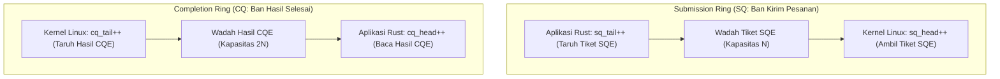
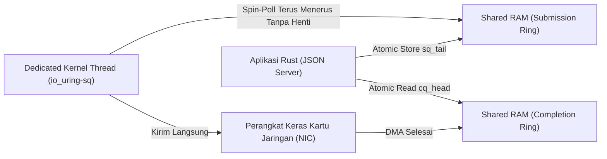
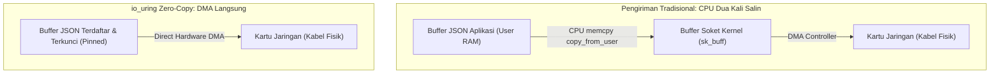

# Rust io_uring: Zero-Syscall Asynchronous I/O Architecture

An advanced systems engineering curriculum compiled with the Human Gradient Descent paradigm. Explores the physical shift from readiness-based epoll context-switching to completion-based shared memory ring buffers in Linux and high-performance Rust.

## The Syscall Tax and Context Switch Inadequacy
<!-- hgd:tier: 1_foundational_fluency -->
<!-- hgd:primer: "Traditional network servers rely on epoll readiness. Handling each incoming request requires repeated read and write syscalls, forcing the CPU to switch between user and kernel space, invalidating processor caches under heavy load." -->
<!-- hgd:probe: "Predict: Why does an epoll JSON server hit a throughput ceiling when handling 500,000 requests per second even when network bandwidth is plenty?" -->
<!-- hgd:truth: "The CPU spends the majority of its execution cycles in kernel trap transitions and TLB cache flushes caused by millions of context switches rather than executing application JSON logic." -->
<!-- hgd:worked: "Worked Solution: At 500k RPS, 2 syscalls per request yields 1,000,000 context switches per second. Each context switch incurs 1.2 to 2.5 microseconds in register saving and memory barrier penalties, consuming over 70% of available CPU clock cycles." -->
<!-- hgd:models: ["syscall", "context switch", "epoll", "tlb flush", "kernel trap", "throughput ceiling"] -->
<!-- hgd:options: [ {"optionId": "opt_a", "text": "The CPU spends the majority of its execution cycles in kernel trap transitions and TLB cache flushes caused by millions of context switches rather than executing application JSON logic.", "isCorrect": true, "causalRationale": "Accurately identifies the physical cost of user-to-kernel boundary crossings at high scale."}, {"optionId": "opt_b", "text": "The JSON parser exceeds memory limits because Rust cannot free heap allocations without an active garbage collection pass.", "isCorrect": false, "diagnosticAxis": "conceptGap", "causalRationale": "Misattributes system bottleneck to language runtime memory management rather than OS I/O overhead."}, {"optionId": "opt_c", "text": "TCP sockets automatically terminate connections when packets arrive faster than 100 microseconds apart.", "isCorrect": false, "diagnosticAxis": "reasoningBug", "causalRationale": "Invents a fictitious network protocol cutoff rule unsupported by transport layer specifications."}, {"optionId": "opt_d", "text": "The kernel completely blocks all network cards from receiving electricity whenever CPU utilization crosses 50%.", "isCorrect": false, "diagnosticAxis": "missingPrerequisite", "causalRationale": "Absurd physical claim that violates computer hardware electrical power architecture."} ] -->

### 1. Pangkal Anomali
Selama lebih dari dua dekade, arsitektur server web modern di Linux yang dibangun dengan bahasa Rust mengandalkan mekanisme pemantauan kesiapan soket jaringan TCP yang disebut `epoll`. Pola kerjanya tampak sangat masuk akal: sistem operasi memberi tahu aplikasi ketika soket TCP memiliki data yang siap dibaca (*readiness notification*). Begitu data siap, program memanggil fungsi pembacaan data, memproses JSON, dan menuliskan jawaban kembali ke soket.

Pendekatan pemantauan kesiapan sekuensial ini awalnya sangat memadai untuk melayani ribuan koneksi web biasa. Pada masa lalu saat kartu jaringan beroperasi pada kecepatan 100 Mbps, waktu jeda penyeberangan proteksi prosesor tertutup oleh latensi transmisi fisik kabel jaringan yang jauh lebih lambat.

Namun di era komputasi modern dengan kartu jaringan 10GbE hingga 100GbE yang mampu menerima 500.000 hingga 1.000.000 permintaan per detik (*Requests Per Second* / RPS), pendekatan klasik ini membentur tembok batas fisik yang sangat keras. Bahkan ketika kabel jaringan masih sangat longgar dan memori RAM masih berlimpah, server tiba-tiba melambat dan penggunaan prosesor (CPU) melonjak hingga 100%. Ironisnya, prosesor tidak sibuk memproses logika bisnis atau membaca format JSON; prosesor habis terkuras energinya hanya karena harus bolak-balik menyeberangi dinding pemisah proteksi antara ranah pengguna (*User Space / Ring 3*) dan ranah sistem operasi (*Kernel Space / Ring 0*).

Setiap kali aplikasi ingin membaca atau menulis data jaringan, ia harus memicu apa yang disebut *System Call (Syscall)*. Pemanggilan *syscall* ini memaksa prosesor menghentikan pekerjaannya, menyimpan puluhan isi register memori ke dalam tumpukan (*stack*), mengganti tabel alamat virtual memori, dan mengosongkan *cache Translation Lookaside Buffer (TLB)*. Jika ada 500.000 permintaan dan masing-masing butuh minimal 2 syscall (`read` dan `write`), maka dalam 1 detik prosesor harus melakukan 1.000.000 kali penyeberangan! Beban penyeberangan ini dikenal sebagai *The Syscall Tax* (Pajak Syscall) yang menuntut paradigma komunikasi baru tanpa interupsi trap berulang.

### 2. Prototipe Intuitif
Bayangkan sebuah kantor pos besar dengan ruang juru ketik di dalam gedung (User Space) dan halaman luar tempat kurir paket bertugas (Kernel Space yang mengendalikan kabel jaringan fisik).

Di antara ruangan juru ketik dan halaman luar terpasang sebuah pintu gerbang besi lapis baja yang dijaga ketat oleh satpam bersenjata (*Kernel Protection Barrier*). Setiap pemeriksaan tanda pengenal dan pembukaan gerbang menyita energi dan waktu yang nyata.

Dalam model lama (`epoll`), setiap kali juru ketik ingin mengirim satu lembar surat, ia harus berdiri dari mejanya, berjalan menuju pintu gerbang, mengetuk pintu, menunggu satpam memeriksa izin, menyerahkan surat ke kurir, lalu berjalan kembali ke mejanya. Prosedur ini sangat melelahkan jika diulang ratusan ribu kali setiap detik; juru ketik akan pingsan karena energinya habis terkuras hanya untuk mondar-mandir mengetuk pintu gerbang satpam.

Sistem baru *io_uring* membuang ritual bolak-balik tersebut dengan memasang sebuah ban berjalan melingkar (*conveyor belt*) yang menembus celah bawah pintu gerbang. Juru ketik cukup meletakkan tumpukan surat di atas ban berjalan tanpa perlu berdiri, dan kurir di halaman luar mengambil surat tersebut secara mandiri tanpa pintu gerbang pernah perlu dibuka lagi!

```mermaid
flowchart LR
    subgraph Classical["Model Lama: Epoll (2 Syscalls Per Request)"]
        U1["Aplikasi User (Juru Ketik)"] -->|Syscall read (Ketuk Pintu)| K1["Kernel Trap Barrier ($$\\tau_{\\text{trap}}$$)"]
        K1 -->|Ganti Konteks CPU| U2["Proses Dokumen JSON"]
        U2 -->|Syscall write (Ketuk Pintu)| K2["Kernel Trap Barrier ($$\\tau_{\\text{trap}}$$)"]
    end
    subgraph Ring["Model io_uring: Ban Berjalan (Shared Memory)"]
        SQ["Submission Queue (Ban Kirim)"] -->|Ambil Tanpa Gangguan| KW["Kernel Worker (Kurir Luar)"]
        KW -->|Taruh Bukti Selesai| CQ["Completion Queue (Ban Hasil)"]
    end
```

### 3. Invarian & Operasi Inti
Invarian fundamental arsitektur ini adalah **Pemisahan Memori Bersama Bebas Kunci (Dual-Ring Shared Memory Separation)**: kernel Linux dan aplikasi berbagi dua bidang memori RAM yang sama persis melalui pemetaan `mmap`.

Dua bidang memori sirkular tersebut dibagi secara fungsional: **Submission Queue (SQ)** untuk pengajuan tugas oleh aplikasi, dan **Completion Queue (CQ)** untuk laporan hasil eksekusi oleh kernel.

Karena kedua pihak membaca dan menulis ke area memori RAM bersama yang sama secara asinkron menggunakan penunjuk atomik, pertukaran data tidak memerlukan interupsi perangkat keras (*hardware interrupt*) dan tanpa satu pun pemanggilan *syscall* pemblokir saat sistem berada dalam kondisi transmisi stabil.

Model mental pemula kerap keliru menganggap io_uring hanya sekadar epoll dengan nama baru, padahal sistem ini merepresentasikan lompatan paradigma dari model reaktif berbasis kesiapan (*Reactor*) menuju model proaktif berbasis penyelesaian tugas (*Proactor*).

| Apa yang Dipikirkan Pemula (Salah) | Apa yang Sebenarnya Terjadi dalam Model Mental |
|---|---|
| Mengira io_uring hanya sekadar epoll dengan nama dan sintaks baru. | io_uring adalah pergeseran paradigma fisik dari *readiness-based* (Reactor) menuju *completion-based* (Proactor). |
| Mengira syscall membaca data jaringan secara instan tanpa biaya jeda. | Setiap syscall memicu pembekuan instruksi CPU, penyimpanan register, dan pembersihan cache TLB memori. |
| Mengira kernel wajib dipanggil setiap kali aplikasi menaruh tugas I/O. | Tugas ditaruh langsung ke dalam memori RAM bersama tanpa interupsi sistem operasi. |

### 4. Notasi Sebagai Kontrak
Penghematan beban kontekstual kernel tidak cukup hanya dipahami secara naratif, melainkan harus diikat ke dalam kontrak kuantitatif formal agar desainer sistem dapat memproyeksikan kapasitas throughput prosesor.

Kontrak matematika di bawah ini membandingkan penalti latensi kumulatif model syscall konvensional terhadap model pengajuan rombongan berbasis memori bersama pada io_uring:
$$\mathcal{O}(\text{Syscall Overhead}) = 2N \cdot \tau_{\text{switch}} \xrightarrow{\text{io\_uring}} \mathcal{O}(1)$$

Persamaan ini menegaskan bahwa pada arsitektur klasik epoll, biaya overhead berskala linier terhadap jumlah transaksi $N$, di mana setiap transaksi menyita penalti penyeberangan proteksi prosesor $\tau_{\text{switch}}$ sebesar 1.2 hingga 2.5 mikrodetik per transisi.

Sebaliknya, io_uring memutus ketergantungan linier tersebut menjadi $\mathcal{O}(1)$ konstan dalam pengajuan rombongan (*batching*), membebaskan jutaan siklus inti CPU yang sebelumnya terbuang percuma untuk dialokasikan sepenuhnya pada logika aplikasi.

* `N`: Jumlah transaksi permintaan HTTP JSON per detik (misal $500.000\text{ RPS}$).
* `$\tau_{\text{switch}}$`: Penalti latensi penyeberangan proteksi prosesor (berkisar antara 1.2 hingga 2.5 mikrodetik per transisi).
* `$2N \cdot \tau_{\text{switch}}$`: Total waktu CPU yang terbuang percuma pada model klasik epoll ($1.000.000 \times 1.5\,\mu\text{s} = 1.5\text{ detik}$ waktu inti prosesor).
* `$\mathcal{O}(1)$`: Pengajuan tugas secara rombongan (*batch*) pada io_uring yang memangkas biaya transisi trap menjadi mendekati nol.

### Glosarium & Jembatan Konsep SMA

| Istilah | Konsep Formal | Jembatan Konsep SMA |
|---|---|---|
| Syscall (System Call) | Instruksi perangkat keras untuk berpindah dari User Mode (Ring 3) ke Kernel Mode (Ring 0) | Surat izin resmi murid kepada kepala sekolah untuk meminjam kunci ruangan laboratorium |
| Context Switch | Proses CPU menyimpan status komputasi thread saat ini dan memuat status thread baru | Murid yang sedang menghitung rumus Fisika disuruh menutup buku dan mulai ujian Sejarah |
| TLB Cache Flush | Pengosongan cache Translation Lookaside Buffer pemetaan alamat virtual ke fisik | Menghapus catatan denah kelas di papan tulis saat bel pergantian jam pelajaran berbunyi |
| epoll | Mekanisme kernel Linux memantau status kesiapan I/O pada kumpulan file descriptor | Guru piket berkeliling mengecek pintu kelas mana saja yang muridnya sudah selesai tugas |
| io_uring | Antarmuka I/O asinkronus berkinerja tinggi Linux berbasis antrean cincin memori bersama | Ban berjalan (*conveyor belt*) dua arah dapur kantin dan ruang makan tanpa pelayan bolak-balik |

---

## Submission and Completion Ring Mechanics
<!-- hgd:prereqs: ["The Syscall Tax and Context Switch Inadequacy"] -->
<!-- hgd:tier: 2_boundary_perturbation -->
<!-- hgd:primer: "io_uring operates via two lockless ring buffers: the Submission Queue (SQ) where user space writes I/O requests, and the Completion Queue (CQ) where the kernel posts completed results without mutex lock contention." -->
<!-- hgd:probe: "Predict: What occurs when the user application enqueues Submission Queue Entries (SQEs) faster than the kernel consumes them, filling the ring buffer?" -->
<!-- hgd:truth: "The submission ring overflows and returns an explicit -EBUSY or backpressure status, requiring the user application to submit pending entries and wait for completion queue drains." -->
<!-- hgd:worked: "Worked Solution: The SQ ring uses atomic head and tail pointers. When tail - head equals the ring capacity, the ring is full. Calling io_uring_enter flushes the batch to kernel execution, clearing room for subsequent submissions." -->
<!-- hgd:models: ["submission queue", "completion queue", "ring buffer", "sqe", "cqe", "overflow", "ebusy"] -->
<!-- hgd:options: [ {"optionId": "opt_a", "text": "The submission ring overflows and returns an explicit -EBUSY status, requiring the application to submit pending entries and await completions.", "isCorrect": true, "causalRationale": "Accurately describes circular buffer backpressure under queue saturation."}, {"optionId": "opt_b", "text": "The kernel silently drops old socket connections without notifying the application.", "isCorrect": false, "diagnosticAxis": "conceptGap", "causalRationale": "Mistakes ring buffer saturation for ungraceful network packet dropping."}, {"optionId": "opt_c", "text": "The ring dynamically doubles its size in physical RAM without kernel reallocation limits.", "isCorrect": false, "diagnosticAxis": "notationBreakdown", "causalRationale": "Ignores the fixed mmap ring capacity negotiated at initialization."}, {"optionId": "opt_d", "text": "The CPU crashes with a blue-screen kernel panic because ring buffers are forbidden from reaching 100% capacity.", "isCorrect": false, "diagnosticAxis": "reasoningBug", "causalRationale": "Fails to understand standard error code backpressure handling in Linux kernel APIs."} ] -->

### 1. Pangkal Anomali
Ketika dua proses atau dua domain proteksi berbeda ingin berbagi antrean data di dalam memori komputer, solusi paling lumrah dalam buku teks ilmu komputer adalah memasang kunci pengaman (*Mutex / Mutual Exclusion Lock*).

Dalam pendekatan penguncian konvensional, pihak mana pun yang ingin memasukkan atau mengambil data wajib mengunci antrean, memodifikasi status memori, lalu melepaskan kunci tersebut agar pihak lain dapat mengaksesnya secara bergiliran.

Namun pada sistem multi-core modern yang memproses jutaan paket per detik, penguncian mutex menjadi bencana performa (*lock contention*). Ketika belasan inti prosesor (CPU) berebut memegang satu gembok kunci yang sama, sebagian besar inti prosesor akan membeku menganggur (*spinning / sleeping*) menunggu gilirannya.

Kebutuhan akan throughput tinggi menuntut arsitektur antrean bebas kunci (*lockless*) di mana aplikasi Rust dan kernel Linux dapat menulis dan membaca secara simultan di memori RAM bersama tanpa pernah saling menghalangi dan tanpa risiko korupsi data.

### 2. Prototipe Intuitif
Bayangkan sebuah piring putar kue bundar berkapasitas tetap yang memiliki 8 wadah mangkok bernomor urut 0 sampai 7 di sebuah restoran sushi.

Di atas piring putar ini terpasang dua jarum penunjuk yang berputar searah jarum jam: Jarum Hijau (Ekor / `Tail`) yang dikendalikan khusus oleh juru masak (aplikasi Rust), dan Jarum Merah (Kepala / `Head`) yang dikendalikan khusus oleh pelayan (kernel Linux).

Juru masak hanya menaruh kue baru di mangkok yang ditunjuk Jarum Hijau lalu memajukannya satu langkah, sedangkan pelayan hanya mengambil kue dari mangkok yang ditunjuk Jarum Merah lalu memajukannya satu langkah.

Keduanya tidak pernah berebut menyentuh jarum yang sama; juru masak hanya memantau Jarum Merah dari kejauhan untuk memastikan piring tidak meluap penuh, sehingga sistem berputar harmonis tanpa satu pun kata terucap dan tanpa kunci gembok.



### 3. Invarian & Operasi Inti
Invarian fundamental mekanisme antrean ini adalah **Pola Produsen Tunggal Konsumen Tunggal Bebas Kunci (Lockless Single-Producer Single-Consumer / SPSC)**.

Pada cincin pengajuan (SQ), aplikasi pengguna bertindak sebagai satu-satunya produsen yang memajukan `sq_tail`, sementara kernel bertindak sebagai satu-satunya konsumen yang memajukan `sq_head`. Sebaliknya pada cincin penyelesaian (CQ), kernel adalah produsen tunggal `cq_tail` dan aplikasi adalah konsumen tunggal `cq_head`.

Karena setiap variabel penunjuk dikendalikan secara eksklusif oleh satu pihak dan diselaraskan pada garis cache memori yang terisolasi (*cache line alignment*), sinkronisasi dicapai semata-mata via operasi atomik perangkat keras tanpa tabrakan memori (*race condition*).

Pemula kerap berasumsi keliru bahwa antrean cincin dapat membesar secara otomatis tanpa batas, padahal kapasitasnya bersifat tetap sejak inisialisasi dan akan mengembalikan status tolak balik (`-EBUSY`) jika kapasitas terlampaui.

| Apa yang Dipikirkan Pemula (Salah) | Apa yang Sebenarnya Terjadi dalam Model Mental |
|---|---|
| Mengira antrean SQ dan CQ membutuhkan mutex lock bersama untuk sinkronisasi. | Pointer head dan tail dipisahkan secara fisik dan hanya diperbarui menggunakan operasi atomik memori. |
| Mengira hasil pekerjaan I/O langsung menimpa tiket tugas yang diajukan. | Tiket tugas (SQE) dan laporan hasil selesai (CQE) berada di dua struktur memori cincin yang terpisah total. |
| Mengira kapasitas ring buffer bisa membesar otomatis tanpa batas. | Ukuran cincin dinegosiasikan saat awal pembuatan dan memiliki jumlah slot tetap bernilai pangkat dua ($2^N$). |

### 4. Notasi Sebagai Kontrak
Untuk mencegah kelebihan muatan (*queue saturation*) yang dapat merusak integritas memori, hubungan matematis antara penunjuk kepala dan ekor diikat dalam formula kapasitas antrean sirkular.

Persamaan aljabar berikut mengatur ketersediaan ruang penyimpanan tugas di dalam antrean cincin submission secara deterministik:
$$\text{Free Slots} = \text{Ring Capacity} - (\text{sq\_tail} - \text{sq\_head})$$

Persamaan ini menegaskan bahwa kapasitas bebas berbanding terbalik dengan selisih indeks atomik ekor (`sq_tail`) yang dimajukan produsen terhadap indeks kepala (`sq_head`) yang dikonsumsi oleh kernel.

Kontrak ini memastikan bahwa aplikasi dapat menghitung ruang kosong secara lokal tanpa memanggil sistem operasi, dan jika nilai slot bebas mencapai tepat nol, sistem secara tegas menerapkan penolakan balik (`-EBUSY`) demi mencegah penimpaan data.

* `Ring Capacity`: Kapasitas total slot yang dipesan dalam memori RAM (wajib bilangan biner pangkat dua, misal $1024, 2048, 4096$).
* `sq_tail`: Indeks atomik posisi pengajuan tugas yang dimajukan oleh aplikasi Rust.
* `sq_head`: Indeks atomik posisi pengambilan tugas yang dimajukan oleh kernel Linux.
* `SQEs`: *Submission Queue Entries* (lembaran kartu tiket tugas pengajuan I/O yang ditulis ke antrean SQ).
* `CQEs`: *Completion Queue Entries* (kartu tanda bukti hasil pelaksanaan I/O yang memuat byte terkirim dan status error).
* `-EBUSY`: Kode status tolak balik (*backpressure*) yang terbit jika `sq_tail - sq_head == Ring Capacity`.

### Glosarium & Jembatan Konsep SMA

| Istilah | Konsep Formal | Jembatan Konsep SMA |
|---|---|---|
| SQE (Submission Queue Entry) | Struktur data deskriptor 64-byte yang merinci jenis operasi I/O yang diminta ke kernel | Lembar formulir pesanan makanan yang diisi oleh pembeli di restoran |
| CQE (Completion Queue Entry) | Struktur data 16-byte yang memuat hasil eksekusi operasi (kode status dan byte) | Struk nota bukti pembayaran dan penerimaan barang dari kasir restoran |
| Lockless SPSC | Arsitektur konkurensi satu produsen dan satu konsumen tanpa penguncian mutex | Dua orang bermain tenis meja; satu orang hanya memukul servis, satu orang mengembalikan bola |
| Backpressure | Pembatasan laju ketika produsen menghasilkan data lebih cepat dari kemampuan konsumen | Pelampung tangki air di rumah yang menutup katup otomatis saat bak mandi sudah penuh |

---

## Kernel Polling via IORING_SETUP_SQPOLL
<!-- hgd:prereqs: ["Submission and Completion Ring Mechanics"] -->
<!-- hgd:tier: 3_isomorphic_transfer -->
<!-- hgd:primer: "With IORING_SETUP_SQPOLL, the Linux kernel spawns a dedicated kernel thread that continuously polls the Submission Queue. Applications submit I/O requests with zero syscalls in the steady state." -->
<!-- hgd:probe: "Predict: Why does SQPOLL achieve zero syscalls per request, and what is the trade-off regarding CPU core allocation?" -->
<!-- hgd:truth: "The dedicated kernel thread continuously reads submissions from shared memory without waiting for io_uring_enter syscalls, consuming an entire dedicated CPU core in a spin-poll loop." -->
<!-- hgd:worked: "Worked Solution: In SQPOLL mode, submitting an I/O request requires only writing the SQE and updating sq_tail via atomic memory release. The kernel thread picks it up in sub-microsecond latency, achieving literally zero syscalls per I/O event at the cost of 100% load on the dedicated polling core." -->
<!-- hgd:models: ["sqpoll", "zero syscall", "kernel thread", "cpu core", "polling", "spin loop"] -->
<!-- hgd:options: [ {"optionId": "opt_a", "text": "The dedicated kernel thread reads submissions directly from shared RAM without syscalls, but permanently consumes an entire CPU core in a continuous poll loop.", "isCorrect": true, "causalRationale": "Accurately identifies the zero-syscall mechanism and its dedicated core resource trade-off."}, {"optionId": "opt_b", "text": "The network card processes HTTP JSON requests directly on its onboard silicon without CPU intervention.", "isCorrect": false, "diagnosticAxis": "conceptGap", "causalRationale": "Confuses software kernel worker polling with smart NIC hardware offload."}, {"optionId": "opt_c", "text": "SQPOLL eliminates all context switches by running user application code inside kernel ring 0.", "isCorrect": false, "diagnosticAxis": "reasoningBug", "causalRationale": "Violates operating system memory isolation and user-space privilege boundaries."}, {"optionId": "opt_d", "text": "The kernel completely turns off all electricity to memory RAM to save power during submission polling.", "isCorrect": false, "diagnosticAxis": "missingPrerequisite", "causalRationale": "Physical impossibility that contradicts basic electrical computer power requirements."} ] -->

### 1. Pangkal Anomali
Penggunaan antrean cincin ganda telah berhasil memangkas sebagian besar overhead pemanggilan sistem operasi dengan memungkinkan pengajuan tugas secara asinkron.

Namun dalam mode standar, setelah aplikasi meletakkan tiket tugas (SQE) ke dalam antrean, kernel yang berada dalam status pasif belum mengetahui bahwa ada pekerjaan baru yang menunggu.

Oleh karena itu, aplikasi masih harus mengeksekusi satu syscall ringkas `io_uring_enter()` untuk membangunkan kernel dan memberitahukan adanya tiket baru di ban berjalan.

Meskipun satu syscall untuk memproses sekelompok tiket jauh lebih hemat dibanding model lama, pada server transaksi finansial berlatensi ultra-rendah jeda beberapa mikrodetik ini tetap menjadi penghambat tercapainya target Zero Syscalls murni.

### 2. Prototipe Intuitif
Bayangkan sebuah kantor layanan pengiriman darurat di mana seorang staf administrasi bertugas menyiapkan dokumen di atas meja penyerahan.

Pada mode normal, setiap kali staf menaruh tumpukan berkas, ia harus memencet bel dinding agar petugas pengantar di ruang sebelah bangun dari kursinya dan datang mengambil berkas tersebut.

Pada mode **SQPOLL (Submission Queue Polling)**, pimpinan kantor menugaskan seorang kurir khusus (*Dedicated Kernel Thread*) yang berdiri tegak tepat di depan meja penyerahan dan terus-menerus menatap meja tanpa berkedip.

Begitu tangan staf administrasi meletakkan berkas di atas meja, kurir khusus tersebut langsung menyambarnya dalam hitungan nanodetik tanpa perlu bel dinding pernah disentuh lagi, dengan konsekuensi kurir tersebut mendedikasikan 100% waktunya hanya untuk berjaga di meja.



### 3. Invarian & Operasi Inti
Invarian mutlak dari mode ini adalah **Eksekusi Kondisi Mantap Tanpa Syscall (Zero-Syscall Steady State Execution)**: selama laju kedatangan permintaan cukup tinggi, seluruh transaksi diproses tanpa melibatkan satu pun syscall.

Thread kernel berputar dalam putaran aktif (*spin loop*) memeriksa penunjuk `sq_tail` di memori RAM bersama, sehingga penyerahan tugas cukup dilakukan via instruksi penulisan memori atomik biasa.

Jika tidak ada transaksi baru yang masuk selama durasi toleransi tertentu (`sq_thread_idle`), thread kernel akan tidur untuk menghemat daya listrik, dan aplikasi membutuhkan satu kali syscall bangun untuk mengaktifkannya kembali.

Pemikiran naif sering menganggap SQPOLL sebagai fitur akselerasi gratis, padahal mode ini menuntut komitmen sumber daya yang mahal berupa satu inti prosesor (vCPU) fisik yang terkunci pada utilitas 100%.

| Apa yang Dipikirkan Pemula (Salah) | Apa yang Sebenarnya Terjadi dalam Model Mental |
|---|---|
| Mengira SQPOLL adalah fitur gratis tanpa ada biaya konsumsi daya listrik. | SQPOLL mengunci 1 inti prosesor fisik (100% CPU utilization) untuk terus-menerus berputar mengawasi memori. |
| Mengira kernel thread tidur santai di antara setiap paket data yang datang. | Thread melakukan putaran aktif (*spin loop*) di memori RAM selama batas waktu idle belum terlampaui. |
| Mengira SQPOLL cocok diaktifkan di semua server kecil atau laptop hemat daya. | Pada mesin dengan hanya 1 atau 2 core vCPU, SQPOLL justru akan merebut jatah komputasi aplikasi utama. |

### 4. Notasi Sebagai Kontrak
Efisiensi biaya eksekusi pada mode polling diikat secara formal dalam fungsi biaya bertingkat yang bergantung pada interval kedatangan transaksi jaringan.

Formula biaya transisi eksekusi sistem dirumuskan sebagai kontrak matematika piecewise berikut:
$$\text{Cost}_{\text{SQPOLL}} = \begin{cases} 0 \text{ syscalls}, & \text{jika } \Delta t_{\text{inter-request}} < t_{\text{idle}} \\ 1 \text{ wake syscall}, & \text{jika thread sempat tertidur} \end{cases}$$

Persamaan di atas mendefinisikan batas operasional di mana penghematan nol-syscall bertahan selama jeda waktu antar-permintaan $\Delta t_{\text{inter-request}}$ lebih kecil dari ambang batas toleransi tidur $t_{\text{idle}}$.

Dengan mengunci kontrak ini, arsitek sistem dapat menentukan secara presisi kapan harus mengalokasikan core CPU untuk SQPOLL berdasarkan profil throughput lalu lintas jaringan aktual.

* `$t_{\text{idle}}$`: Durasi toleransi tidur thread kernel sebelum memasuki mode hemat daya (misalnya 2000 milidetik).
* `$\Delta t_{\text{inter-request}}$`: Waktu jeda antar kedatangan transaksi HTTP JSON dari jaringan.
* `Zero Syscall`: Kondisi mantap di mana aplikasi melayani ribuan klien tanpa satu pun penyeberangan proteksi prosesor.
* `IORING_SETUP_SQPOLL`: Bendera konfigurasi kernel saat inisialisasi cincin io_uring.

### Glosarium & Jembatan Konsep SMA

| Istilah | Konsep Formal | Jembatan Konsep SMA |
|---|---|---|
| SQPOLL | Modus kernel Linux di mana kthread didedikasikan untuk polling SQ | Satpam jaga berdiri tegak mengamati gerbang agar tamu tak perlu memencet bel |
| Spin Loop | Teknik CPU menguji suatu kondisi dalam putaran ketat berulang | Murid yang setiap 2 detik melihat jendela untuk mengecek apakah jemputan sudah tiba |
| Kernel Thread | Entitas eksekusi independen yang berjalan di dalam ranah kernel sistem operasi | Petugas teknisi internal gedung yang bekerja otomatis di balik layar |
| vCPU / Core | Unit komputasi pemrosesan fisik independen di dalam silikon chip prosesor | Meja kerja terpisah di kantor tempat orang bisa menghitung mandiri bersamaan |

---

## Zero-Copy JSON Streaming with Registered Buffers
<!-- hgd:prereqs: ["The Syscall Tax and Context Switch Inadequacy", "Kernel Polling via IORING_SETUP_SQPOLL"] -->
<!-- hgd:tier: 4_adversarial_dilemma -->
<!-- hgd:primer: "When serving JSON responses, copying payload bytes from user memory into kernel socket buffers consumes valuable memory bandwidth. io_uring eliminates this with registered buffers and zero-copy send." -->
<!-- hgd:probe: "Predict: What safety constraint does Rust's ownership model enforce when performing an asynchronous zero-copy send (IORING_OP_SEND_ZC) with registered buffers?" -->
<!-- hgd:truth: "The application buffer must remain valid and unmodified in memory until the kernel emits a completion CQE indicating the network interface has completed physical transmission." -->
<!-- hgd:worked: "Worked Solution: In traditional write, user memory can be modified immediately after the syscall returns because data was copied to kernel sk_buff. In zero-copy, kernel hardware DMA reads directly from user memory. Modifying or dropping the Rust buffer before CQE completion causes data corruption or use-after-free." -->
<!-- hgd:models: ["zero-copy", "registered buffers", "ioring_op_send_zc", "ownership", "dma", "buffer pinning"] -->
<!-- hgd:options: [ {"optionId": "opt_a", "text": "The Rust application buffer must remain strictly pinned and unmodified in memory until the kernel emits a completion CQE indicating physical transmission is finished.", "isCorrect": true, "causalRationale": "Accurately identifies the DMA zero-copy memory lifecycle invariant."}, {"optionId": "opt_b", "text": "Rust automatically creates a shadow heap clone of the buffer to allow instant reuse without waiting.", "isCorrect": false, "diagnosticAxis": "conceptGap", "causalRationale": "Contradicts the zero-copy invariant by falsely reintroducing memory duplication."}, {"optionId": "opt_c", "text": "The buffer can be freed immediately because the CPU caches all bytes inside the L1 register file.", "isCorrect": false, "diagnosticAxis": "reasoningBug", "causalRationale": "Fails to account for asynchronous network interface DMA access to physical RAM."}, {"optionId": "opt_d", "text": "Zero-copy allows the network card to physically erase the hard drive whenever a packet collision occurs.", "isCorrect": false, "diagnosticAxis": "missingPrerequisite", "causalRationale": "Gross misunderstanding of network packet transmission and storage hardware boundaries."} ] -->

### 1. Pangkal Anomali
Setelah penyeberangan proteksi prosesor berhasil dipangkas hingga nol menggunakan io_uring dan SQPOLL, throughput transmisi server melonjak ke tingkat yang luar biasa.

Namun ketika beban jaringan ditingkatkan melampaui 40 Gbps pada kartu jaringan modern, prosesor kembali mengalami kemacetan parah pada jalur bus memori RAM (*memory bandwidth saturation*).

Kemacetan ini berakar pada operasi penyalinan data konvensional (`memcpy`) di mana CPU harus menyalin setiap byte JSON dari buffer memori pengguna ke buffer perantara kernel (`sk_buff`) sebelum dialirkan ke kabel fisik.

Akibatnya, setiap byte data dipompa melewati bus memori RAM sebanyak minimal dua kali, menimbulkan penumpukan panas prosesor dan saturasi bandwidth kawat tembaga motherboard pada throughput tinggi.

### 2. Prototipe Intuitif
Bayangkan sebuah gudang penyimpanan arsip naskah dokumen (memori RAM aplikasi Anda) dan truk kontainer kargo di dermaga pelabuhan (kartu jaringan fisik / *NIC*).

Dalam prosedur pengiriman lama, staf gudang harus memfotokopi naskah asli lembar demi lembar ke mesin fotokopi, memasukkan salinannya ke kotak pos perantara (kernel buffer), baru kemudian kurir pelabuhan mengangkutnya ke truk.

Dalam prosedur **Zero-Copy dengan Registered Buffers**, gudang Anda mendaftarkan lemari brankas penyimpanan naskah secara resmi ke otoritas pelabuhan (`IORING_REGISTER_BUFFERS`) dan mengunci posisinya (*Pinned Memory*).

Saat pengiriman dilakukan, lengan robot pemuat kontainer (*Direct Memory Access / DMA*) menjangkau langsung ke dalam brankas Anda untuk membaca naskah asli tanpa ada salinan kertas yang dibuat dan tanpa menyita waktu staf gudang.



### 3. Invarian & Operasi Inti
Invarian fundamental transmisi zero-copy adalah **Kekekalan Masa Hidup Buffer Terkunci (Buffer Lifetime Pinning Invariant)**: halaman memori fisik yang didaftarkan ke kernel dikunci di RAM agar tidak ditukar ke disk swap.

Di dalam ekosistem bahasa pemrograman Rust, aturan kepemilikan (*ownership*) mewajibkan buffer memori tetap utuh dan dilarang dibebaskan atau dimodifikasi selama transmisi DMA perangkat keras sedang berlangsung.

Pelanggaran terhadap masa hidup buffer—misalnya mendaur ulang memori sebelum kartu penyelesaian (CQE) terbit—akan memicu korupsi paket data atau kerentanan memori *use-after-free* karena kartu jaringan membaca memori yang sedang diubah.

Pemula kerap keliru mengira bahwa zero-copy selalu menghasilkan eksekusi lebih cepat untuk semua ukuran payload, padahal untuk pesan berukuran kecil (<64 byte) biaya prapendaftaran halaman memori bisa melampaui biaya salin biasa.

| Apa yang Dipikirkan Pemula (Salah) | Apa yang Sebenarnya Terjadi dalam Model Mental |
|---|---|
| Mengira buffer memori bisa langsung ditimpa segera setelah fungsi `send_zc` dipanggil. | Buffer fisik wajib tetap utuh dan tak tersentuh di RAM sampai kartu CQE konfirmasi fisik diterima dari kernel. |
| Mengira zero-copy selalu lebih kencang untuk semua ukuran pesan, termasuk 10 byte. | Untuk pesan berukuran mikro (<64 byte), biaya registrasi halaman memori justru bisa lebih mahal dari biaya memcpy kecil. |
| Mengira Rust otomatis membuat salinan bayangan rahasia jika kita mengubah buffer. | Rust mematuhi aturan zero-copy murni; tidak ada salinan tersembunyi yang dibuat tanpa izin eksplisit pengembang. |

### 4. Notasi Sebagai Kontrak
Keuntungan efisiensi memori fisik pada pengiriman dokumen JSON diformalkan dalam kontrak perbandingan lalu lintas bus memori perangkat keras.

Persamaan aljabar di bawah ini merangkum perbandingan konsumsi bandwidth bus memori antara model salin ganda konvensional dan model transmisi langsung tanpa salin:
$$\text{Memory Traffic} = \begin{cases} 2 \cdot \text{Size}_{\text{payload}} \text{ (User } \to \text{ Kernel } \to \text{ NIC)}, & \text{Tradisional Copy} \\ 1 \cdot \text{Size}_{\text{payload}} \text{ (User } \xrightarrow{\text{DMA}} \text{ NIC)}, & \text{io\_uring Zero-Copy} \end{cases}$$

Persamaan ini memperlihatkan bahwa io_uring Zero-Copy secara deterministik memangkas lalu lintas bus memori tepat 50% dengan mengalirkan data langsung dari RAM aplikasi ke pengontrol DMA jaringan.

Kontrak ini menetapkan kepastian kuantitatif bagi perekayasa sistem untuk merancang arsitektur server microservice JSON yang mampu beroperasi pada kecepatan kabel (*wire-speed*) 100 Gbps tanpa kejenuhan bus memori.

* `IORING_OP_SEND_ZC`: Perintah operasi kernel io_uring untuk transmisi paket *zero-copy* langsung via pengontrol DMA.
* `$\text{Size}_{\text{payload}}$`: Ukuran byte dari dokumen payload JSON yang dikirimkan.
* `Registered Buffers`: Alokasi memori yang telah didaftarkan sebelumnya via `io_uring_register_buffers` untuk mengeliminasi pemetaan halaman dinamis.
* `CQE_F_MORE`: Bendera penyelesaian parsial yang mengindikasikan apakah buffer sudah aman digunakan kembali atau masih dipegang oleh perangkat keras.

### Glosarium & Jembatan Konsep SMA

| Istilah | Konsep Formal | Jembatan Konsep SMA |
|---|---|---|
| Zero-Copy | Teknik transmisi data di mana CPU tidak menyalin data antar area memori | Meminjamkan buku catatan asli kepada teman untuk dibaca langsung, bukan memfotokopinya |
| DMA (Direct Memory Access) | Fitur pengontrol perangkat keras membaca/menulis RAM tanpa keterlibatan CPU | Jalur pipa air otomatis dari tandon ke kran taman tanpa perlu ditimba dengan ember |
| Pinned Memory | Halaman memori virtual yang dikunci pada RAM fisik dan dilarang dipindahkan ke swap disk | Memaku papan pengumuman di dinding agar tidak tertiup angin atau dipindahkan ke gudang |
| Ownership (Rust) | Aturan bahwa setiap nilai memori hanya boleh memiliki satu pemilik tunggal | Kunci gembok loker sekolah; hanya siswa pemilik kunci yang boleh membuka isinya |
