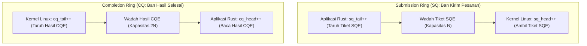
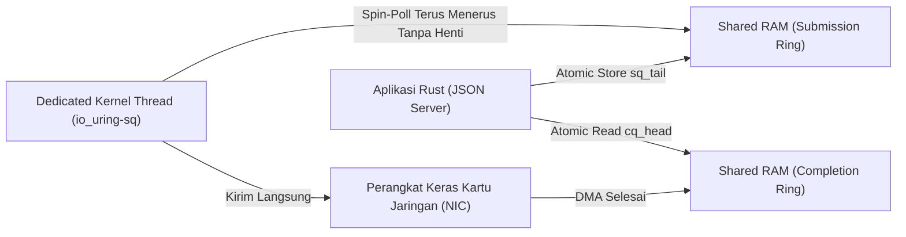
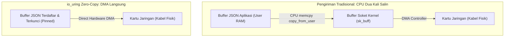

# Rust io_uring: Zero-Syscall Asynchronous I/O Architecture

An advanced systems engineering curriculum compiled with the Human Gradient Descent paradigm. Explores the physical shift from readiness-based epoll context-switching to completion-based shared memory ring buffers in Linux and high-performance Rust.

## The Syscall Tax and Context Switch Inadequacy
<!-- hgd:tier: 1_foundational_fluency -->
<!-- hgd:primer: "Traditional network servers rely on epoll readiness. Handling each incoming request requires repeated read and write syscalls, forcing the CPU to switch between user and kernel space, invalidating processor caches under heavy load." -->
<!-- hgd:probe: "Predict: Why does an epoll JSON server hit a throughput ceiling when handling 500,000 requests per second even when network bandwidth is plenty?" -->
<!-- hgd:truth: "The CPU spends the majority of its execution cycles in kernel trap transitions and TLB cache flushes caused by millions of context switches rather than executing application JSON logic." -->
<!-- hgd:worked: "Worked Solution: At 500k RPS, 2 syscalls per request yields 1,000,000 context switches per second. Each context switch incurs 1.2 to 2.5 microseconds in register saving and memory barrier penalties, consuming over 70% of available CPU clock cycles." -->
<!-- hgd:models: ["syscall", "context switch", "epoll", "tlb flush", "kernel trap", "throughput ceiling"] -->
<!-- hgd:options: [
  {"optionId": "opt_a", "text": "The CPU spends the majority of its execution cycles in kernel trap transitions and TLB cache flushes caused by millions of context switches rather than executing application JSON logic.", "isCorrect": true, "causalRationale": "Accurately identifies the physical cost of user-to-kernel boundary crossings at high scale."},
  {"optionId": "opt_b", "text": "The JSON parser exceeds memory limits because Rust cannot free heap allocations without an active garbage collection pass.", "isCorrect": false, "diagnosticAxis": "conceptGap", "causalRationale": "Misattributes system bottleneck to language runtime memory management rather than OS I/O overhead."},
  {"optionId": "opt_c", "text": "TCP sockets automatically terminate connections when packets arrive faster than 100 microseconds apart.", "isCorrect": false, "diagnosticAxis": "reasoningBug", "causalRationale": "Invents a fictitious network protocol cutoff rule unsupported by transport layer specifications."},
  {"optionId": "opt_d", "text": "The kernel completely blocks all network cards from receiving electricity whenever CPU utilization crosses 50%.", "isCorrect": false, "diagnosticAxis": "missingPrerequisite", "causalRationale": "Absurd physical claim that violates computer hardware electrical power architecture."}
] -->

### 1. Pangkal Anomali
Selama lebih dari dua dekade, arsitektur server web modern di Linux mengandalkan mekanisme pemantauan kesiapan yang disebut `epoll`. Pola kerjanya tampak sangat masuk akal: sistem operasi memberi tahu aplikasi ketika soket jaringan memiliki data yang siap dibaca (*readiness notification*). Begitu data siap, program memanggil fungsi pembacaan data, memproses JSON, dan menuliskan jawaban kembali ke soket.

Namun di era komputasi modern dengan kartu jaringan 10GbE hingga 100GbE yang mampu menerima 500.000 hingga 1.000.000 permintaan per detik (*Requests Per Second* / RPS), pendekatan klasik ini membentur tembok batas fisik yang sangat keras. 

Bahkan ketika kabel jaringan masih sangat longgar dan memori RAM masih berlimpah, server tiba-tiba melambat dan penggunaan prosesor (CPU) melonjak hingga 100%. Ironisnya, prosesor tidak sibuk memproses logika bisnis atau membaca format JSON; prosesor habis terkuras energinya hanya karena harus bolak-balik menyeberangi dinding pemisah proteksi antara ranah pengguna (*User Space / Ring 3*) dan ranah sistem operasi (*Kernel Space / Ring 0*).

Setiap kali aplikasi ingin membaca atau menulis data jaringan, ia harus memicu apa yang disebut *System Call (Syscall)*. Pemanggilan *syscall* ini memaksa prosesor menghentikan pekerjaannya, menyimpan puluhan isi register memori ke dalam tumpukan (*stack*), mengganti tabel alamat virtual memori, dan mengosongkan *cache Translation Lookaside Buffer (TLB)*. Jika ada 500.000 permintaan dan masing-masing butuh minimal 2 syscall (`read` dan `write`), maka dalam 1 detik prosesor harus melakukan 1.000.000 kali penyeberangan! Beban penyeberangan ini dikenal sebagai *The Syscall Tax* (Pajak Syscall).

### 2. Prototipe Intuitif
Bayangkan sebuah kantor pos besar. Di dalam kantor ada seorang juru ketik (aplikasi Anda di *User Space*), dan di halaman luar ada seorang kurir pengantar paket (kernel Linux yang mengendalikan kabel jaringan fisik).

Di antara ruangan juru ketik dan halaman luar terpasang sebuah pintu gerbang besi lapis baja yang dijaga ketat oleh satpam bersenjata (*Kernel Protection Barrier*).

Dalam model lama (`epoll`), setiap kali juru ketik ingin mengirim satu lembar surat:
1. Juru ketik harus berdiri dari mejanya, berjalan menuju pintu gerbang.
2. Juru ketik mengetuk pintu, satpam memeriksa tanda pengenal dan paspor (pemeriksaan hak akses izin memori).
3. Pintu gerbang dibuka, juru ketik menyerahkan satu surat kepada kurir.
4. Juru ketik kembali ke mejanya dan mulai mengetik surat berikutnya.

Jika hanya ada 10 surat sehari, prosedur keamanan ini tidak terasa melelahkan. Tetapi bayangkan jika juru ketik harus mengirim 500.000 lembar surat setiap detik! Juru ketik akan pingsan karena waktunya habis terkuras hanya untuk berjalan bolak-balik mengetuk pintu gerbang satpam.

Sistem baru *io_uring* membuang ritual bolak-balik tersebut. Satpam memasang sebuah ban berjalan melingkar (*conveyor belt*) yang menembus celah bawah pintu gerbang. Juru ketik cukup meletakkan tumpukan surat di atas ban berjalan tanpa perlu berdiri, dan kurir di halaman luar mengambil surat tersebut secara mandiri. Pintu gerbang tidak pernah perlu dibuka lagi!

```mermaid
flowchart LR
    subgraph Classical["Model Lama: Epoll (2 Syscalls Per Request)"]
        U1["Aplikasi User (Juru Ketik)"] -->|Syscall read (Ketuk Pintu)| K1["Kernel Trap Barrier ($$\tau_{\text{trap}}$$)"]
        K1 -->|Ganti Konteks CPU| U2["Proses Dokumen JSON"]
        U2 -->|Syscall write (Ketuk Pintu)| K2["Kernel Trap Barrier ($$\tau_{\text{trap}}$$)"]
    end
    subgraph Ring["Model io_uring: Ban Berjalan (Shared Memory)"]
        SQ["Submission Queue (Ban Kirim)"] -->|Ambil Tanpa Gangguan| KW["Kernel Worker (Kurir Luar)"]
        KW -->|Taruh Bukti Selesai| CQ["Completion Queue (Ban Hasil)"]
    end
```

### 3. Invarian & Operasi Inti
Invarian fundamental arsitektur ini adalah **Pemisahan Memori Bersama Bebas Kunci (Dual-Ring Shared Memory Separation)**: sistem operasi dan aplikasi berbagi dua bidang memori RAM yang sama persis melalui pemetaan `mmap`. 

Dua bidang memori tersebut berbentuk lingkaran sirkular:
1. **Submission Queue (SQ)**: Antrean pengajuan tugas tempat aplikasi meletakkan permintaan I/O.
2. **Completion Queue (CQ)**: Antrean penyelesaian tempat kernel meletakkan laporan hasil kerja yang sudah selesai.

Karena kedua pihak membaca dan menulis ke area memori RAM bersama yang sama, pertukaran data terjadi secara asinkron tanpa memerlukan interupsi perangkat keras (*hardware interrupt*) dan tanpa satu pun pemanggilan *syscall* pemblokir saat sistem berada dalam kondisi transmisi stabil.

| Apa yang Dipikirkan Pemula (Salah) | Apa yang Sebenarnya Terjadi dalam Model Mental |
|---|---|
| Mengira io_uring hanya sekadar epoll dengan nama dan sintaks baru. | io_uring adalah pergeseran paradigma fisik dari *readiness-based* (Reactor) menuju *completion-based* (Proactor). |
| Mengira syscall membaca data jaringan secara instan tanpa biaya jeda. | Setiap syscall memicu pembekuan instruksi CPU, penyimpanan register, dan pembersihan cache TLB memori. |
| Mengira kernel wajib dipanggil setiap kali aplikasi menaruh tugas I/O. | Tugas ditaruh langsung ke dalam memori RAM bersama tanpa interupsi sistem operasi. |

### 4. Notasi Sebagai Kontrak
Formula penghematan beban konteks kernel dirumuskan secara matematis:
$$\mathcal{O}(\text{Syscall Overhead}) = 2N \cdot \tau_{\text{switch}} \xrightarrow{\text{io\_uring}} \mathcal{O}(1)$$

Persamaan di atas adalah kontrak penghematan biaya eksekusi sistem:
* `N`: Jumlah transaksi permintaan HTTP JSON per detik (misal $500.000\text{ RPS}$).
* `$\tau_{\text{switch}}$`: Penalti latensi penyeberangan proteksi prosesor (berkisar antara 1.2 hingga 2.5 mikrodetik per transisi).
* `$2N \cdot \tau_{\text{switch}}$`: Total waktu CPU yang terbuang percuma pada model klasik epoll (mencapai $1.000.000 \times 1.5\,\mu\text{s} = 1.5\text{ detik}$ waktu inti prosesor).
* `$\mathcal{O}(1)$`: Pengajuan tugas secara rombongan (*batch*) pada io_uring yang memangkas biaya transisi trap menjadi mendekati nol.

### Glosarium & Jembatan Konsep SMA

| Istilah | Konsep Formal | Jembatan Konsep SMA |
|---|---|---|
| Syscall (System Call) | Instruksi perangkat keras khusus untuk berpindah dari User Mode (Ring 3) ke Kernel Mode (Ring 0) | Surat izin resmi dari murid (aplikasi) kepada kepala sekolah (kernel) untuk meminjam kunci ruangan lab |
| Context Switch | Proses CPU menyimpan status komputasi thread saat ini dan memuat status thread baru | Murid yang sedang fokus menghitung rumus Fisika tiba-tiba disuruh menutup buku dan mulai ujian Sejarah |
| TLB Cache Flush | Pengosongan cache Translation Lookaside Buffer pemetaan alamat virtual ke fisik | Menghapus catatan pintas peta denah kelas di papan tulis setiap kali bel pergantian jam pelajaran berbunyi |
| epoll | Mekanisme kernel Linux untuk memantau status kesiapan I/O pada kumpulan file descriptor | Guru piket yang berkeliling mengecek pintu kelas mana saja yang muridnya sudah selesai mengerjakan tugas |
| io_uring | Antarmuka I/O asinkronus berkinerja tinggi Linux berbasis antrean cincin memori bersama | Ban berjalan (*conveyor belt*) dua arah antara dapur kantin dan ruang makan siswa tanpa pelayan bolak-balik |
| Ring Buffer | Struktur data antrean sirkular berkapasitas tetap dengan penunjuk indeks kepala dan ekor | Piring putar lauk di meja makan bundar; piring diputar melingkar tanpa perlu mengangkat meja |
| User Space | Ruang memori beralamat virtual tempat aplikasi pengguna berjalan dengan hak akses terbatas | Ruang kelas siswa; murid bebas menulis di mejanya sendiri tetapi dilarang mengotak-atik instalasi listrik gedung |
| Kernel Space | Area memori berhak akses istimewa tertinggi tempat sistem operasi mengendalikan perangkat keras | Ruang kontrol panel listrik pusat sekolah yang hanya boleh dimasuki oleh teknisi resmi bersertifikat |

---

## Submission and Completion Ring Mechanics
<!-- hgd:prereqs: ["The Syscall Tax and Context Switch Inadequacy"] -->
<!-- hgd:tier: 2_boundary_perturbation -->
<!-- hgd:primer: "io_uring operates via two lockless ring buffers: the Submission Queue (SQ) where user space writes I/O requests, and the Completion Queue (CQ) where the kernel posts completed results without mutex lock contention." -->
<!-- hgd:probe: "Predict: What occurs when the user application enqueues Submission Queue Entries (SQEs) faster than the kernel consumes them, filling the ring buffer?" -->
<!-- hgd:truth: "The submission ring overflows and returns an explicit -EBUSY or backpressure status, requiring the user application to submit pending entries and wait for completion queue drains." -->
<!-- hgd:worked: "Worked Solution: The SQ ring uses atomic head and tail pointers. When tail - head equals the ring capacity, the ring is full. Calling io_uring_enter flushes the batch to kernel execution, clearing room for subsequent submissions." -->
<!-- hgd:models: ["submission queue", "completion queue", "ring buffer", "sqe", "cqe", "overflow", "ebusy"] -->
<!-- hgd:options: [
  {"optionId": "opt_a", "text": "The submission ring overflows and returns an explicit -EBUSY status, requiring the application to submit pending entries and await completions.", "isCorrect": true, "causalRationale": "Accurately describes circular buffer backpressure under queue saturation."},
  {"optionId": "opt_b", "text": "The kernel silently drops old socket connections without notifying the application.", "isCorrect": false, "diagnosticAxis": "conceptGap", "causalRationale": "Mistakes ring buffer saturation for ungraceful network packet dropping."},
  {"optionId": "opt_c", "text": "The ring dynamically doubles its size in physical RAM without kernel reallocation limits.", "isCorrect": false, "diagnosticAxis": "notationBreakdown", "causalRationale": "Ignores the fixed mmap ring capacity negotiated at initialization."},
  {"optionId": "opt_d", "text": "The CPU crashes with a blue-screen kernel panic because ring buffers are forbidden from reaching 100% capacity.", "isCorrect": false, "diagnosticAxis": "reasoningBug", "causalRationale": "Fails to understand standard error code backpressure handling in Linux kernel APIs."}
] -->

### 1. Pangkal Anomali
Jika dua orang atau dua proses ingin berbagi antrean data di dalam memori komputer, solusi paling umum yang diajarkan dalam ilmu komputer adalah menggunakan kunci pengaman (*Mutex / Mutual Exclusion Lock*). Siapa pun yang ingin menambah atau mengambil data harus mengunci antrean terlebih dahulu, melakukan modifikasi, lalu membuka kunci tersebut.

Namun pada sistem multi-core modern yang memproses jutaan paket per detik, penguncian mutex menjadi bencana performa (*lock contention*). Ketika 16 inti prosesor berebut memegang satu kunci yang sama, sebagian besar inti prosesor akan menganggur dan terpaksa membeku (*spinning / sleeping*), menunggu gilirannya memegang kunci.

Bagaimana mungkin aplikasi Rust kita dan kernel Linux dapat membaca dan menulis antrean secara bersamaan di memori RAM yang sama tanpa pernah mengunci satu sama lain, dan tanpa risiko data tertimpa atau rusak?

### 2. Prototipe Intuitif
Bayangkan sebuah piring putar kue bundar yang memiliki 8 wadah mangkok bernomor urut 0 sampai 7.

Di atas piring putar ini terpasang dua jarum penunjuk yang berputar melingkar searah jarum jam:
* **Jarum Hijau (Ekor Penulis / `Tail`)**: Dikendalikan secara eksklusif oleh tangan juru masak (aplikasi Rust Anda). Juru masak hanya bertugas menaruh kue baru di mangkok yang ditunjuk jarum hijau, lalu memajukan jarum hijau satu langkah ke depan.
* **Jarum Merah (Kepala Pembaca / `Head`)**: Dikendalikan secara eksklusif oleh pelayan restoran (kernel Linux). Pelayan hanya bertugas mengambil kue dari mangkok yang ditunjuk jarum merah, lalu memajukan jarum merah satu langkah ke depan.

Keduanya tidak pernah berebut menyentuh jarum yang sama! Juru masak hanya mengamati posisi jarum merah dari kejauhan untuk memastikan mangkok di depannya tidak sedang penuh, dan pelayan hanya mengamati jarum hijau untuk memastikan ada kue yang siap diambil. Sistem berputar harmonis tanpa satu pun kata terucap dan tanpa kunci gembok.



### 3. Invarian & Operasi Inti
Invarian fundamental mekanisme antrean ini adalah **Pola Produsen Tunggal Konsumen Tunggal Bebas Kunci (Lockless Single-Producer Single-Consumer / SPSC)**:
* Pada antrean SQ: Aplikasi pengguna adalah *satu-satunya produsen* yang berhak memodifikasi penunjuk `sq_tail`, dan kernel adalah *satu-satunya konsumen* yang berhak memodifikasi penunjuk `sq_head`.
* Pada antrean CQ: Kernel adalah *satu-satunya produsen* yang memodifikasi `cq_tail`, dan aplikasi adalah *satu-satunya konsumen* yang memodifikasi `cq_head`.

Karena masing-masing variabel penunjuk dikendalikan oleh tepat satu pihak dan diposisikan pada garis cache memori yang terisolasi (*cache line alignment*), operasi penambahan indeks dilakukan dengan instruksi atomik perangkat keras tanpa pernah memicu tabrakan memori (*race condition*).

| Apa yang Dipikirkan Pemula (Salah) | Apa yang Sebenarnya Terjadi dalam Model Mental |
|---|---|
| Mengira antrean SQ dan CQ membutuhkan mutex lock bersama untuk sinkronisasi. | Pointer head dan tail dipisahkan secara fisik dan hanya diperbarui menggunakan operasi atomik memori. |
| Mengira hasil pekerjaan I/O langsung menimpa tiket tugas yang diajukan. | Tiket tugas (SQE) dan laporan hasil selesai (CQE) berada di dua struktur memori cincin yang terpisah total. |
| Mengira kapasitas ring buffer bisa membesar otomatis tanpa batas. | Ukuran cincin dinegosiasikan saat awal pembuatan dan memiliki jumlah slot tetap bernilai pangkat dua ($2^N$). |

### 4. Notasi Sebagai Kontrak
Formula ketersediaan slot antrean sirkular:
$$\text{Free Slots} = \text{Ring Capacity} - (\text{sq\_tail} - \text{sq\_head})$$

Kontrak matematika penentu kapasitas cincin memori:
* `Ring Capacity`: Kapasitas total slot yang dipesan dalam memori RAM (wajib bilangan biner pangkat dua, misal $1024, 2048, 4096$).
* `sq_tail`: Indeks atomik posisi pengajuan tugas yang dimajukan oleh aplikasi Rust.
* `sq_head`: Indeks atomik posisi pengambilan tugas yang dimajukan oleh kernel Linux.
* `SQEs`: *Submission Queue Entries* (lembaran kartu tiket tugas pengajuan I/O yang ditulis ke antrean SQ).
* `CQEs`: *Completion Queue Entries* (kartu tanda bukti hasil pelaksanaan I/O yang memuat byte terkirim dan status error).
* `-EBUSY`: Kode status tolak balik (*backpressure*) yang terbit jika `sq_tail - sq_head == Ring Capacity`.

### Glosarium & Jembatan Konsep SMA

| Istilah | Konsep Formal | Jembatan Konsep SMA |
|---|---|---|
| SQE (Submission Queue Entry) | Struktur data deskriptor 64-byte yang merinci jenis operasi I/O yang diminta ke kernel | Lembar formulir pesanan makanan yang diisi oleh pembeli di restoran |
| CQE (Completion Queue Entry) | Struktur data 16-byte yang memuat hasil eksekusi operasi (kode status dan byte) | Struk nota bukti pembayaran dan penerimaan barang dari kasir restoran |
| Lockless SPSC | Arsitektur konkurensi di mana satu produsen dan satu konsumen berkomunikasi tanpa penguncian | Dua orang bermain tenis meja; satu orang hanya memukul bola servis, satu orang hanya mengembalikan bola |
| Mutex Lock | Primitif sinkronisasi pemrograman untuk mencegah akses data simultan pada bagian kritis | Gembok pintu kamar mandi; hanya satu orang yang boleh masuk pada satu waktu |
| Backpressure | Mekanisme pembatasan laju ketika produsen menghasilkan data lebih cepat dari kemampuan konsumen | Pelampung tangki air di rumah yang menutup katup otomatis saat bak mandi sudah penuh |
| Operasi Atomik | Instruksi tingkat mesin prosesor yang dieksekusi secara tak terpisahkan tanpa gangguan | Saklar lampu yang dalam sekali klik langsung menyala tanpa ada status setengah hidup |

---

## Kernel Polling via IORING_SETUP_SQPOLL
<!-- hgd:prereqs: ["Submission and Completion Ring Mechanics"] -->
<!-- hgd:tier: 3_isomorphic_transfer -->
<!-- hgd:primer: "With IORING_SETUP_SQPOLL, the Linux kernel spawns a dedicated kernel thread that continuously polls the Submission Queue. Applications submit I/O requests with zero syscalls in the steady state." -->
<!-- hgd:probe: "Predict: Why does SQPOLL achieve zero syscalls per request, and what is the trade-off regarding CPU core allocation?" -->
<!-- hgd:truth: "The dedicated kernel thread continuously reads submissions from shared memory without waiting for io_uring_enter syscalls, consuming an entire dedicated CPU core in a spin-poll loop." -->
<!-- hgd:worked: "Worked Solution: In SQPOLL mode, submitting an I/O request requires only writing the SQE and updating sq_tail via atomic memory release. The kernel thread picks it up in sub-microsecond latency, achieving literally zero syscalls per I/O event at the cost of 100% load on the dedicated polling core." -->
<!-- hgd:models: ["sqpoll", "zero syscall", "kernel thread", "cpu core", "polling", "spin loop"] -->
<!-- hgd:options: [
  {"optionId": "opt_a", "text": "The dedicated kernel thread reads submissions directly from shared RAM without syscalls, but permanently consumes an entire CPU core in a continuous poll loop.", "isCorrect": true, "causalRationale": "Accurately identifies the zero-syscall mechanism and its dedicated core resource trade-off."},
  {"optionId": "opt_b", "text": "The network card processes HTTP JSON requests directly on its onboard silicon without CPU intervention.", "isCorrect": false, "diagnosticAxis": "conceptGap", "causalRationale": "Confuses software kernel worker polling with smart NIC hardware offload."},
  {"optionId": "opt_c", "text": "SQPOLL eliminates all context switches by running user application code inside kernel ring 0.", "isCorrect": false, "diagnosticAxis": "reasoningBug", "causalRationale": "Violates operating system memory isolation and user-space privilege boundaries."},
  {"optionId": "opt_d", "text": "The kernel completely turns off all electricity to memory RAM to save power during submission polling.", "isCorrect": false, "diagnosticAxis": "missingPrerequisite", "causalRationale": "Physical impossibility that contradicts basic electrical computer power requirements."}
] -->

### 1. Pangkal Anomali
Bahkan setelah kita menggunakan antrean cincin (*ring buffer*) ganda yang canggih, dalam mode standar masih ada satu ganjalan kecil: setelah aplikasi meletakkan tiket SQE ke dalam antrean, bagaimana kernel tahu bahwa ada tiket baru yang harus dikerjakan?

Dalam mode standar, aplikasi masih harus memanggil satu *syscall* ringkas bernama `io_uring_enter()` untuk membangunkan kernel dan berkata: *"Hei kernel, aku baru saja menaruh 10 tiket di ban berjalan, tolong segera proses!"*

Meskipun biaya satu syscall untuk 10 tiket jauh lebih murah daripada 10 syscall terpisah, pada server ultra-ekstrem (seperti server transaksi bursa saham frekuensi tinggi atau server gateway JSON dengan latensi sub-milidetik), pemanggilan `io_uring_enter()` ini masih menghasilkan jeda waktu beberapa mikrodetik. Pemrogram sistem menginginkan nol mutlak: **Zero Syscalls**. Bagaimana cara menghilangkannya sama sekali?

### 2. Prototipe Intuitif
Bayangkan sebuah kantor layanan darurat.

Pada mode normal: Setiap kali Anda meletakkan berkas di kotak keluar, Anda harus memencet bel dinding agar petugas di ruang sebelah bangun dari kursinya dan datang mengambil berkas tersebut. Bunyi bel ini adalah analogi dari *syscall* `io_uring_enter()`.

Pada mode **SQPOLL (Submission Queue Polling)**: Kepala kantor menugaskan seorang asisten khusus (*Dedicated Kernel Thread*) yang berdiri tegak tepat di depan kotak keluar Anda. Asisten ini tidak pernah duduk, tidak pernah membaca koran, dan tidak pernah berkedip. Matanya terus-menerus menatap mangkok kotak keluar dengan kecepatan ribuan kali per detik (*spin-polling loop*).

Begitu tangan Anda menjatuhkan selembar berkas ke dalam kotak, dalam hitungan nanodetik asisten langsung menyambar berkas itu dan langsung berlari mengantarkannya ke kartu jaringan. Anda tidak perlu lagi menyentuh bel dinding! Panggilan bel resmi menjadi tepat nol.

Namun imbalannya jelas: asisten tersebut tidak bisa mengerjakan pekerjaan lain. Satu kursi kerja (satu inti prosesor / CPU core) sepenuhnya terpakai 100% hanya untuk mengawasi kotak keluar tersebut.



### 3. Invarian & Operasi Inti
Invarian mutlak modus ini adalah **Eksekusi Kondisi Mantap Tanpa Syscall (Zero-Syscall Steady State Execution)**: selama interval kedatangan antar-permintaan jaringan lebih cepat daripada batas waktu tidur *thread* kernel (`sq_thread_idle`), jumlah pemanggilan *syscall* per permintaan HTTP adalah **tepat 0.00**.

Prosesor hanya melakukan operasi penulisan memori RAM biasa (*memory write*) dan instruksi memori penjamin urutan (*memory barrier*). Sistem operasi tidak pernah terinterupsi.

| Apa yang Dipikirkan Pemula (Salah) | Apa yang Sebenarnya Terjadi dalam Model Mental |
|---|---|
| Mengira SQPOLL adalah fitur gratis tanpa ada biaya konsumsi daya listrik. | SQPOLL mengunci 1 inti prosesor fisik (100% CPU utilization) untuk terus-menerus berputar mengawasi memori. |
| Mengira kernel thread tidur santai di antara setiap paket data yang datang. | Thread melakukan putaran aktif (*spin loop*) di memori RAM selama batas waktu idle belum terlampaui. |
| Mengira SQPOLL cocok diaktifkan di semua server kecil atau laptop hemat daya. | Pada mesin dengan hanya 1 atau 2 core vCPU, SQPOLL justru akan merebut jatah komputasi aplikasi utama. |

### 4. Notasi Sebagai Kontrak
Formula biaya transisi eksekusi sistem:
$$\text{Cost}_{\text{SQPOLL}} = \begin{cases} 0 \text{ syscalls}, & \text{jika } \Delta t_{\text{inter-request}} < t_{\text{idle}} \\ 1 \text{ wake syscall}, & \text{jika thread sempat tertidur} \end{cases}$$

Kontrak aljabar kinerja sistem pada mode polling:
* `t_{idle}`: Durasi toleransi tidur thread kernel sebelum memasuki mode hemat daya (misalnya dikonfigurasi 2000 milidetik).
* `\Delta t_{inter-request}`: Waktu jeda antar kedatangan transaksi HTTP JSON dari jaringan.
* `Zero Syscall`: Kondisi mantap di mana aplikasi melayani ribuan klien tanpa satu pun penyeberangan proteksi prosesor.
* `IORING_SETUP_SQPOLL`: Bendera konfigurasi kernel saat inisialisasi cincin io_uring.

### Glosarium & Jembatan Konsep SMA

| Istilah | Konsep Formal | Jembatan Konsep SMA |
|---|---|---|
| SQPOLL | Modus kernel Linux di mana sebuah kthread didedikasikan untuk melakukan polling SQ | Satpam jaga yang berdiri tegak mengamati gerbang tanpa berkedip agar tamu tak perlu memencet bel |
| Spin Loop (Busy Waiting) | Teknik pemrograman di mana prosesor terus menguji suatu kondisi dalam putaran ketat berulang | Murid yang setiap 2 detik melihat ke arah jendela untuk melihat apakah mobil jemputan sudah tiba |
| Kernel Thread (kthread) | Entitas eksekusi independen yang berjalan di dalam ranah kernel sistem operasi | Petugas teknisi internal gedung yang bekerja otomatis di balik layar tanpa perintah siswa |
| vCPU / Core Prosesor | Unit komputasi pemrosesan fisik independen di dalam silikon chip prosesor | Meja kerja terpisah di kantor; jika ada 4 meja kerja, 4 orang bisa menghitung mandiri bersamaan |
| Memory Barrier | Instruksi prosesor perangkat keras untuk menjamin urutan pembacaan dan penulisan memori | Garis antrean tali pembatas di bank; orang di belakang dilarang maju sebelum orang di depan selesai |
| Steady State | Kondisi operasional stabil di mana parameter sistem tidak lagi berubah drastis terhadap waktu | Kecepatan konstan mobil di jalan tol setelah selesai melewati tanjakan gerbang masuk |

---

## Zero-Copy JSON Streaming with Registered Buffers
<!-- hgd:prereqs: ["The Syscall Tax and Context Switch Inadequacy", "Kernel Polling via IORING_SETUP_SQPOLL"] -->
<!-- hgd:tier: 4_adversarial_dilemma -->
<!-- hgd:primer: "When serving JSON responses, copying payload bytes from user memory into kernel socket buffers consumes valuable memory bandwidth. io_uring eliminates this with registered buffers and zero-copy send." -->
<!-- hgd:probe: "Predict: What safety constraint does Rust's ownership model enforce when performing an asynchronous zero-copy send (IORING_OP_SEND_ZC) with registered buffers?" -->
<!-- hgd:truth: "The application buffer must remain valid and unmodified in memory until the kernel emits a completion CQE indicating the network interface has completed physical transmission." -->
<!-- hgd:worked: "Worked Solution: In traditional write, user memory can be modified immediately after the syscall returns because data was copied to kernel sk_buff. In zero-copy, kernel hardware DMA reads directly from user memory. Modifying or dropping the Rust buffer before CQE completion causes data corruption or use-after-free." -->
<!-- hgd:models: ["zero-copy", "registered buffers", "ioring_op_send_zc", "ownership", "dma", "buffer pinning"] -->
<!-- hgd:options: [
  {"optionId": "opt_a", "text": "The Rust application buffer must remain strictly pinned and unmodified in memory until the kernel emits a completion CQE indicating physical transmission is finished.", "isCorrect": true, "causalRationale": "Accurately identifies the DMA zero-copy memory lifecycle invariant."},
  {"optionId": "opt_b", "text": "Rust automatically creates a shadow heap clone of the buffer to allow instant reuse without waiting.", "isCorrect": false, "diagnosticAxis": "conceptGap", "causalRationale": "Contradicts the zero-copy invariant by falsely reintroducing memory duplication."},
  {"optionId": "opt_c", "text": "The buffer can be freed immediately because the CPU caches all bytes inside the L1 register file.", "isCorrect": false, "diagnosticAxis": "reasoningBug", "causalRationale": "Fails to account for asynchronous network interface DMA access to physical RAM."},
  {"optionId": "opt_d", "text": "Zero-copy allows the network card to physically erase the hard drive whenever a packet collision occurs.", "isCorrect": false, "diagnosticAxis": "missingPrerequisite", "causalRationale": "Gross misunderstanding of network packet transmission and storage hardware boundaries."}
] -->

### 1. Pangkal Anomali
Bayangkan Anda telah berhasil memangkas seluruh pemanggilan *syscall* hingga tepat nol menggunakan io_uring dan SQPOLL. Kinerja server melonjak drastis. Namun ketika throughput jaringan dinaikkan melampaui 40 Gbps, prosesor kembali mengalami kemacetan parah di jalur bus memori RAM (*memory bus bandwidth saturation*). Dari mana asal beban ini?

Masalahnya terletak pada operasi penyalinan data (*Memory Copy / memcpy*).

Dalam arsitektur konvensional, ketika aplikasi Rust Anda menyusun string dokumen JSON di dalam memori heap (`User Space`), saat Anda memanggil fungsi pengiriman, CPU harus membaca setiap byte karakter JSON tersebut lalu menyalinnya ke dalam memori perantara kernel yang disebut `sk_buff` (*Kernel Socket Buffer*). Baru setelah itu, kartu jaringan membaca data dari kernel buffer untuk dikirim ke kabel fiber optik.

Artinya, setiap byte data JSON harus melewati bus memori RAM sebanyak minimal dua kali! Jika server melayani bandwidth 40 Gbps, prosesor harus memompa data sebesar 80 Gbps di dalam jalur kawat tembaga motherboard. Panas meningkat dan jalur memori menjadi macet total.

### 2. Prototipe Intuitif
Bayangkan Anda memiliki sebuah gudang penyimpanan dokumen rahasia (memori RAM aplikasi Anda). Di luar gerbang ada truk kontainer pengiriman antar-pulau (kartu jaringan / *NIC*).

Dalam prosedur pengiriman lama:
1. Anda memfotokopi naskah asli lembar demi lembar menjadi salinan kedua.
2. Anda memasukkan salinan kedua tersebut ke dalam kotak kardus milik pos keliling (kernel socket buffer).
3. Sopir truk mengambil kardus dari pos keliling untuk dimuat ke dalam kontainer.

Dua kali lipat kertas terbuang, dan waktu Anda habis hanya untuk berdiri di depan mesin fotokopi!

Dalam prosedur **Zero-Copy dengan Registered Buffers**:
Anda mendaftarkan lemari brankas di gudang Anda secara resmi kepada otoritas pelabuhan (`IORING_REGISTER_BUFFERS`). Otoritas pelabuhan memasang gembok pengunci khusus agar lemari brankas tidak dipindahkan (*Pinned Pages*).

Ketika saatnya mengirim naskah, sopir truk kontainer membawa lengan robot pengambil (*Direct Memory Access / DMA*) langsung ke dalam lemari brankas Anda. Lengan robot membaca naskah asli secara langsung tanpa perlu ada fotokopi selembar kertas pun! Tidak ada kertas ganda, dan prosesor Anda sama sekali tidak menyentuh byte naskah tersebut saat pengiriman berlangsung.



### 3. Invarian & Operasi Inti
Invarian mutlak sistem transmisi zero-copy adalah **Kekekalan Masa Hidup Buffer Terkunci (Buffer Lifetime Pinning Invariant)**:
Halaman memori fisik yang didaftarkan ke kernel dikunci (*pinned*) agar sistem operasi tidak menukarnya ke dalam file swap di hard disk. 

Konsekuensi krusialnya: di dalam bahasa pemrograman Rust yang menjamin keamanan memori (*memory safety*), hak kepemilikan (*ownership*) dari buffer JSON tersebut **dilarang keras dibebaskan, dimodifikasi, atau digunakan kembali** sampai kernel menerbitkan kartu CQE konfirmasi bahwa kartu jaringan fisik telah selesai memancarkan seluruh sinyal listrik/cahaya ke kabel jaringan.

Jika seorang pemrogram ceroboh menggunakan kata kunci `unsafe` untuk mendaur ulang buffer sebelum konfirmasi terbit, kartu jaringan akan membaca data yang sedang diubah di tengah jalan, memicu korupsi paket data (*data corruption*) atau celah keamanan *use-after-free*.

| Apa yang Dipikirkan Pemula (Salah) | Apa yang Sebenarnya Terjadi dalam Model Mental |
|---|---|
| Mengira buffer memori bisa langsung ditimpa segera setelah fungsi `send_zc` dipanggil. | Buffer fisik wajib tetap utuh dan tak tersentuh di RAM sampai kartu CQE konfirmasi fisik diterima dari kernel. |
| Mengira zero-copy selalu lebih kencang untuk semua ukuran pesan, termasuk 10 byte. | Untuk pesan berukuran mikro (<64 byte), biaya registrasi halaman memori justru bisa lebih mahal dari biaya memcpy kecil. |
| Mengira Rust otomatis membuat salinan bayangan rahasia jika kita mengubah buffer. | Rust mematuhi aturan zero-copy murni; tidak ada salinan tersembunyi yang dibuat tanpa izin eksplisit pengembang. |

### 4. Notasi Sebagai Kontrak
Formula penghematan lalu lintas bus memori:
$$\text{Memory Traffic} = \begin{cases} 2 \cdot \text{Size}_{\text{payload}} \text{ (User } \to \text{ Kernel } \to \text{ NIC)}, & \text{Tradisional Copy} \\ 1 \cdot \text{Size}_{\text{payload}} \text{ (User } \xrightarrow{\text{DMA}} \text{ NIC)}, & \text{io\_uring Zero-Copy} \end{cases}$$

Kontrak aljabar efisiensi memori perangkat keras:
* `IORING_OP_SEND_ZC`: Perintah operasi kernel io_uring untuk transmisi paket *zero-copy* langsung via pengontrol DMA.
* `Size_{payload}`: Ukuran byte dari dokumen payload JSON yang dikirimkan.
* `Registered Buffers`: Alokasi memori yang telah didaftarkan sebelumnya via `io_uring_register_buffers` untuk mengeliminasi pemetaan halaman dinamis.
* `CQE_F_MORE`: Bendera penyelesaian parsial yang mengindikasikan apakah buffer sudah aman digunakan kembali atau masih dipegang oleh perangkat keras.

### Glosarium & Jembatan Konsep SMA

| Istilah | Konsep Formal | Jembatan Konsep SMA |
|---|---|---|
| Zero-Copy | Teknik transmisi data di mana CPU tidak menyalin data dari satu area memori ke area lain | Meminjamkan buku catatan asli kepada teman untuk dibaca langsung, bukan memfotokopinya dulu |
| DMA (Direct Memory Access) | Fitur pengontrol perangkat keras untuk membaca dan menulis RAM tanpa keterlibatan CPU | Jalur pipa air otomatis langsung dari tandon ke kran taman tanpa perlu ditimba manual dengan ember |
| Registered Buffers | Mekanisme prapendaftaran buffer memori ke kernel untuk mengunci tabel halaman virtual | Mendaftarkan nomor plat kendaraan resmi ke gerbang tol otomatis agar palang pintu langsung terbuka |
| Pinned Memory | Halaman memori virtual yang dikunci pada RAM fisik dan dilarang dipindahkan ke swap disk | Memaku papan pengumuman di dinding agar tidak tertiup angin atau dipindahkan ke gudang belakang |
| Ownership (Kepemilikan Rust) | Aturan kompilator Rust bahwa setiap nilai memori hanya boleh memiliki satu pemilik tunggal | Kunci gembok loker sekolah; hanya siswa pemilik kunci yang sah yang boleh membuka dan mengambil isinya |
| sk_buff | Struktur data kernel Linux yang menampung paket data jaringan di memori sistem operasi | Kotak kardus pos standar tempat kurir membungkus paket barang kiriman sebelum dimasukkan ke mobil |
